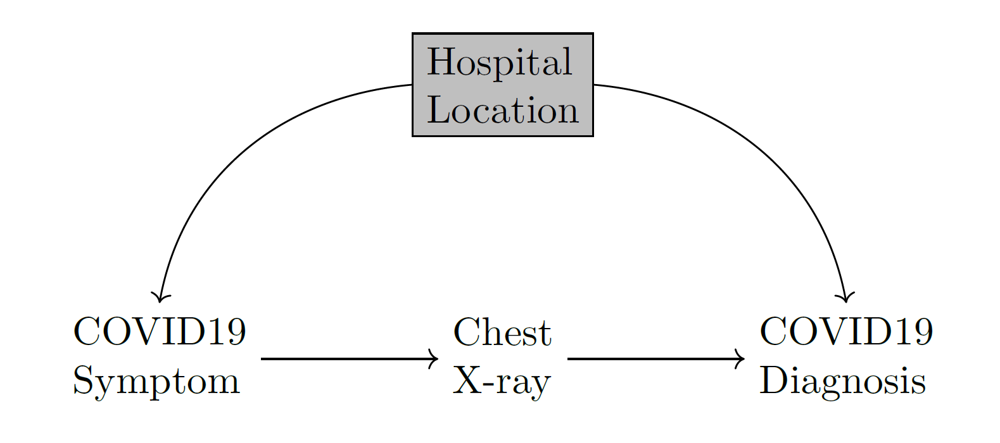

# Introduction

## Introduction

::: incremental

- Goal: Perform Causal Inference, e.g. evaluating the causal effect of an intervention on a system of interest
- Today, most of our datasets contain high-dimensional variables, such as images
- Modern deep learning architectures can handle high dimensional data and solve ML problems such as prediction or learning distributions
- However, they are not designed to perform causal inference
	- They fail to generalize where there exists spurious correlations in the data 

:::

## Main Example of the paper

- Healthcare dataset with Symptoms, Diagnosis and XrayImages of a collection of patients
	- Contains a mixture data from two hospitals in different cities where one of the cities is more wealthy, where patients are less likely to fall sick on average
- <mark>Hospital location </mark> acts as a latent confounder that affect both the Symptoms and Diagnosis

## Main Example of the paper

## Main Idea of the paper

- The paper proposes a modular sampling-based framework for deep causal generative models
	- low-dimensional targets: collect observational samples and use these samples to estimate the interventional distribution
	- high-dimensional targets: the method can be used to obtain samples from the interventional distribution, which is implicitly modeled
- Using deep learning architectures that mimic the causal structure of the system
- Using pre-trained generative models like DALL-E, ChatGPT or Bard

## Incremental lists

::: incremental

- Put in code fence
- Using three colons

:::

## Emoji

🤩 Totes work, except in PDF output, boo.

## Speaker notes

Include speaker notes in another fenced code block.

::: notes

Like this.

:::

## Columns

:::::::::::::: {.columns}
::: {.column width="50%"}
Put your contents in column code blocks
:::
::: {.column width="50%"}
To make them show up in two columns
:::
::::::::::::::