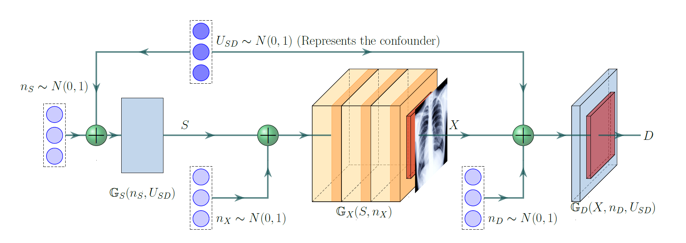
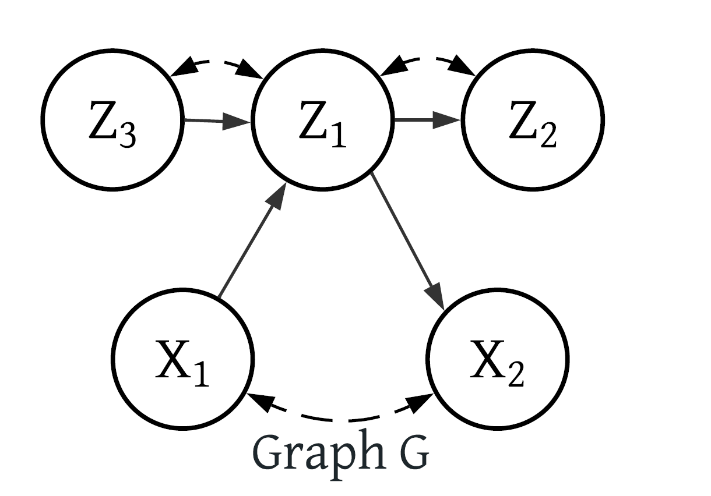
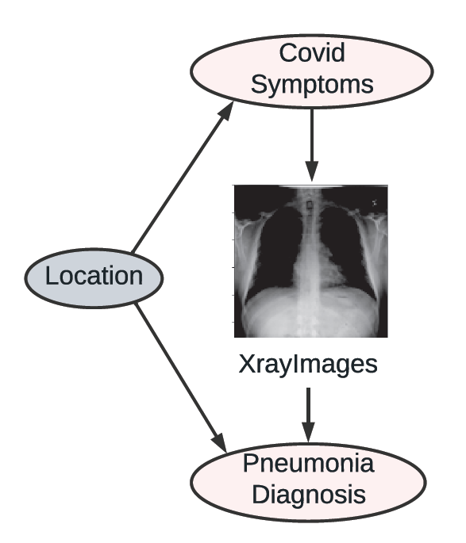

# Introduction

## Background - Structural Causal Model

::: incremental
-   An SCM $\mathcal{M}$ is a $5$-tuple $\mathcal{M}=(\mathcal{V}, \mathcal{N}, \mathcal{U}, \mathcal{F}, P(.) )$
-   Each observed variable $V_i\in\mathcal{V}$ is realized as an evaluation of the function $f_i\in\mathcal{F}$ looks at a subset of the remaining observed variables
    -   Remaining observed variables $Pa_i\subset \mathcal{V}$ (Parent Set of $V_i$)
    -   Unobserved exogenous noise variable $E_i\in \mathcal{N}$
    -   Unobserved confounding variable $U_i\in\mathcal{U}$
-   $P(.)$ is a product joint distribution over all unobserved variables $\mathcal{N}\cup\mathcal{U}$
:::

## Background - SCMs and Causal Graphs

::: incremental
-   Each SCM induces a directed graph called the causal graph or acyclic directed mixed graph (ADMG)
-   In the context of this paper, the graph is still acyclic, but no longer a DAG
    -   The graph can handle bidirectional edges (e.g. $V_i \leftrightarrow V_j$) to represent unobserved confounders
-   $V_i$ is called an ancestor of $V_j$ if there is a directed path from $V_i$ to $V_j$
-   A subset $g \subset G$ is called a c-component if it is a maximal set of nodes in $G$ that are connected by bi-directed paths
:::

## Introduction

::: incremental
-   Goal: Perform Causal Inference, e.g. evaluating the causal effect of an intervention on a system of interest
-   Today, most of our datasets contain high-dimensional variables, such as images
-   Modern deep learning architectures can handle high dimensional data and solve ML problems such as prediction or learning distributions
-   However, they are not designed to perform causal inference
    -   They fail to generalize where there exists spurious correlations in the data
:::

## Main Example of the paper

-   Healthcare dataset with <mark>Symptoms</mark>, <mark>Diagnosis</mark> and <mark>XrayImages</mark> of a collection of patients
    -   Contains a mixture data from two hospitals in different cities where one of the cities is more wealthy, where patients are less likely to fall sick on average
-   <mark>Hospital location </mark> acts as a latent confounder that affect both the Symptoms and Diagnosis

## Main Example of the paper

## Main Idea of the paper

-   The paper proposes a modular sampling-based framework for deep causal generative models
    -   Collect observational samples and use these samples to estimate the interventional distribution
-   In this paper, $\mathcal{L}_1$, $\mathcal{L}_2$, and $\mathcal{L}_3$ distributions as notation for observational, interventional, and counterfactual distributions respectively
-   Using deep learning architectures that mimic the causal structure of the system
-   Using pre-trained generative models like DALL-E, ChatGPT or Bard

## Main Idea of the paper

# Deep Causal Generative Models with Unobserved Confounders

## Definition

Let a SCM $\mathcal{M}$ be made up of functions $X_i = f_i(Pa_i, E_i)$.

A neural net architecture $\mathbb{G}$ is called a deep causal generative model (DCM) for an ADMG $G$ inducing a distribution $Q$ if it is composed of a collection of neural nets, one $\mathbb{G}_i$ for each $V_i\in\mathcal{V}$ such that

-   Each $\mathbb{G}_i$ accepts a sufficiently high-dimensional noise vector $N_i$
-   The output of $\mathbb{G}_j$ is input to $\mathbb{G}_i \Leftrightarrow V_j\in Pa_G(V_i)$
-   $N_i=N_j \Leftrightarrow V_i\leftrightarrow V_j$

Note that $\mathbb{G}$ will contain **one neural net per observed variable**: $\mathbb{G}=\{\mathbb{G}_{Z_1},\mathbb{G}_{Z_2}, ... \}$

## Intuition

::: columns
::: {.column width="70%"}
-   Let $D\sim P(\mathcal{V})$ be an observational sample
-   Train a DCM $\mathbb{G}$ that fits the observational distribution $P(\mathcal{V})$ to sample the interventional distribution $\mathcal{L}_2$
-   Training involves identifying which causal mechanisms should be trained together based on their dependencies in the causal graph
-   Start with the first neural network $\mathbb{G}_{Z_1} \in \mathbb{G}$ to learn a mapping to sample $P(Z_1 | Z_3, X_1)$
-   The training preserve the integrity of c-components and factorize the joint distribution of them to yield $P(\mathcal{V})$

\Leftarrow
:::

::: {.column width="30%"}

:::
:::

## Intuition

![Modular training in 3 steps. Step 1: Since $P(X_1,X_2| do(Z_1)) \neq P(X_1,X_2| Z_1)$, add an edge from c-component $H_1: [Z_1,Z_2,Z_3]$ to c-component $H_2: [X_1,X_2]$. Step 2: Train only the mechanisms in $H_1$ to match $P(Z_1,Z_2,Z_3|X_1) = Q(Z_1,Z_2,Z_3|do(X_1))$. Step 3: Train only $H_2$ while using pre-trained $Z_1,Z_3$ to match $P(X_1,X_2,Z_1, Z_3) = Q(X_1,X_2,Z_1, Z_3)$](imgs/DCM.PNG)

## Intuition

-   By training mechanisms in the same c-component together, the complexity of matching joint distributions involving high and low-dimensional variables is significantly reduced.
-   Modularizing the training process allows for more efficient training and simplifies the overall learning task.

# Experiments

## Performance on Real-world COVIDx CXR-3

::: columns
::: {.column width="70%"}

- $30000$ XRay images with labels $C$ (Covid) and $N$ (Pneumonia)
    - Healthy patiens: $C=0, N=0$
    - Non-Covid Pneumonia patiens: $C=0, N=1$
    - Covid Pneumonia patiens: $C=1, N=1$
- Patient’s location is a hidden confounder
    - A persons socio-economic and health conditions in a specific location might affect both the likelihood of getting Covid and being properly diagnosed with Pneumonia by local health care

:::

::: {.column width="30%"}

:::
:::

## Performance on Real-world COVIDx CXR-3

- Fit the joint distribution $P(XRay, C, N)$
- Modular training of $[\mathbb{G}_{Xray}] \rightarrow [\mathbb{G}_{C}, \mathbb{G}_{N}]$
    - Using pre-trained generative model for X-Ray images $\mathbb{G}_{Xray}$
    - Train $\mathbb{G}_{C}$ and $\mathbb{G}_{N}$ together as they are in the same c-component
- The joint distribution contains both low and high-dimensional variables
    - Map $\mathrm{Xray}$ to a low-dimensional representation $\mathrm{Rxray}$ with an encoder and match ${P(C, Rxray, N)}$

## Performance on Real-world COVIDx CXR-3

- The score which is minimized is the Total Variation Distance (TVD)
- The average treatment effect, i.e., the difference between $E[P(N|do(C=1))]$ and  $E[P(N|do(C=0))]$ is in $[0.05, 0.08]$
    - Intervention with Covid increases the likelihood of being diagnosed with Pneumonia

# Conclusion

## Conclusion

- The paper propose Modular-DCM for learning deep causal generative models for estimating causal effects with high-dimensional variables in the presence of unobserved confounders
- Modular-DCM can generate high-dimensional samples from identifiable interventional and counterfactual distributions
- Main Limitation: The paper assumes that the causal graph is fully specified with latents and the causal model is semi-Markovian (the probability of there being a change in the hidden state depends on the amount of time that has elapsed since entry into the current state (?))
