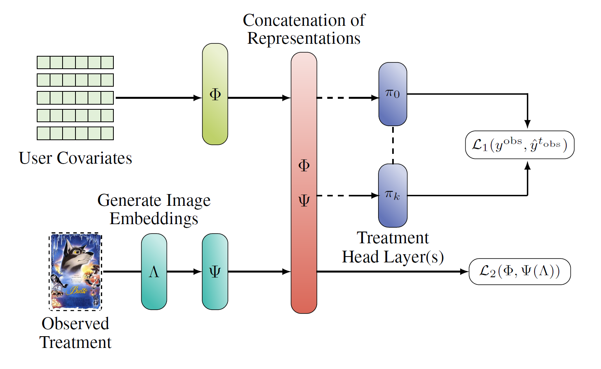
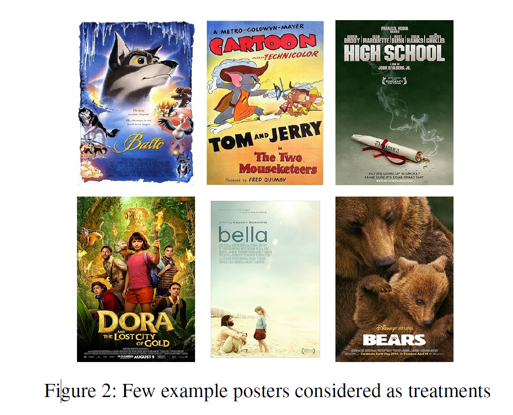

## Outline

- Introduction & Motivation
- Problem Formulation
- Proposed Model: NICE
- Data Simulation & Experimental Setup
- Results & Discussion
- Conclusions & Future Directions

## Introduction & Motivation

- **Causal Effect Estimation**  
  Estimating individual treatment effects (ITEs) in observational studies is challenging due to confounding biases and the lack of ground truth outcomes [(Rubin 2005)](https://doi.org/10.1080/01621459.2005.10476572).

- **Why Image Treatments?**  
  Many studies use scalar or categorical representations for treatments. However, real-world applications (e.g., personalized thumbnails in OTT (Over the Top, e.g. Youtube, Streaming) services or product images in e-commerce) involve rich, multi-dimensional data like images [(Harada & Kashima 2021; Kaddour et al. 2021)](https://doi.org/10.1145/3357384.3358048).

- **Objective of the Paper**  
  Introduce NICE (Network for Image treatments Causal effect Estimation) to uitilise image attributes for improved causal effect estimation.

## Problem Formulation

- **Notation**:
  - $n \in \mathbb{N}$ users / instances with index $i$.
  - $k \in \mathbb{N}$ (discrete) treatments with index $t$.
    - Treatments are represented by images $I_t \in \mathcal{I} \subset \mathbb{R}^m$.
    - The assigned treatment for user $i$ is $t_i \in \{1,2, ..., k\}$.
  - User covariates $x_i \in \mathcal{X} \subset \mathbb{R}^d$,
  - (Potential) Outcomes $y_{i}^{t}$ for user $i$ with treatment $t$.

$\Rightarrow$ The dataset consists of $n$ pairs: $\{x_i, I_{t_i}, y_{i}^{t_i}\}_{i=1}^n$.

(They are using the classic assumptions: *Unconfoundedness* and *Overlap/Positivity*)

## Problem Formulation

- **Theoretical Motivation**:
    - Following **Rubin-Neyman Potential Outcomes Framework**
    - Consider a pair of treatments $a$ and $b$.
    - The Individual Treatment Effect (ITE) for user $i$ is:
      $$
      \tau^{a,b}(x_i) = \mathbb{E}[y^{a}_i | x=x_i] - \mathbb{E}[y^{b}_i | x=x_i]
      $$

- **Objective**:
    - Measurement of the model performance on the *Precision in Estimation of Heterogeneous Effect* (PEHE) as proposed by [Pham 2017](https://arxiv.org/abs/1702.04473).
      $$
      \epsilon_{\text{PEHE}}  = \frac{1}{{k \choose 2}} \sum\limits_{a=1}^{k} \sum\limits_{b=0}^{a-1}\left[ \frac{1}{n} \sum\limits_{i=1}^n (\hat{\tau}^{a, b}(\mathbf{x}_i) - \tau^{a, b}(\mathbf{x}_i))^2 \right]
      $$

## Proposed Model: NICE

:::: {.columns}

::: {.column width="70%"}

{width="100%"}

:::

::: {.column width="30%"}

:::{style="font-size: 60%;"}

- User Covariate Embedding $\Phi : \mathcal{X} \rightarrow \mathbb{R}^{d_1}$.
- Treatment Embedding $\Psi : \Lambda(\mathcal{I}) \rightarrow \mathbb{R}^{d_2}$.
- Treatment Head Networks (fully-connected NNs) $\pi_t$ for $t \in \{1, 2, ..., k\}$.
- Loss Function: $\mathcal{L} = \alpha \cdot \mathcal{L}_1 + \beta \cdot \mathcal{L}_2$.
- Where $\mathcal{L}_1 = \frac{1}{n} \sum_{i=1}^{n} (\hat{y}^{t}_i - y_i)^2$ is MSE-like and
- $\mathcal{L}_2 = \binom{k}{2}^{-1} \sum_{a=1}^{k} \sum_{b=1}^{a-1} \mathrm{MMD}\left( \\ \lbrace \Phi; \Psi(\Lambda))\}_{t=a}, \lbrace \Phi; \Psi(\Lambda) \}_{t=b} \right)$
    uses Maximum Mean Discrepancy (MMD) to reduce treatment assignment bias.

:::

:::

::::

## Proposed Model: NICE

- **NICE Framework Overview**  
  A neural network architecture that integrates:
  - **Representation Learning (:white_check_mark:):**  
    Learn low-dimensional embeddings for both user covariates and image treatments.
      - Pre-trained models (e.g., ResNet or VGG) are used to extract image features.
  - **Treatment Head Networks (:grey_question:):**  
    Separate networks for each treatment to generate counterfactual predictions.
  - **Loss Functions (:question:):**  
    Combination of Mean Square Error (MSE) for outcome prediction and a Maximum Mean Discrepancy (MMD) loss to reduce treatment assignment bias [(Sriperumbudur et al. 2012)](https://doi.org/10.1214/11-AOS947).
    - where $\mathcal{L}_1$ is the regression loss and $\mathcal{L}_2$ is the treatment regularization loss.

## Treatment Head Networks

- **Multiple Treatment Heads:**  
  - For $k$ available treatments, $k$ fully connected networks (denoted as $\pi_t$ for $t \in \{1, 2, \dots, k\}$) are trained.
  - Each network is dedicated to estimating the potential outcome for its corresponding treatment.

- **Outcome Prediction:**  
  - The final predicted potential outcome for treatment $t$ is:
    $$
    \hat{y}^t_i = \pi_t\big(\Phi(x_i), \Psi(\Lambda(I_t))\big)
    $$

## Treatment Regularization Loss?

- **Approach:**  
  - **Balancing Representations:**  
    Since the latent spaces of covariates and treatments differ, the goal is to obtain a balanced representation using Integral Probability Metrics (IPM).
  - **MMD Loss:**  
    Use a special case of IPM, the Maximum Mean Discrepancy (MMD) loss,to compute the average distance between the joint embeddings across all treatment pairs.

- **Mathematical Formulation:**  
  $$
  \mathcal{L}_2 = \frac{1}{\binom{k}{2}} \sum_{a=1}^{k} \sum_{b=1}^{a-1} \text{MMD}\Big(\{\Phi; \Psi(\Lambda)\}_{t=a}, \{\Phi; \Psi(\Lambda)\}_{t=b}\Big)
  $$
  where $\{\Phi;\Psi\}$ denotes the concatenation of the covariate and treatment representations.

- **Impact:**  
  By minimizing $L_2$, the model reduces confounding effects, leading to more accurate estimation of individual treatment effects.

## Understanding MMD in that Loss?

- **How It Works:**  
  - MMD computes the difference between the mean embeddings of two distributions in a Reproducing Kernel Hilbert Space (RKHS).
  - For distributions $P$ and $Q$ with kernel $k$, it is defined as:
    $$
    \text{MMD}(P, Q) = \mathbb{E}_{x,x'\sim P}[k(x,x')] + \mathbb{E}_{y,y'\sim Q}[k(y,y')] \\
    \quad - 2\mathbb{E}_{x\sim P,\,y\sim Q}[k(x,y)]
    $$

- **In the model:**  
  - Here, the two distributions are the joint embeddings (i.e., I think the concatenation $\{\Phi; \Psi(\Lambda)\}$) for different treatment groups (?).
  - By minimizing the MMD loss, the model aligns these distributions, thereby reducing treatment assignment bias and mitigating confounding effects (?).

## Data Simulation & Experimental Setup

:::: {.columns}

::: {.column width="40%"}

- **Semi-Synthetic Data Generation**  
  - Uses real-world poster images from the PosterLens dataset.
  - Simulated user covariates and potential outcomes are generated to mimic realistic scenarios.

:::

::: {.column width="60%"}

{width="100%"}

:::

::::

## User Covariates & Treatment Representations

- **User Covariates ($x_i$):**  
  - Obtained from 20K ResNet embeddings.
  - Each $x_i \in \mathbb{R}^{512}$ serves as a proxy for the user's characteristics.

- **Treatment Representations:**  
  - To simulate $k$ treatments, generate $k+1$ centroids $\{z_1, z_2, \dots, z_k, z_{k+1}\}$.
  - **Centroid Selection:**  
    - Either randomly select $k+1$ embeddings or use KMeans clustering on the 20K embeddings.
  - These centroids are used in the potential outcome generation.

## Generating Potential Outcomes

- **Step 1: Sampling $\tilde{y}^t_{i}$**  
  For each treatment $t$:
  - Sample parameters:
    $$
    \mu_t \sim \mathcal{N}(0.45, 0.15), \quad \sigma_t \sim \mathcal{N}(0.1, 0.05)
    $$
  - For each user $i$, sample:
    $$
    \tilde{y}^t_{i} \sim \mathcal{N}(\mu_t, \sigma_t)
    $$

- **Step 2: Computing the Preference Term $d^t_{i}$**  
  - The preference of user $i$ for treatment $t$ is given by:
    $$
    d^t_{i} = x_i^T z_t + x_i^T z_{k+1}
    $$
  - This term captures the alignment between the user covariates and treatment centroids.

- **Final Potential Outcome:**  
  - Combine the sampled outcome and preference:
    $$
    y^t_{i} = c \, \tilde{y}^t_{i} \, d^t_{i} = c\, \tilde{y}^t_{i} \left(x_i^T z_t + x_i^T z_{k+1}\right)
    $$
  - A fixed constant $c > 0$ is used (set to $c = 5$ in the experiments).

## Observed Treatment Assignment

- **Treatment Assignment Probability:**  
  For each user $i$ and treatment $t$, the probability is defined as:
  $$
  p^t_{i} = \frac{\exp(\kappa_i y^t_{i})}{\sum_{a=1}^k \exp(\kappa_i y^a_{i})}
  $$
  - Here, $\kappa = [\kappa_1, \kappa_2, \dots, \kappa_k]$ is a vector of positive parameters that controls the treatment assignment bias.
  - A higher $\kappa_a$ for a particular treatment $a$ skews the probability towards that treatment.

- **Observed Treatment:**  
  - For each user $i$, a treatment is randomly assigned based on the probabilities $p^t_{i}$.

## Experimental Results & Discussion

- **Quantitative Results**  
  - NICE consistently outperforms all baseline methods on the PEHE metric.
    - But all "baseline" methods are not tailored for handling images, so its not a fair comparison?!
  - The performance gap increases with the number of treatments and in zero-shot settings.
    - Zero-shot Causal Inference would be allow for testing the model on unseen treatments (e.g. what if a new thumbnail is introduced).

- **Robustness**  
  - NICE claims superior performance under varying treatment assignment biases, highlighting its robustness in real-world scenarios.

## Conclusions & Future Directions

- **Key Contributions**  
  - Introduces NICE, a framework that leverages image treatments for causal effect estimation.
  - Demonstrates improved ITE estimation compared to existing methods.
  - Uses a combination of MSE and MMD losses to balance treatment representations and reduce confounding effects.
  - Validates the approach on semi-synthetic data.

- **Future Research**  
  - Extending the framework to more complex data types (e.g., video, multimodal data).
  - Enhancing scalability and interpretability of the model.
  - Validating the approach on real-world datasets beyond semi-synthetic simulations.
