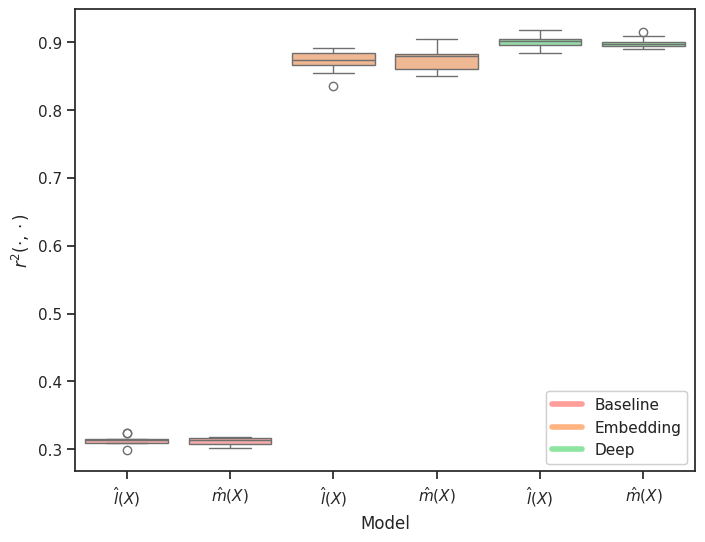
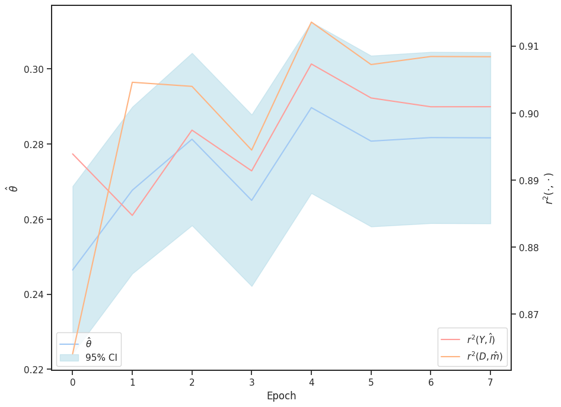

<h2 style="text-align: left; margin-top: 1.5cm;">DoubleMLDeep: Estimation of Causal Effects with Multimodal Data</h2>

February 20, 2024

Sven Klaassen   <small>University of Hamburg   Economic AI</small>

Jan Teichert-Kluge   <small>University of Hamburg</small>

Philipp Bach   <small>University of Hamburg   Economic AI</small>

Victor Chernozhukov   <small>Massachusetts Institute of Technology</small>

Martin Spindler   <small>University of Hamburg   Economic AI</small>

Suhas Vijaykumar   <small>Massachusetts Institute of Technology</small>

::: {.notes}
Hello everyone, I am very pleased to be here today to present the first results of our research project on "DoubleMLDeep: Estimation of Causal Effects with Multimodal Data"! Our research group consists of 

...

My name is Jan Teichert-Kluge, and I am a research associate and PhD student at the University of Hamburg in the field of statistics with applications in business administration and data science. In my research, I focus on the exciting fields of machine learning, especially deep learning, and causal inference. I look forward to networking with you after my presentation and having further discussions on the topics of statistics, machine learning and causal inference.
:::

# Motivation

::: {.notes}
I would like to start with our motivation for this project.
A major motivating factor is the growth in data volumes in the course of global digitalization. More and more unstructured data is also becoming available -> keyword: big data.
:::

## Motivating Example - Data Sources

 Image Data

Text Data

Tabular Data

::: {.notes}
So, here you see the website of a well-known online store.
There is a lot of data behind it, but not all of it is publicly accessible.
However, most online stores have published 
  - photos of their products
  - a description of the products as text
  - some tabular data such as the average rating or the number of reviews on the product page
:::

## Motivating Examples
* Example Use Cases:
  - Price Elasticity 
  - Effects of medical treatments
  - Effects on the environment, e.g. the effect of condensation trails on the climate

* Sources like images and text contain valuable insights
  - Contain rich hidden information about unobserved confounding variables

::: {.notes}

...

What all examples have in common is:

:::

## Motivating Example - PLR

#### Partially linear regression model (PLR) 

$$
\begin{align}
Y &= \theta_0 D + g_0(X) + \varepsilon, & \mathbb{E}[\varepsilon | X, D] = 0 \label{eq:plr1} \\
D &= m_0(X) + \vartheta, & \mathbb{E}[\vartheta | X] = 0 \label{eq:plr2}
\end{align}
$$

with 

:::: {.columns}

::: {.column width="50%"}

- Output $Y$
- Treatment $D$
- Additional features $X = (X_1, \dots)$
- Stochastic errors $\varepsilon$ and $\vartheta$

:::

::: {.column width="50%"}

{width=300}

:::
::::

::: {.notes}
The question now is how to estimate the causal effect!

We define this partial linear regression model with the outcome $Y$ and treatment $D$. Possible confounders are selected as $X$. 

This causal model is shown here as a DAG (directed acyclic graph).

:::

## Motivating Example - DML

#### Double/Debiased Machine Learning (DML)

- Use machine learning methods to fit 
$$
\begin{align}
l_0(X) &:= \mathbb{E}[Y | X] \label{eq:l_hat} \\
m_0(X) &:= \mathbb{E}[D | X] \label{eq:m_hat}
\end{align}
$$
- Construct the orthogonalized score (either cross-fitting or split the sample) for a fitted nuisance learner $\hat{\eta}_0:=(\hat{l}_0, \hat{m}_0)$
$$
\begin{align}
\psi(W, \theta, \hat{\eta}) := \left(Y - \hat{l}(X) - \theta\left(D - \hat{m}(X)\right)\right) \cdot \left(D - \hat{m}(X)\right)
\end{align}
$$
- Compute the estimate as the solution of 
$$
0 = \frac{1}{n}\sum_{i=1}^n \psi(W, \hat{\theta}, \hat{\eta}_0)
$$

::: {.notes}
We use ML methods to learn the conditional expected values of Y on X, respectively D on X.

Then we use this orth. score and solve this equation to get the estimate theta hat!

- On the final step, we calculate the estimate by solving the following equation:
:::

## Motivating Example - DML

 

- Assumptions for the nuisance elements (see @dml2018)
$$
\begin{align}
\lVert \hat{m}(X) - m_0(X) \rVert_{P,2} \cdot \left(\lVert \hat{m}(X) - m_0(X) \rVert_{P,2} +  \lVert \hat{l}(X) - l_0(X)\rVert _{P,2}\right) \le \delta_n n^{-1/2}.
\end{align}
$$

- Under some regularity conditions the estimator $\hat{\theta}$ concentrates in $1/\sqrt{n}$-neighborhood of $\theta_0$ and
$$
\sqrt{n}(\hat{\theta} - \theta_0) \to \mathcal{N}(0, \sigma^2)
$$

. . .

$\Rightarrow$ simple approach to control for confounders, *if they can be used for ML models!*

::: {.notes}
- We rely on the approach of @dml2018

- This estimator has, under certain conditions, nice properties!

:::

# DoubleML Deep

## DoubleML Deep - Motivation

- Use multimodal data (text and images) *additionally* to conventional tabular features

{width=750}

::: {.notes}
  
:::

## DoubleML Deep - Module Structure

{width=500}

## DoubleML Deep - Workflow

::: {.notes}
Now I would like to briefly explain the workflow of DoubleMLDeep in Python.
wor
First of all, some necessary input parameters must be defined. 
Then the actual DoubleMLDeep network can be created, which uses Hugging Face Transformer models and the Pytorch framework, among other things.

A DoubleMLDeep Data Module must be created and handles the various input data such as texts and images. This uses the Pytorch Lightning Framework.

The DoubleMLDeep Lightning Module also uses Pytorch Lightning and contains additional training parameters.

The network can now be trained with the pytorch Lightning Trainer. The corresponding predictions in the DoubleML package can then be used to obtain the estimate of the causal parameter. 
:::

## DoubleML Deep - More Details

 

- Use pretrained models for unstructured data e.g. Bert and Beit

- Basic models for tabular data seem sufficient

- Monitor the nuisance losses
  - $\lVert Y - \hat{l}(X) \rVert_{P,2} \le \lVert l_0(X) - \hat{l}(X) \rVert_{P,2} + \sigma_{\epsilon}$
  - $\lVert D - \hat{m}(X) \rVert_{P,2} \le \lVert m_0(X) - \hat{m}(X)\rVert_{P, 2} + \sigma_{\vartheta}$

::: {.notes}
- **Unstructured Data Models:** We employ pre-trained models like BERT and BEiT to extract valuable information from unstructured data, including product descriptions and images.

- **Tabular Data Models:** Basic models for tabular data have proven to be effective.

- **Monitoring Nuisance Losses:** To ensure the reliability of our estimations, we diligently monitor nuisance losses. The following conditions are crucial for assessing the quality of our models:

  - $\lVert Y - \hat{l}(X) \rVert_{P,2} &\le \lVert l_0 - \hat{l}(X) \rVert_{P,2} + \sigma_{\epsilon}$ 

  - $ \lVert D - \hat{m}(X) \rVert_{P,2} &\le \lVert m_0(X) - \hat{m}(X)\rVert_{P,2} + \sigma_{\vartheta}$

  These conditions help maintain the validity of our estimates by ensuring that the discrepancies between our estimated nuisance functions and their true counterparts, along with stochastic errors, remain within acceptable bounds.
:::

# Semi-Synthetic Data

## Construction of a semi-synthetic dataset

- The validation of the proposed estimator is a crucial step in ensuring their accuracy and reliability.
  * Performance of causal models is not straightforward to evaluate in real world applications
  * The true causal effect (unlike true labels for predicted outcomes) is not observable

## Construction of a semi-synthetic dataset

- We generate a semi-synthetic dataset with a known treatment effect parameter
  * The confounding operates through labels of the supervised learning tasks

* We use the following datasets:

| Modality   | Dataset used |
| --------   | ------- |
| Tabular    | DIAMONDS dataset \cite{ggplot2_book}                  |
| Text       | IMDB dataset \cite{maas-EtAl:2011:ACL-HLT2011}        |
| Image      | CIFAR-10 dataset \cite{Krizhevsky09learningmultiple}  |

::: {.notes}

 ...

:::

## Construction of a semi-synthetic dataset

We generate a semi-synthetic dataset according to the underlying PLR model
$$
\begin{align}
Y &= \theta_0 D + \tilde{g}_0(\tilde{X}) + \varepsilon, \\
D &= \tilde{m}_0(\tilde{X}) + \vartheta, 
\end{align}
$$
where $\tilde{X}= (\tilde{X}_{\text{tab}}, \tilde{X}_{\text{txt}}, \tilde{X}_{\text{img}})$ with the following additive structure
$$
\begin{align}
\tilde{g}_0(\tilde{X}) &= \sum_{\text{mod}\in\{\text{tab},\text{txt},\text{img}\}} \tilde{g}_{\text{mod}}(\tilde{X}_{\text{mod}}) \\
\tilde{m}_0(\tilde{X}) &= \sum_{\text{mod}\in\{\text{tab},\text{txt},\text{img}\}} \tilde{m}_{\text{mod}}(\tilde{X}_{\text{mod}}) 
\end{align}
$$
and $\varepsilon, \vartheta \sim \mathcal{N}(0, 1)$.

::: {.notes}

...

:::

## Construction of a semi-synthetic dataset

* The effect on the outcome $Y$ is generated via a standardized version of target variable to balance the confounding impact of all modalities:
$$
\begin{align}
    \tilde{g}_{\text{mod}}(\tilde{X}_{\text{mod}}) = \frac{\tilde{X}_{\text{mod}} - \mathbb{E}[\tilde{X}_{\text{mod}}]}{\sigma_{\tilde{X}_{\text{mod}}}}, \quad \text{mod}\in\{\text{tab}, \text{txt}, \text{img}\}
\end{align}
$$
* Further, to ensure a strong confounding, the impact on the treatment $D$ is defined via:
$$
\begin{align}
    \tilde{m}_{\text{mod}}(\tilde{X}_{\text{mod}}) = -\tilde{g}_{\text{mod}}(\tilde{X}_{\text{mod}}), \quad \text{mod}\in\{\text{tab}, \text{txt}, \text{img}\}
\end{align}
$$

::: {.notes}

...

:::

## Construction of a semi-synthetic dataset

* Due to the negative sign and the additive structure, the confounding effect will ensure that higher outcomes $Y$ occur with lower treatment values $D$, creating a **negative bias**
  - The independence of all three original datasets and the additive negative confounding results in a negative bias even if we only control for a subset of confounding factors

{width=500}

## Construction of a semi-synthetic dataset

* The treatment effect is set to $\theta_0=0.5$ with $n=50.000$ samples in the dataset
* The confounding is generated through the labels $\tilde{X}_{\text{mod}}$ of the corresponding dataset
* Both $\tilde{g}_0(X)$ and $\tilde{m}_0(X)$ are rescaled to ensure a signal-to-noise ratio of $2$ for $Y$ and $D$ (given unit variances of the error terms)

## Challenges of the proposed dataset

* Dependency on the target of the modality $\tilde{X}_{\text{mod}}$
  - Might not be fully explained by the corresponding features $X_{\text{mod}}$
* Consequently, the estimate $\hat{\theta}$ might only be able to account for the part of confounding which can be explained by the input features:
$$
\begin{align}
    \tilde{X}_{\text{mod}} = \mathbb{E}[\tilde{X}_{\text{mod}}|X_{\text{mod}}] + U_{\text{mod}},
\end{align}
$$
where $U_{\text{mod}}$ can not be controlled for

## Bounds for the estimation of $\theta_0$

* Since all modalities contribute a negative bias, the semi-synthetic dataset can be used as a benchmark with an oracle upper bound of an effect estimate of $\theta_0=0.5$
* For the lower bound, one can evaluate a basic ordinary least squares model with outcome $Y$ on the treatment variable $D$ (excluding all confounding variables)
  - The resulting effect estimate $\hat{\theta}_{\text{OLS}} = -0.4594$

## Bounds for the estimation of $\theta_0$

* To access the predictive performance of the nuisance models, we can rely on oracle predictions of
$$
\begin{align}
    \tilde{m}_0(\tilde{X}):= \mathbb{E}[D|\tilde{X}] \\
    \tilde{l}_0(\tilde{X}):= \mathbb{E}[Y|\tilde{X}] &= \theta_0 \tilde{m}_0(\tilde{X}) + \tilde{g}_0(\tilde{X})
\end{align}
$$
* Evaluating the oracle predictions $\tilde{m}_0(\tilde{X})$ and $\tilde{l}_0(\tilde{X})$ results in the following upper bounds for the performance of the nuisance estimators
$$
\begin{align}
    R^2(D, \tilde{m}_0(\tilde{X})) &= 0.6713\\
    R^2(Y, \tilde{l}_0(\tilde{X})) &= 0.5845
\end{align}
$$
on the whole dataset of $n=50,000$ observations

## Simulation Results

:::: {.columns}

::: {.column width="30%"}

* **Baseline Model**
  - Standard DML approach, relying only on tabular data
  - Based on the LightGBM package for estimation of the nuisance elements

:::

::: {.column width="30%"}

* **Deep Model**
  - Relies on the proposed architecture
  - Uses the out-of-sample predictions of $\hat{m}(X)$ and $\hat{l}(X)$ generated from the model
  - Based on the RoBERTa Model for text modality, a VIT Model for images and a SAINT model for the tabular data

:::

::: {.column width="30%"}

* **Embedding Model**
  - Also relies on the proposed architecture
  - Does not use the generated predictions directly
    - Generated embedding $H_E$ is used together with the tabular features $X_{\text{tab}}$ as input for a boosting algorithm (again with LightGBM)

:::

::::

## Simulation Results

* In order to compare the predictive performance of the models, a relative $r^2$-score with respect to the upper bound is defined as
$$
\begin{align}
    0 \leq r^2(D, \hat{m}) &:= \frac{R^2(D, \hat{m}(X))}{R^2(D, \tilde{m}_0(\tilde{X}))} \leq 1\\
    0 \leq r^2(Y, \hat{l}) &:= \frac{R^2(Y, \hat{l}(X))}{R^2(Y, \tilde{l}_0(\tilde{X}))} \leq 1
\end{align}
$$

## Simulation Results

Results of Simulation Study. Reported: mean ± sd. over five
random train-test splits

|   | Baseline | Embedding | Deep |
|---|----------|-----------|------|
| $r^2(Y, \hat{l}_0)$ | $0.31  \pm  0.01$ | $0.87 \pm  0.02$ | $\mathbf{0.90 \pm  0.01}$ |
| $r^2(D, \hat{m}_0)$ | $0.31 \pm  0.01$ | $0.87 \pm  0.02$ | $\mathbf{0.90 \pm  0.01}$ |
| $\hat{\theta}$      | $-0.32 \pm  0.01$ | $\mathbf{0.28 \pm  0.01}$ | $0.27 \pm  0.01$ |

*Higher = better (best in bold)*

## Simulation Results - Predictive Performance

## Simulation Results - Performance on $\theta$

## Simulation Results - Continous Estimates on $\theta$

## Future Research Direction

 

- Further applications (We are really looking forward to possible collaborations)

- Extensions of the [DoubleML package](https://docs.doubleml.org/stable/index.html)

- Using multiple time periods

- Case Studies

::: {.notes}

:::

# References

## References

::: {#refs}
:::

## Affiliations

University of Hamburg

<small>https://www.bwl.uni-hamburg.de/en/statistik/allgemein.html</small>

Massachusetts Institute of Technology

<small>https://stat.mit.edu/about/</small>

Economic AI

<small>https://economicai.com/</small>

DoubleML

<small>https://docs.doubleml.org/stable/index.html</small>

. . .

$\Rightarrow$ **Thanks for your Attention!**

::: {.notes}
- Economic AI: for industry collaborations and trainings on doubleml please check out the website of economicai.com ! 
:::