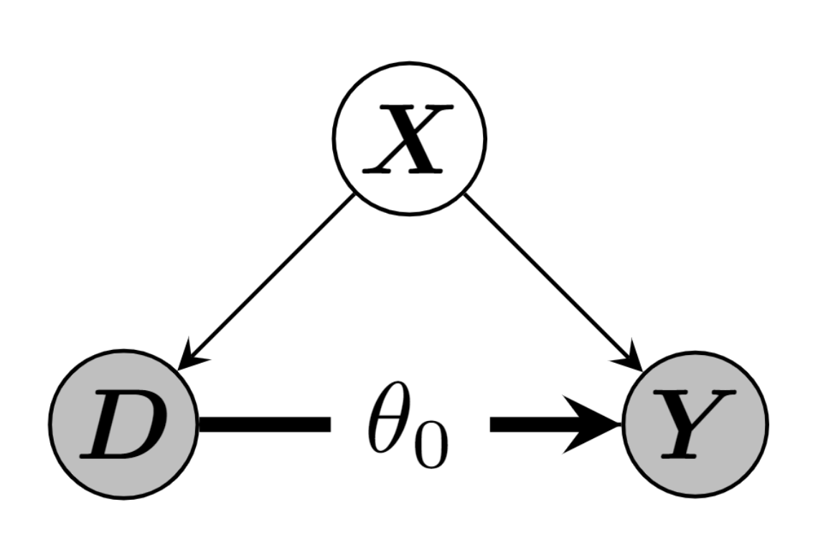

<div style="text-align: center;">
<div class="logo-container">

</div>
<h1 style="text-align: left; margin-top: 1.0cm;">Endogeneity</h1>
<h2 style="text-align: left; margin-top: 0.5cm;">Statistical Significance, Impact, and Relevance</h2>
<p style="text-align: left; margin-top: 0.5cm;">PhD Course, Prof. Dr. Dr. h.c. Sönke Albers<br> September 17 - 19, 2024 Hamburg</p>

<div class="author-container">
<p class="author"><b>Jan Teichert-Kluge <br> <small>University of Hamburg</small></b></p>
</div>
</div>

# Introduction to Endogeneity

## What is Endogeneity ?
- Yout want to do valid inference on a target parameter of interest in a general model like:
$$
Y = g(X) + \xi
$$

- **Endogeneity is Violation of the Exogeneity Assumption 💡**:
$$
\mathbb{E}[\xi|X] \neq 0 
$$

- **Without Exogeneity, we are missing**:
  - $\mathbb{E}[\xi] = 0$ (Law of total expectation)
  - ($\mathbb{E}[X'\xi] = 0$, the regressors are uncorrelated with the errors)

---

## What is Endogeneity ?

- **Endogeneity** refers to situations where an explanatory variable is correlated with the error term in a regression model.
- It is a critical issue because it leads to **biased estimates**, impacting the validity of causal inferences [@Ebbes2021].

::: {.callout-important}
- Sources of <s>evil</s> **endogeneity** [@Hill2021]:
  - **1. Omitted variable bias**
  - **2. Measurement error**
  - **3. Simultaneity**.
:::

## Why does Endogeneity Matter?

- **Statistical Significance**: Endogeneity can influence the effect size (regression coefficient value).
  - **Causal Inference**: Without addressing endogeneity, any causal claims are questionable.
  - In economics the effect sizes is very important.
- **Marketing Research**: Marketing models often involve simultaneous decisions by consumers and firms, introducing endogeneity [@Papies2022].

. . .

$\Rightarrow$ *"Everything is endogenous, except for God."*

---

## Examples of Endogeneity in Marketing

- In many cases one is interested in understanding influences (*causal effects*) of an action (new webdesign, coupons, etc.) on an outcome (sales, KPIs, etc.)
  - Needs valid inference on a parameter of interest 
- In marketing, **price** is often endogenous because it is determined simultaneously with demand.
  * e.g. estimating price elasticity of demand
- **Advertising** may also be endogenous due to unobserved factors influencing both sales and ad expenditures [@Rossi2014].


---

## Overview

:::: {.columns}

::: {.column width="33%" .fragment}
**Awareness ($\approx$ 1990-2000)**

:::{style="font-size: 75%;"}


- **IV Methods:**
  - *Moore et al. (1991)* – Early IV methods.
  - *Boulding et al. (1994)*
  - *Villas-Boas & Winer (1999)*

:::

:::

::: {.column width="33%" .fragment}
**Takeoff ($\approx$ 2000-2010)**

:::{style="font-size: 75%;"}

- **IV Applications:**
  - *Chintagunta (2001), Sudhir (2001)*
  - *Rust et al. (2002)*
  - *Verhoef (2003)*
- **Methods**:
  - *Petrin & Train (2010)* - Control Function
- **IV Skepticism:**
  - *Bound et al. (1995)* – Weak Instruments

:::

:::
::: {.column width="33%" .fragment}

**Diversification ($\approx$ 2010-?)**

:::{style="font-size: 75%;"}

- **Instrument-Free Methods:**
  - *Ebbes et al. (2005)* – Latent IVs
  - *Park & Gupta (2012)* – Gaussian Copulas
- **Quasi-experimental Methods:**
  - *Goldfarb & Tucker (2011)* - Diff-in-Diff
  - *Tirunillai & Tellis (2017)*- Synthetic Controls
  - *Hartmann et al. (2011)* - Regression Discontinuity

:::

:::

::::

^[Own illustration based on @Papies2022]

---

## Overview

:::{style="font-size: 75%;" .incremental}

- **Instrumental Variables**: Identify causal effects by using exclusion restrictions, meaning they rely on certain variables that influence the independent variable but not the outcome directly. Examples include methods like two-stage least squares regression and the control function approach, both of which depend on these exclusion restrictions.

- **Gaussian Copula**: This method is used to model the joint relationship between an endogenous variable (one influenced by other factors within the model) and the error term. It provides a way to estimate causal effects when traditional methods may not apply.

- **Latent IVs**: This approach is used when typical instrumental variables are not available. It helps separate the endogenous and exogenous components of a variable by using latent (unobserved) factors.

- **DiD**: This method compares the changes in outcomes between a group that receives a treatment and a control group that does not, using panel data collected before and after the treatment to estimate the causal effect.

- **Synthetic Control**: This approach constructs a synthetic control group as a weighted combination of untreated units, enabling comparisons between treated and untreated groups when an exact match for a control group is unavailable.

- **Regression Discontinuity**: This method compares units that are just above or below a certain threshold used to assign a treatment. It leverages the cutoff point for treatment assignment to estimate the causal effect, often using natural divisions like geographic boundaries or other criteria.

:::

. . .

$\Rightarrow$ Good News: We focus on IV-Methods and Copulas for today :grinning:


# A brief insight into the Theory :books: {transition="concave-in"}

## Omitted Variable Bias
Our goal is to do valid inference for a target parameter of interest $\beta$. Consider the following simple linear regression model (the *long* model) including all covariates:
$$
Y = \alpha^{\text{l}} + \beta^{\text{l}} X + \gamma W + \xi, \quad \mathbb{E}[\xi | X] = 0
$$

:::{style="font-size: 100%;"}
Where:

- $Y$ is the dependent variable (e.g., sales),
- $X$ and $W$ are independent variables (e.g., advertising expenditure, product quality),
- $\xi$ is the error term, capturing all other factors affecting $Y$.
:::

---

## Omitted Variable Bias

Assume you forgot the other relevant variable $W$ that is correlated both with $Y$ and $X$ and $W$ now is **omitted** from the model. The new (*short* model) specification would be:

$$
Y = \alpha^{\text{s}} + \beta^{\text{s}} X + \zeta, \quad \mathbb{E}[\zeta | X] \neq 0
$$

However, when $W$ is omitted from the regression, the error term $\zeta$ from the *short* model will include the effect of $W$:
$$
\zeta = \xi + \gamma W
$$
This causes $\zeta$ to be **correlated** with $X$, leading to **omitted variable bias**. In this case, the estimate of $\beta$ will be biased because part of the effect of $W$ on $Y$ will incorrectly be attributed to $X$.

---

## Omitted Variable Bias
The problem now is the biased estimate of $\beta$. In the *short model*, $\beta^{\text{s}}$ is
$$
\beta^{\text{s}} = \frac{\text{Cov}(X, Y)}{\text{Var}(X)}
$$
Substituting $Y$ from the true / *long* form brings us to:
$$
\beta^{\text{s}} = \frac{\text{Cov}(X, \alpha^{\text{l}} + \beta^{\text{l}} X + \gamma W + \xi)}{\text{Var}(X)}
$$
---

## Omitted Variable Bias
Application of the properties of (co-)variances leads to simplified decomposition: 
$$
\beta^{\text{s}} = \frac{\overbrace{\text{Cov}(X, \alpha^{\text{l}})}^{=0} + \beta^{\text{l}} \overbrace{\text{Cov}(X, X)}^{=\text{Var}(X)} + \gamma \text{Cov}(X, W) + \overbrace{\text{Cov}(X, \xi)}^{=0}}{\text{Var}(X)}
$$
where $\text{Cov}(X, \xi) = 0$ because of $\mathbb{E}[\xi | X] = 0$.
We get the simplified form:
$$
\beta^{\text{s}} = \beta^{\text{l}} + \gamma \frac{\text{Cov}(X, W)}{\text{Var}(X)}
$$

---

## Omitted Variable Bias

We want an unbiased estimate, i.e., for $\beta^{\text{s}} = \beta^{\text{l}}$. Thus, the second term on the right-hand side must vanish:

$$
0 = \gamma \frac{\text{Cov}(X, W)}{\text{Var}(X)}.
$$

Since $\text{Var}(X) \neq 0$ and $\gamma \neq 0$ by model specification, the product can only be zero if $X$ and $W$ are uncorrelated. Therefore, we require:

$$
\text{Cov}(X, W) = 0.
$$

Or, in other words, $X$ and $W$ must be orthogonal: $X \perp W$.

---

## Simultaneity

What happens if the variables are linked in a more complex way, so that we need at least two or more equations to describe them?

**Example: Price Elasticity of Demand**

The price elasticity of demand measures the responsiveness of quantity demanded to changes in price, represented as:

$$
\epsilon = \frac{\% \Delta Q}{\% \Delta P} = \frac{\Delta Q}{Q} \frac{P}{\Delta P}
$$

- Intersections of demand and supply functions, **simultaneous causality**.

---

## Simultaneity

We can estimate the price elasticity using the least squares approach based on observed prices and quantities. The logarithmic model is:

$$
\ln(Q_i) = \alpha + \beta \ln(P_i) + u_i
$$

:::{style="font-size: 75%;"}
Where:

- $Q_i$ is the quantity,
- $P_i$ is the price,
- $u_i$ is the error term,
- $\beta$ gives us the elasticity of demand.

:::


. . .

Assume unobserved demand and supply shocks:

$\Rightarrow$ Endogeneity of $\ln(P)$

---

## Simultaneity

:::: {.columns}

::: {.column width="60%"}

- Observed equilibrium quantities and prices: Intersections of demand and supply functions
- A simultaneous shift in both the demand and supply functions can lead to **endogeneity** in the observed price $\ln(P_i)$, causing biased estimates if not properly addressed.


$\Rightarrow$ ⚡ Positive slope of the estimated demand curve

:::

::: {.column width="40%"}

```{python}
# import libraries
import plotly.graph_objects as go
from plotly.subplots import make_subplots
import numpy as np
import pandas as pd
import statsmodels.api as sm

# Set seed for reproducibility
np.random.seed(31416)

# define demand function
def demand(p, u):
    return 120 - p + u


# define supply function
def supply(p,e):
    return p + e

# define equilibrium function
def equilibrium(u,e):
    p = (120 + u - e) / 2
    q = demand(p,u)
    return p, q

# Create an array of 1000 equally spaced points between 0 and 100
p = np.linspace(5, 100, 1000)

# save p_eq and q_eq in a pd.DataFrame
df = pd.DataFrame(columns=['u', 'e', 'p_eq', 'q_eq'])

# Set 3 different values for e and u to iterate over
u_values = np.array([10, 20, 30, 40])# * np.random.normal(1, 4, 3)
e_values = np.array([20, 30, 40, 50])# * np.random.normal(1, 4, 3)

# Calculate equilibrium price and quantity for each combination of u and e
for i in range(len(u_values)):
    for j in range(len(e_values)):
        u = u_values[i]
        e = e_values[j]

        # Create demand and supply arrays
        q_demand = demand(p, u)
        q_supply = supply(p, e)

        # Find the equilibrium price and quantity
        p_eq, q_eq = equilibrium(u, e)
        this_df = pd.DataFrame({'u': [u], 'e': [e], 'p_eq': [p_eq], 'q_eq': [q_eq], 'i_demand': [i], 'i_supply': [j]})
        df = pd.concat([df, this_df], ignore_index=True)

# Randomly sample 8 equilibrium points
df_smpl = df.sample(8)

# range for x and y axis
range_x = [df['p_eq'].min()-8, df['p_eq'].max()+8]
range_y = [df['q_eq'].min()-12, df['q_eq'].max()+12]

# Scatterplot of equilibrium price and elasticity estimation
X = sm.add_constant(df_smpl['p_eq'])
model = sm.OLS(df_smpl['q_eq'], X)
results = model.fit()
intercept, slope = results.params
x = np.linspace(range_x[0], range_x[1], 100)
y = intercept + slope * x

# Color palette (colorblind friendly)
color_palette = ['#377eb8', '#ff7f00', '#4daf4a', '#f781bf', '#a65628', '#984ea3',
                '#999999', '#e41a1c', '#dede00']
col_1, col_2, col_3, col_4, col_5 = color_palette[:5]

# plotly scatter plot for equilibrium points
trace_1 = go.Scatter(x=df_smpl['p_eq'], y=df_smpl['q_eq'], mode='markers',
                    name='(P*, Q*)', marker=dict(size=10, color = col_1),
                    textposition='top right')

# plotly line plot for OLS estimation
trace_2 = go.Scatter(x=x, y=y, mode='lines', name=f'OLS, Slope: {slope:.2f}',
                    line=dict(color=col_2, width=3), visible='legendonly')

# Create the figure
fig = go.Figure()
fig.add_trace(trace_1)
fig.add_trace(trace_2)

fig.update_xaxes(range=range_x, showticklabels=False)
fig.update_yaxes(range=range_y, showticklabels=False)

# legend position: below figure
fig.update_layout(
    xaxis_title='Price (P)',
    yaxis_title='Quantity (Q)',
    template='plotly_white',
    width=450,  # Set the width of the figure
    height=400,  # Set the height of the figure
    legend=dict(x=0.5, y=-0.25, xanchor='center', yanchor='top', orientation='h'),
    margin=dict(l=40, r=40, t=20, b=40)
)

fig.show()

```

:::

::::

---

## Simultaneity

:::: {.columns}

::: {.column width="60%"}

- Observed equilibrium quantities and prices: Intersections of demand and supply functions
- A simultaneous shift in both the demand and supply functions can lead to **endogeneity** in the observed price $\ln(P_i)$, causing biased estimates if not properly addressed.


$\Rightarrow$ ✅ Negative slope of the demand function

:::

::: {.column width="40%"}

```{python}
# Plot the true demand and supply functions together with equlibrium points
fig = go.Figure()

# Plot only randomly 5 equilibrium points for simplicity
for i in range(len(u_values)):
  q_demand = demand(p, u_values[i])
  q_supply = supply(p, e_values[i])

  fig.add_trace(go.Scatter(x=p, y=q_demand, mode='lines', name=f'D {i+1}', text=f'D {i+1}', 
  hoverinfo='text', line=dict(color=col_3, width=1.2), showlegend=False))
  fig.add_trace(go.Scatter(x=p, y=q_supply, mode='lines', name=f'S {i+1}', text=f'S {i+1}',
  hoverinfo='text', line=dict(color=col_5, width=1.2), showlegend=False))
# Add obs. equilibrium points
fig.add_trace(go.Scatter(x=df_smpl['p_eq'], y=df_smpl['q_eq'], mode='markers',
              name='(P*, Q*)', marker=dict(size=10, color = col_1),
              textposition='top right'))

fig.update_xaxes(range=range_x, showticklabels=False)
fig.update_yaxes(range=range_y, showticklabels=False)

# legend position: below figure
fig.update_layout(
    xaxis_title='Price (P)',
    yaxis_title='Quantity (Q)',
    template='plotly_white',
    width=450,  # Set the width of the figure
    height=400,  # Set the height of the figure
    legend=dict(x=0.5, y=-0.25, xanchor='center', yanchor='top', orientation='h'),
    margin=dict(l=40, r=40, t=20, b=40)
)

fig.show()

```

:::

::::

---

## Measurement Error

The relationship between education and wages can be modeled (e.g. simplified *Mincer Equation*) as:

$$
\ln(W) = \alpha + \beta E + u
$$

Where:

- $W$ is the wage,
- $E$ is the years of education,
- $u$ is the error term,
- $\beta$ is the return to education (i.e., the effect of an additional year of education on wages).

---

## Measurement Error

If education $E$ is measured with error, say we observe $E^*$ instead of the true value $E$, then:

$$
E^* = E + v
$$

Where:

- $E^*$ is the observed (but erroneous) measure of education,
- $v$ is the measurement error.

This leads to the observed equation:

$$
\ln(W) = \alpha + \beta (E^* - v) + u
$$

---

## Measurement Error

Rearranging the previous equation gives:

$$
\ln(W) = \alpha + \beta E^* + (\beta v + u)
$$

Here, the new error term $(\beta v + u)$ consists of both the original error $u$ and the measurement error $v$. This causes **endogeneity** because the measurement error $v$ is likely correlated with the observed $E_i^*$, violating the assumption that the error term is uncorrelated with the independent variable, leading to biased and inconsistent estimates of $\beta$.


# Dealing with Endogeneity :arrows_counterclockwise:

## General

- In the following, we look at different methods for dealing with endogeneity problems.
- We start with a short introduction to the method and look at the theory behind it.
- For each method we look at the practical approach, in this case we use **Python** with the packages `numpy`, `statsmodels` and `linearmodels`.

---

## General

- For the practical approach, we create a simulated data set that is used to briefly illustrate the methods (proof of concept):
$$
\begin{aligned}
X &\sim \mathcal{N}(0, 1) \\
Z &\sim \mathcal{N}(0, 1) \\
\xi &\sim \mathcal{N}(0, 1)
\end{aligned}
$$

$$
W = \text{snrW} \times \left( \beta_Z Z + \beta_\xi \xi \right) + (1 - \beta_Z - \beta_\xi) \epsilon, \quad \epsilon \sim \mathcal{N}(0, 1)
$$

$$
Y = \alpha + \beta X + \gamma W + \xi
$$

with $\alpha = 2$, $\beta = 3$, $\gamma = 1.5$, $\beta_Z = 0.1$, $\beta_\xi = 0.3$, and $\text{snrW} = 3$.

```{python}
# Import necessary libraries
import numpy as np
import pandas as pd
import statsmodels.api as sm
import statsmodels.formula.api as smf
import matplotlib.pyplot as plt
import seaborn as sns
from statsmodels.sandbox.regression.gmm import IV2SLS
from statsmodels.stats.diagnostic import het_breuschpagan, breaks_hansen, linear_harvey_collier

# Set random seed for reproducibility
np.random.seed(42)

# Data Generating Process (DGP)
n = 1000
alpha = 2
beta = 3
gamma = 1.5

betaZ = 0.1 # Strength of Z on W
betaXi = 0.3 # Strength of errorterm on W
snrW = 3 # Signal to noise ratio for W


def dgp(n, alpha, beta, gamma, betaZ, betaXi, snrW):

  # Exogenous variables
  X = np.random.normal(0, 1, n)  # Exogenous regressor
  Z = np.random.normal(0, 1, n)  # Instrument for W
  error_xi = np.random.normal(0, 1, n)  # Error term
  # Create W with some endogenous relationship to error
  W = snrW * (betaZ * Z + betaXi * error_xi) + (1 - betaZ - betaXi) * np.random.normal(0, 1, n)
  # W is correlated with error_xi, hence endogenous
  # Outcome variable Y
  Y = alpha + beta * X + gamma * W + error_xi

  return pd.DataFrame({'Y': Y, 'X': X, 'W': W, 'Z': Z, '$\\xi$': error_xi})
```

--- 

## General

```{python}
import plotly.express as px
import pandas as pd
import plotly.graph_objects as go
from ipywidgets import interact

# Assuming df is your dataframe generated from the function
df = dgp(n, alpha, beta, gamma, betaZ, betaXi, snrW)
# Function to create scatter plot with dropdowns
def create_scatter_plot(df):
    fig = go.Figure()

    # Add scatter plot traces
    fig.add_trace(go.Scatter(x=df['X'], y=df['Y'], mode='markers', name='Y ~ X'))
    fig.add_trace(go.Scatter(x=df['W'], y=df['Y'], mode='markers', name='Y ~ W'))
    fig.add_trace(go.Scatter(x=df['Z'], y=df['Y'], mode='markers', name='Y ~ Z'))
    fig.add_trace(go.Scatter(x=df['Z'], y=df['W'], mode='markers', name='W ~ Z'))
    fig.add_trace(go.Scatter(x=df['W'], y=df['$\\xi$'], mode='markers', name='$\\xi$ ~ W'))
    fig.add_trace(go.Scatter(x=df['Z'], y=df['$\\xi$'], mode='markers', name='$\\xi$ ~ Z'))

    # Update layout with dropdown menu
    fig.update_layout(
        updatemenus=[
            dict(
                buttons=[
                    dict(label="Y ~ X",
                         method="update",
                         args=[{"visible": [True, False, False, False, False, False]}]),
                    dict(label="Y ~ W",
                         method="update",
                         args=[{"visible": [False, True, False, False, False, False]}]),
                    dict(label="Y ~ Z",
                         method="update",
                         args=[{"visible": [False, False, True, False, False, False]}]),
                         dict(label="W ~ Z",
                         method="update",
                         args=[{"visible": [False, False, False, True, False, False]}]),
                    dict(label="$\\xi$ ~ W",
                         method="update",
                         args=[{"visible": [False, False, False, False, True, False]}]),
                    dict(label="$\\xi$ ~ Z",
                         method="update",
                         args=[{"visible": [False, False, False, False, False, True]}]),
                ],
                direction="down",
            )
        ]
    )

    return fig

# Create the scatter plot
fig = create_scatter_plot(df)

# Show the plot
fig.show()
```

---


## General

We see that OLS will fail due to the endogeneity of $W$:

:::{style="font-size: 75%;"}

:::: {.columns}

::: {.column width="50%"}
```{python}
ols_model = smf.ols('Y ~ X + W', data=df).fit()
results_summary = ols_model.summary()
results_summary.tables[0]
```
:::
::: {.column width="50%"}
```{python}
results_summary.tables[1]
```

:::
::::
:::

---

## Instrumental Variables (IVs)

- Instrumental Variable Estimation: General approach for consistent estimation even in the presence of Endogeneity.
  - Even the form of the structural equations is unknown :partying_face:!
- But beware! We estimate here the **Local** Average Treatment Effects (LATE): @Imbens1994 show demonstrate that the IV estimator under weak conditions is a weighted average of LATE.
- Assume a simple linear Example:
$$
Y = \alpha + \beta X + \gamma W + \xi
$$

:::{style="font-size: 75%;"}

Where

- $X$ is exogenous (holding orthogonality condition $\mathbb{E}[X' \xi]=0$).
- $W$ is an endogenous variable.
- and $\xi$ as the errorterm.

:::

---

## Instrumental Variables (IVs)

💡 **Idea: IV Estimation^[@Ebbes2021]**

- Search for instrumental variables, $Z$, i.e., exogenous variables that are correlated with the endogenous regressor $W$
  - Conditions for a Valid Instrumental Variable:
    1. **IV1. Relevance**: $\text{Cor}(Z, X) \neq 0$ called the *relevance criterion*.
    2. **IV2. Exogeneity**: $\text{Cor}(Z, \xi) = 0$ called the *exclusion restriction*
- Isolate the part of the variation in $W$ that is not correlated with $\xi$
- Use the exogenous variation in $W$ to estimate the regression coefficients

. . .

$\Rightarrow$ For linear models, we can follow the simple **Two-Stage Least Squares (TSLS)** approach!

---

## IVs in Marketing :chart_with_upwards_trend:

**Managers' Behavior is Source of Endogeneity**

:::{style="font-size: 70%;"}

| **Dependent Variable**       | **Potentially Endogenous Regressor** | **Potential Causes for Endogeneity**                                                                 | **Potential IVs (with citations)**                                                                                         |
|------------------------------|--------------------------------------|------------------------------------------------------------------------------------------------------|-----------------------------------------------------------------------------------------------------------------------------|
| Demand                       | Price                                | Managers set prices based on factors that are related to demand but are unobserved by the researcher:<br>- Promotional activities, Changes in popularity, Product characteristics (for cross-sectional analyses) | Costs of ingredients and transportation (Rooderkerk et al. 2013, p. 706);<br>Prices in other markets (Nevo 2001, p. 320)    |
| Demand                       | Advertising                          | Managers set advertising based on factors that are related to demand but are unobserved by the researcher:<br>- Price changes, Changes in preferences or popularity, (Expected) sales volume      | Advertising expenditures of other (noncompeting) firms (Dinner et al. 2014, p. 534);<br>Advertising cost                    |
| Demand                       | Detailing                            | Managers set detailing based on factors that are related to demand but are unobserved by the researcher, e.g., large accounts receive more detailing than small accounts                              | Costs for detailing (e.g., wages; Chintagunta and Desiraju 2005, p. 74)                                                      |
| Firm Performance              | CMO Presence                         | Firms strategically choose to have a CMO, and this choice depends on unobserved firm characteristics as well as expected performance effects                        | CMO prevalence among peer firms (Germann et al. 2015, p. 8)                                                                 |


: Possible IV Cases and IVs for Marketing, taken and slightly changed from @Ebbes2021 {tbl-colwidths="[10,10,50,30]"}

:::

---

## IVs in Marketing :chart_with_upwards_trend:

**Consumers' Behavior is Source of Endogeneity**

:::{style="font-size: 70%;"}

| **Dependent Variable**       | **Potentially Endogenous Regressor** | **Potential Causes for Endogeneity**                                                                 | **Potential IVs (with citations)**                                                                                         |
|------------------------------|--------------------------------------|------------------------------------------------------------------------------------------------------|-----------------------------------------------------------------------------------------------------------------------------|
| Demand                       | Piracy                               | Unobserved factors (e.g., popularity) affect both a music album’s sales as well as piracy                                                 | RIAA announcement to start legal actions against file sharing (Bhattacharjee et al. 2007, p. 1364)                           |
| Demand (offline channel)      | Demand (online channel)              | Preferences for channels are correlated                                                                                                   | Ease of access to online channel (Gentzkow 2007, p. 726)                                                                      |
| Consumer Share of Wallet      | Membership in Loyalty Program        | Consumers with high intrinsic preference for a firm have a higher share of wallet and are more likely to join the firm’s loyalty program                                       | General inclination to join a loyalty program (Leenheer et al. 2007, p. 36)                                                   |

: Possible IV Cases and IVs for Marketing, taken and slightly changed from @Ebbes2021 {tbl-colwidths="[10,10,50,30]"}

:::

---

## Instrumental Variables (IVs)

### Two-Stage Least Squares (TSLS)

1️⃣ **First Stage**

Decomposition of $W$ into two components:

$$
W = \underbrace{\pi_0 + \pi_1 Z}_{\text{Part of } W \text{ that is } \\ \text{not correlated with } \xi} + \underbrace{\zeta}_{\text{Part of } W \text{ that is } \\ \text{correlated with } \xi}
$$

Estimate this equation using OLS: Use the predicted values $\hat{W} = \hat{\pi}_0 + \hat{\pi}_1 Z$ instead of $W$ in the second stage.

> - **Relevance**: $\pi_1 \neq 0$
> - **Exogeneity**: $\text{Cor}(\pi_0 + \pi_1 Z, \xi) = 0$

---

### Two-Stage Least Squares (TSLS)

 2️⃣ **Second Stage**

Estimate a regression model for $Y$ based on the predicted values for $\hat{W}$:

$$
Y = \alpha + \beta X + \gamma \hat{W} + \tilde{\xi}
$$

- Under the IV assumptions **IV1.** and **IV2.**, the TSLS estimator $\hat{\gamma}^{TSLS}$ is a consistent, unbiased, and asymptotically normally distributed estimator for $\gamma$.
- Adjustment of standard errors for $\hat{\gamma}^{TSLS}$ is necessary for valid test statistics and confidence intervals.

---

### TSLS Estimator in One Step

- The TSLS estimator can also be calculated in a single step:
$$
\hat{\gamma}^{TSLS} = \frac{\widehat{\mathrm{Cov}}(Z, Y)}{\widehat{\mathrm{Cov}}(Z, W)}
$$
- It can be shown that the TSLS estimator is asymptotically normally distributed:
$$
\hat{\gamma}^{TSLS} \leadsto^d N\left(\gamma, \sigma^2_{\hat{\gamma}^{TSLS}}\right).
$$
- With variance estimator:
$$
\sigma^2_{\hat{\gamma}^{TSLS}} = \frac{1}{n}  \frac{\mathrm{Var}\left((Z - E[Z]) \xi \right)}{\left[\widehat{\mathrm{Cov}}(Z, W)\right]^2} .
$$

---

### Practical Guidelines for Using TSLS^[according to @Ebbes2021]

#### Reporting Results
- When using **2SLS**, researchers should present both the Ordinary Least Squares (OLS) and 2SLS results.
- This includes showing the coefficients and standard errors for each approach.
- Check if the direction of bias in OLS matches the theoretical expectations.
  - Example: In cases where upward bias is expected, such as price effects, 2SLS should show a more negative estimate than OLS [@Ebbes2021].

---

### Practical Guidelines for Using TSLS

**First-Stage Regression**

- Always report the complete results of the first-stage regression.
  - This includes all instrumental variables (IVs) and exogenous regressors used in the equation.
- Key details to check:
  - Coefficients should have the expected sign and magnitude.
  - Report the standard errors for these estimates to ensure statistical significance [@Ebbes2011].
  
---

### Practical Guidelines for Using TSLS

**Evaluating Instrument Strength**

- **Report the R²** of the first-stage regression, both with and without the IVs included.
  - A large difference in R² indicates strong instruments.
- Report the **F-statistic** for the excluded IVs.
  - A common benchmark is F > 10 for strong instruments, but this should be interpreted as a minimum requirement [@stock2002diagnostic; @rossi2014instrument].
  
---

### Practical Guidelines for Using TSLS

**Stability and Sensitivity Analysis**

- If multiple IVs are used for a single endogenous regressor, compare results:
  - Use the theoretically strongest IV alone and compare it to using all IVs.
  - This helps check the stability of the results. If large differences are found, the validity of the IVs should be re-examined [@angrist2008mostly; @Ebbes2011].
  
---

### Practical Guidelines for Using TSLS

**Endogeneity Testing**

- Perform a formal test for the presence of endogeneity, such as the **Hausman test**.
  - This test compares OLS estimates to 2SLS and checks if the OLS estimator is consistent.
  - If the null hypothesis is rejected, then 2SLS should be used [@wooldridge2010econometric; @verbeek2012econometrics].
  
---

### Practical Guidelines for Using TSLS

**Over-Identification Test**

- When there are more IVs than endogenous regressors, a **Sargan test** (or Hansen J-test) should be performed.
  - This test checks if the IVs are valid (exogenous) by testing their relationship to the residuals from the second-stage regression.
  - Large p-values suggest that the IVs are valid, but this test should not replace theoretical reasoning [@wooldridge2010econometric; @bascle2008overidentification].
  
---

## IV Approach - Hands on

:::{style="font-size: 75%;"}

:::: {.columns}

::: {.column width="50%"}
```{python}
import statsmodels.api as sm
import statsmodels.formula.api as smf
import linearmodels.iv.model as lm

stage1 = smf.ols('W ~ X + Z', data=df).fit()
df['W_hat'] = stage1.fittedvalues

# Stage 2: Use the fitted values of W to estimate the second stage
stage2 = smf.ols('Y ~ X + W_hat', data=df).fit()

results_summary = stage2.summary()
results_summary.tables[0]

mlr1 = smf.ols(formula="Y ~ X + W", data=df).fit()

mdatac = sm.add_constant(data=df, prepend=False)
mlr2 = lm.IV2SLS(dependent=mdatac["Y"],
                 exog=mdatac[["const", "X"]],
                 endog=mdatac["W"],
                 instruments=mdatac[["Z"]])

mlr2 = mlr2.fit(cov_type="homoskedastic", debiased=True)

mlr2.summary.tables[0]
```
:::

::: {.column width="50%"}
```{python}
mlr2.summary.tables[1]
```

:::

::::

:::

---

## IV Approach - Hands on

:::{style="font-size: 100%;"}

:::: {.columns}

::: {.column width="50%"}
**Wu-Hausman-Test**
```{python}
mlr2.wu_hausman()
```
:::

::: {.column width="50%"}
**Wooldridge-Test**

```{python}
mlr2.wooldridge_regression
```

:::

$\Rightarrow$ **Sargan-Test** not possible in our 1-Instrument setting!

::::

:::

---

## Control Function Approach

- **Purpose**: A method to correct for endogeneity by incorporating an additional "control function" in the model to account for endogenous explanatory variables ([@Papies2017], [@Ebbes2011] and [@Petrin2010]).
  - For the linear model (OLS), the CF approach is **exactly equivalent to TSLS**!
  
💡 **Idea: Control Function Approach (CF)**

  - A control function is constructed using the residuals from the endogenous variable's first-stage regression [@Petrin2010].
  - This function is then included in the second-stage regression to purge the correlation between the endogenous regressor and the error term [@Hill2021].

---


### Control Function Approach
**Key Concepts**:


1️⃣ **First Stage**:

   - Regress the endogenous variable on all exogenous variables (including instruments).
   - Obtain the residuals (control function) [@Petrin2010].

2️⃣ **Second Stage**:

   - Include the control function from the first stage in the original model [@Wooldridge2015].
   - Estimate the regression with the control function to account for endogeneity [@Angrist2001].


---

### Control Function Approach

Lets look at a simple OLS Example with one endogenous variable:
$$
Y = \alpha + \beta X + \gamma W + \xi
$$

Where

- $X$ is exogenous (holding orthogonality condition $\mathbb{E}[X' \xi]=0$) and can be used as valid instrument.
- $W$ is an endogenous variable.
- and $\xi$ as the errorterm.

Now, we will follow the **Stages** for the Control Function approach.

---

### Control Function Approach

1️⃣ **First Stage**

Regress $W$ on all exogenous variables $X$ and instruments $Z$:
$$
W = \underbrace{\pi_0 + \pi_1 Z}_{\text{Part of } W \text{ that is } \\ \text{not correlated with } \xi} + \underbrace{\zeta}_{\text{Part of } W \text{ that is } \\ \text{correlated with } \xi}
$$

:::{style="font-size: 75%;"}
Where:

- $\mathbb{E}[Z' \zeta] = 0$.
- $W$ is the endogenous variable.
- $Z$ is the instruments
- $\zeta$ are the residuals (**CF**).

:::

We can write the linear projection of $\xi$ on $\zeta$ in error form as
$$
\xi = \lambda \zeta + \varepsilon
$$

---

### Control Function Approach

2️⃣ **Second Stage**:

Plugging the linear projection into the model:
$$
Y = \alpha + \beta X + \lambda \zeta + \varepsilon
$$

Where we see $\zeta$ as an (exogenous) explanatory variable and $\lambda \zeta$ is the control function term to account for endogeneity [@Papies2017].

. . .

$\Rightarrow$ @Kim2022 show that projection and rewriting would lead to the same (numerical!) form of IV approach (**only for linear models with additive errors**).

---

### Control Function Approach

**Advantages**:

- **Simplicity**: Easy to implement and interpret [@Wooldridge2015].
- **Flexibility**: Can handle various forms of endogeneity, such as simultaneity or omitted variables [@Ebbes2021].
- **Robustness**: Works well even with a small number of instruments or noisy instruments [@Hill2021].

---

## Control Function Approach - Hands on

:::{style="font-size: 75%;"}

:::: {.columns}

::: {.column width="50%"}
```{python}
residuals_W = stage1.resid
df['residuals_W'] = residuals_W

# Then, include the residuals in the original regression model
control_func_model = smf.ols('Y ~ X + W + residuals_W', data=df).fit()

results_summary = control_func_model.summary()
results_summary.tables[0]
```
:::
::: {.column width="50%"}
```{python}
results_summary.tables[1]
```

:::
::::
:::

## Copulas :link:

- We've looked at IV Methods so far, but what if we can't find a valid instrument?
  - IV-free Methods: **Copulas**
- **Copulas** decompose a joint probability distribution into:
  - **Marginals**: individual distributions, each with no inherent correlation.
  - **Copula**: a coupling function that links :link: the marginals, capturing the dependency structure.

::: {.callout-important}
**The copula allows us to specify the correlation between variables separately from their marginal distributions!**
:::

---

### Copulas

Probabilty Distributions, Marginal Distributions, Joint Distributions :scream: ?

:::{style="font-size: 75%;"}

::: {.callout-note}

**Cumulative Distribution Function (CDF)**

- **Definition**: The CDF of a random variable $X$ gives the probability that it takes on a value less than or equal to $x$. It provides the cumulative probability up to a specific point:
$$
F(x) = P(X \leq x)
$$

**Marginal Distribution Function**

- **Definition**: The marginal distribution function of a random variable $X$ in a multivariate setting is the CDF of $X$ alone and describes its the distribution, ignoring the other variables in the joint distribution.:
$$
F_X(x) = P(X \leq x)
$$


**Joint Distribution Function**

- **Definition**: The joint distribution function of two or more random variables $X_1, X_2, \dots, X_n$  gives the probability that each of the random variables takes on values less than or equal to specified points simultaneously:
$$
F(x_1, x_2, \dots, x_n) = P(X_1 \leq x_1, X_2 \leq x_2, \dots, X_n \leq x_n)
$$

:::

:::

---

### Copulas

- Copulas help to link **CDF** to **Joint distribution** for any number of input parameters. 
$$
F_{XY} = C(F_X (x), F_Y (y))
$$

- Here, $C$ is the copula function which takes marginal CDF for each variable and creates a joint CDF.
  - They allow one to easily model and estimate the distribution of random vectors by estimating marginals and copulae separately.

- Simple Copula in the Normal/Gaussian Copula:
$$
C_N (u,v) = \Phi_R (\Phi^{-1}(u), \Phi^{-1}(v))
$$

Where, $u$ and $v$ are the random variables, $R$ the correlation matrix and $C_N$ is the normal copula.

---

### Copulas and Endogeneity

- One of the primary applications of (gaussian) copulas is in addressing endogeneity, particularly in econometrics and marketing models.
- (Gaussian) copula can be used to model the correlation between endogenous variables and the error term. 
  - This is achieved by linking the non-normally distributed endogenous variable to a normally distributed error term through a copula structure​​.
- The approach from @Park2012 introduces a Gaussian copula correction term to the regression model.
  - Suitable for management research where valid IVs are scarce.

---

### The Gaussian Copula Approach (GC)

- The model is the same es before:
  $$
  Y = \alpha + \beta X + \gamma W + \xi
  $$

- **Sklar’s Theorem**:
  - Any joint distribution can be decomposed into marginal distributions and a copula, which captures the dependency between them.
  - The Gaussian copula links the marginal distributions of the endogenous regressor and the error term.


---

### The Gaussian Copula Approach (GC)

- **Identifying Assumption**:
  - The potentially endogenous regressor follows a **non-normal distribution**.
  - The error term follows a **normal distribution**.

- **GC Estimation Process ^[@Park2012]**:

  - Adds an additional term to the regression equation:
  $$
  Y = \alpha + \beta X + \gamma W + \gamma_c W_c + \xi^*
  $$
  - $W_c = \Phi^{-1}(F_W(W))\), where \(\Phi^{-1}$ is the inverse normal CDF and $F_W$ is the empirical CDF of $W$.

--- 

### The Gaussian Copula Approach - Hands on

- To illustrate the approach, lets construct data with non-normal distributed vales^[Adapted and slightly changed from [GitHub](https://github.com/tinoproductions/DirtyQuant/blob/master/Introduction%20to%20Copulas.ipynb)]:

:::{style="font-size: 100%;"}

- Mean vector: $\mu = \begin{bmatrix} 0 \\ 0 \end{bmatrix}$ and Covariance matrix: $\Sigma = \begin{bmatrix} 1 & 1.5 \\ 1.5 & 1 \end{bmatrix}$

- Sample from the bivariate normal distribution: $(X_{\text{norm}}, Y_{\text{norm}}) \sim \mathcal{N}(\mu, \Sigma)$ and transform to uniform variables: $X_{\text{unif}} = \Phi(X_{\text{norm}}), \quad Y_{\text{unif}} = \Phi(Y_{\text{norm}})$

- **Transform to Gamma and Beta distributions**:
$$
\begin{align}
\text{web}_{time} &= \Gamma^{-1}(X_{\text{unif}}; a=2, \text{scale}=5) \\
\text{web}_{spend} &= \text{Beta}^{-1}(Y_{\text{unif}}; a=0.5, b=0.5, \text{loc}=5, \text{scale}=100)
\end{align}
$$

:::

---

### The Gaussian Copula Approach - Hands on

```{python}
import pandas as pd
import numpy as np
import statsmodels.api as sm
import plotly.express as px
import plotly.figure_factory as ff
import statsmodels.formula.api as smf

from arch import arch_model
from ipywidgets import HBox, VBox
from scipy.optimize import fmin, minimize
from scipy.stats import t
from scipy.stats import norm
import datetime
from scipy.stats import gamma
from scipy.stats import norm
from scipy.stats import t
from scipy.stats import beta
import matplotlib.pyplot as plt

np.random.seed(seed=5)
mean = [0,0]
rho = 0.8
cov = [[1,rho],[rho,1]] # diagonal covariance, points lie on x or y-axis

norm_1,norm_2 = np.random.multivariate_normal(mean,cov,1000).T
unif_1 = norm.cdf(norm_1)
unif_2 = norm.cdf(norm_2)

website_time = pd.DataFrame(gamma.ppf(unif_1, a=2, scale=5))
website_spend =  pd.DataFrame(beta.ppf(unif_2,a=0.5, b=0.5, loc=5, scale=100))
join_time_spend = pd.concat([website_time, website_spend], axis=1)
join_time_spend.columns = ['Time', 'Cash']
gamma_dist  = ff.create_distplot([website_time.values.reshape(-1)], group_labels = [' '])
gamma_dist.update_layout(showlegend=False, title_text='Time Spent on Website', width=1000, height=500)
gamma_dist.show()
```

---

### The Gaussian Copula Approach - Hands on
```{python}
t_dist  = ff.create_distplot([website_spend.values.reshape(-1)], group_labels = [' '])
t_dist.update_layout(showlegend=False, title_text='Dollars Spent on Website', width=1000, height=500)
t_dist.show()
```

---

### The Gaussian Copula Approach - Hands on

```{python}
fig = px.scatter(join_time_spend, x = 'Time', y='Cash', width=1000, height=500,  range_y=[0,110], trendline='ols', trendline_color_override='DeepPink',  marginal_x='histogram', marginal_y='histogram')
fig.show()
```

:::{style="font-size: 75%;"}

```{python}
ols_model = smf.ols('Cash ~ Time', data=join_time_spend).fit()
ols_model.summary().tables[1]
```

:::

---

### The Gaussian Copula Approach - Hands on

```{python}
time_cdf =  pd.DataFrame(gamma.cdf(website_time.values, a = 2, scale=5))
time_cdf_vs_original = pd.concat([time_cdf, website_time], axis=1)
time_cdf_vs_original.columns = ['CDF', 'Original']

time_cdf_vs_original_plot = px.scatter(time_cdf_vs_original, x = 'Original', y='CDF', width=1000, height=500, title='Gamma Cumulative Distribution Function for Time',  marginal_x='histogram', marginal_y='histogram')
time_cdf_vs_original_plot.show()
```

---

### The Gaussian Copula Approach - Hands on

```{python}
dollar_cdf = pd.DataFrame(beta.cdf(website_spend.values,a=0.5, b=0.5, loc=5, scale=100))
dollar_cdf_vs_original = pd.concat([dollar_cdf, website_spend], axis=1)
dollar_cdf_vs_original.columns = ['CDF', 'Original']

dollar_cdf_vs_original_plot = px.scatter(dollar_cdf_vs_original, x = 'Original', y='CDF', width=1000, height=500, title='Beta Cumulative Distribution Function for Dollars Spent',  marginal_x='histogram', marginal_y='histogram')
dollar_cdf_vs_original_plot.show()
```

---

### The Gaussian Copula Approach - Hands on

```{python}
join_time_spend_uniform = pd.concat([dollar_cdf, time_cdf], axis=1)
join_time_spend_uniform.columns = ['Time', 'Cash']

time_v_money_uniform = px.scatter(join_time_spend_uniform, x = 'Time', y='Cash', width=1000, height=500,  marginal_x='histogram', marginal_y='histogram', title='Dollars vs Time in Copula Space', trendline='ols', trendline_color_override='DeepPink', )
time_v_money_uniform.show()
```

---

### The Gaussian Copula Approach - Hands on

**OLS yiels:**

:::{style="font-size: 75%;"}
```{python}

# Step 1: Generate synthetic data with endogeneity
np.random.seed(42)
n = 1000

# True exogenous variable and random error
X_exog = np.random.gamma(2, 3, n)  # heavy-tailed, non-normal exogenous component of X
v = np.random.normal(0, 1, n)  # additional noise

# Create correlation between X and epsilon (endogeneity)
epsilon = np.random.normal(0, 1, n)
X = 3 * epsilon + X_exog  # X is endogenous, correlated with epsilon

# Generate outcome variable Y (true relationship: Y = 2 + 0.5 * X + epsilon)
Y = 2 + 1.5 * X + epsilon

# Step 2: Create a pandas DataFrame
data = pd.DataFrame({
    'X': X,
    'Y': Y
})

website_time = data["X"]
website_spend = data["Y"]

df_all = pd.concat([website_spend, website_time], axis=1)
df_all.columns = ['Cash', 'Time']
df_all['cdf_Time'] = pd.DataFrame((website_time.rank())/1000)
df_all['cdf_Cash'] = pd.DataFrame(norm.ppf((website_spend.rank()-0.5)/1000))

ols_model = smf.ols('Cash ~ Time + cdf_Time', data=df_all).fit()
ols_model.summary().tables[1]
```
:::


# Thank you for your attention :muscle:!

# References {transition="concave-in"}

## References

::: {#refs}
:::

# Appendix {.appendix transition="concave-in"}

# Appendix: A short simulation :test_tube: {.appendix transition="concave-in"}

## Simulation Data

We define the following DGP:

$$
\begin{aligned}
X &\sim \mathcal{N}(0, 1) \\
Z &\sim \mathcal{N}(0, 1) \\
\xi &\sim \mathcal{N}(0, 1)
\end{aligned}
$$

$$
W = \text{snrW} \times \left( \beta_Z Z + \beta_\xi \xi \right) + (1 - \beta_Z - \beta_\xi) \epsilon, \quad \epsilon \sim \mathcal{N}(0, 1)
$$

$$
Y = \alpha + \beta X + \gamma W + \xi
$$

with $\alpha = 2$, $\beta = 3$, $\gamma = 1.5$, $\beta_Z = 0.1$, $\beta_\xi = 0.3$, and $\text{snrW} = 3$.

```{python}
# Import necessary libraries
import numpy as np
import pandas as pd
import statsmodels.api as sm
import statsmodels.formula.api as smf
import matplotlib.pyplot as plt
import seaborn as sns
from statsmodels.sandbox.regression.gmm import IV2SLS
from statsmodels.stats.diagnostic import het_breuschpagan, breaks_hansen, linear_harvey_collier

# Set random seed for reproducibility
np.random.seed(42)

# Data Generating Process (DGP)
n = 1000
alpha = 2
beta = 3
gamma = 1.5

betaZ = 0.1 # Strength of Z on W
betaXi = 0.3 # Strength of errorterm on W
snrW = 3 # Signal to noise ratio for W


def dgp(n, alpha, beta, gamma, betaZ, betaXi, snrW):

  # Exogenous variables
  X = np.random.normal(0, 1, n)  # Exogenous regressor
  Z = np.random.normal(0, 1, n)  # Instrument for W
  error_xi = np.random.normal(0, 1, n)  # Error term
  # Create W with some endogenous relationship to error
  W = snrW * (betaZ * Z + betaXi * error_xi) + (1 - betaZ - betaXi) * np.random.normal(0, 1, n)
  # W is correlated with error_xi, hence endogenous
  # Outcome variable Y
  Y = alpha + beta * X + gamma * W + error_xi

  return pd.DataFrame({'Y': Y, 'X': X, 'W': W, 'Z': Z, '$\\xi$': error_xi})

df = dgp(n, alpha, beta, gamma, betaZ, betaXi, snrW)
```

--- 

## Simulation Data

```{python}
import plotly.express as px
import pandas as pd
import plotly.graph_objects as go
from ipywidgets import interact

# Assuming df is your dataframe generated from the function
df = dgp(n, alpha, beta, gamma, betaZ, betaXi, snrW)
# Function to create scatter plot with dropdowns
def create_scatter_plot(df):
    fig = go.Figure()

    # Add scatter plot traces
    fig.add_trace(go.Scatter(x=df['X'], y=df['Y'], mode='markers', name='Y ~ X'))
    fig.add_trace(go.Scatter(x=df['W'], y=df['Y'], mode='markers', name='Y ~ W'))
    fig.add_trace(go.Scatter(x=df['Z'], y=df['Y'], mode='markers', name='Y ~ Z'))
    fig.add_trace(go.Scatter(x=df['Z'], y=df['W'], mode='markers', name='W ~ Z'))
    fig.add_trace(go.Scatter(x=df['W'], y=df['$\\xi$'], mode='markers', name='$\\xi$ ~ W'))
    fig.add_trace(go.Scatter(x=df['Z'], y=df['$\\xi$'], mode='markers', name='$\\xi$ ~ Z'))

    # Update layout with dropdown menu
    fig.update_layout(
        updatemenus=[
            dict(
                buttons=[
                    dict(label="Y ~ X",
                         method="update",
                         args=[{"visible": [True, False, False, False, False, False]}]),
                    dict(label="Y ~ W",
                         method="update",
                         args=[{"visible": [False, True, False, False, False, False]}]),
                    dict(label="Y ~ Z",
                         method="update",
                         args=[{"visible": [False, False, True, False, False, False]}]),
                         dict(label="W ~ Z",
                         method="update",
                         args=[{"visible": [False, False, False, True, False, False]}]),
                    dict(label="$\\xi$ ~ W",
                         method="update",
                         args=[{"visible": [False, False, False, False, True, False]}]),
                    dict(label="$\\xi$ ~ Z",
                         method="update",
                         args=[{"visible": [False, False, False, False, False, True]}]),
                ],
                direction="down",
            )
        ]
    )

    return fig

# Create the scatter plot
fig = create_scatter_plot(df)

# Show the plot
fig.show()
```

---

## Simulation Data
**We can plot a correlation matrix as a heatmap**:
```{python}
pd.set_option('display.width', 70)
corr_matrix = df.corr()
sns.heatmap(corr_matrix, cmap='coolwarm', annot=True)

```

---

## OLS Approach

:::{style="font-size: 75%;"}

:::: {.columns}

::: {.column width="50%"}
```{python}
ols_model = smf.ols('Y ~ X + W', data=df).fit()
results_summary = ols_model.summary()
results_summary.tables[0]
```
:::
::: {.column width="50%"}
```{python}
results_summary.tables[1]
```

:::
::::
:::

---

## IV Approach

:::{style="font-size: 75%;"}

:::: {.columns}

::: {.column width="50%"}

```{python}
stage1 = smf.ols('W ~ X + Z', data=df).fit()
df['W_hat'] = stage1.fittedvalues

# Stage 2: Use the fitted values of W to estimate the second stage
stage2 = smf.ols('Y ~ X + W_hat', data=df).fit()

results_summary = stage2.summary()
results_summary.tables[0]
```
:::

::: {.column width="50%"}

```{python}
results_summary.tables[1]
```

**Reporting first stage results**:
```{python}
# Check instrument strength by evaluating R² with and without the instrument
r2_with_iv = stage1.rsquared
stage1_no_iv = smf.ols('W ~ X', data=df).fit()
r2_without_iv = stage1_no_iv.rsquared
f_statistic = stage1.f_test('Z = 0').fvalue

print(f"\nR² with IV: {r2_with_iv}")
print(f"R² without IV: {r2_without_iv}")
print(f"F-statistic for the excluded instrument (Z): {f_statistic}")
```
:::

::::

:::

---

## IV Approach - Using pythons `linearmodels` API
:::{style="font-size: 75%;"}

:::: {.columns}

::: {.column width="50%"}
```{python}
import statsmodels.api as sm
import statsmodels.formula.api as smf
import linearmodels.iv.model as lm

mlr1 = smf.ols(formula="Y ~ X + W", data=df).fit()

mdatac = sm.add_constant(data=df, prepend=False)
mlr2 = lm.IV2SLS(dependent=mdatac["Y"],
                 exog=mdatac[["const", "X"]],
                 endog=mdatac["W"],
                 instruments=mdatac[["Z"]])

mlr2 = mlr2.fit(cov_type="homoskedastic", debiased=True)

mlr2.summary.tables[0]
```
:::

::: {.column width="50%"}
```{python}
mlr2.summary.tables[1]
```

:::

::::

:::

---

## IV Approach - Using pythons `linearmodels` API: Testing
:::{style="font-size: 100%;"}

:::: {.columns}

::: {.column width="50%"}
**Wu-Hausman-Test**
```{python}
mlr2.wu_hausman()
```
:::

::: {.column width="50%"}
**Wooldridge-Test**

```{python}
mlr2.wooldridge_regression
```

:::

$\Rightarrow$ **Sargan-Test** not possible in our 1-Instrument setting!

::::

:::

---

## IV - Control Function Approach

:::{style="font-size: 75%;"}

:::: {.columns}

::: {.column width="50%"}
```{python}
residuals_W = stage1.resid
df['residuals_W'] = residuals_W

# Then, include the residuals in the original regression model
control_func_model = smf.ols('Y ~ X + W + residuals_W', data=df).fit()

results_summary = control_func_model.summary()
results_summary.tables[0]
```
:::
::: {.column width="50%"}
```{python}
results_summary.tables[1]
```

:::
::::
:::


# Appendix: But what about non-linear models :mage:? {.appendix transition="concave-in"}

## IV in non-linear Models :mage:

- Assumptions on linearity may not hold for all parts of a SEM!
  - One can assumpe for example partially-linear relationships.
- OLS and linear models (parametric models in general) have a number of comparatively strict assumptions.
  - If these are not fulfilled, you should use semi-parametric or non-parametric models.

. . .

$\Rightarrow$ **Lets create data with non-linear respones and run the simulation again!**

---


## Non-linear Simulation Data

We define the following non-linear DGP:
$$
\begin{aligned}
X &\sim \mathcal{N}(0, 1) \\
Z &= 0.8 \cdot X^2 + 0.2 \cdot \mathcal{N}(0, 1) \\
W &= \beta_Z \cdot Z + \beta_X \cdot \cos(X^2) + \beta_\xi \cdot \xi + 0.5 \cdot \mathcal{N}(0, 1) \\
\xi &\sim \mathcal{N}(0, 1)
\end{aligned}
$$
Here, $W$ is correlated with the error term $\xi$, hence endogenous.
The outcome variable $Y$ is defined as:
$$
Y = \alpha + \beta \cdot \cos(X^2) + \gamma \cdot W + \xi
$$
with $\alpha = 0.5$, $\beta = 0.5$, $\gamma = 1.5$, $\beta_Z = 1$, $\beta_\xi = 1$.

```{python}
np.random.seed(42)

# Data Generating Process (DGP)
n = 1000
alpha = 0.5
beta = 0.5
gamma = 1.5

betaZ = 1 # Strength of Z on W
betaX = 0.5
betaXi = 1 # Strength of errorterm on W


def dgp(n, alpha, beta, gamma, betaZ, betaXi):

  # Exogenous variables
  X = np.random.normal(0, 1, n)  # Exogenous regressor
  Z = 0.8 * (X**2) + 0.2 * np.random.normal(0, 1, n)  # Instrument for W
  error_xi = np.random.normal(0, 1, n)  # Error term
  # Create W with some endogenous relationship to error
  W = betaZ * Z + betaX * np.cos((X**2)) + betaXi * error_xi + 0.5 * np.random.normal(0, 1, n)
  # W is correlated with error_xi, hence endogenous
  # Outcome variable Y
  Y = alpha + beta * np.cos((X**2)) + gamma * W + error_xi

  return pd.DataFrame({'Y': Y, 'X': X, 'W': W, 'Z': Z, '$\\xi$': error_xi})

```

--- 

## Non-linear Simulation Data

```{python}
# Assuming df is your dataframe generated from the function
df = dgp(n, alpha, beta, gamma, betaZ, betaXi)
# Function to create scatter plot with dropdowns
def create_scatter_plot(df):
    fig = go.Figure()

    # Add scatter plot traces
    fig.add_trace(go.Scatter(x=df['X'], y=df['Y'], mode='markers', name='Y ~ X'))
    fig.add_trace(go.Scatter(x=df['W'], y=df['Y'], mode='markers', name='Y ~ W'))
    fig.add_trace(go.Scatter(x=df['Z'], y=df['Y'], mode='markers', name='Y ~ Z'))
    fig.add_trace(go.Scatter(x=df['Z'], y=df['W'], mode='markers', name='W ~ Z'))
    fig.add_trace(go.Scatter(x=df['W'], y=df['$\\xi$'], mode='markers', name='$\\xi$ ~ W'))
    fig.add_trace(go.Scatter(x=df['Z'], y=df['$\\xi$'], mode='markers', name='$\\xi$ ~ Z'))

    # Update layout with dropdown menu
    fig.update_layout(
        updatemenus=[
            dict(
                buttons=[
                    dict(label="Y ~ X",
                         method="update",
                         args=[{"visible": [True, False, False, False, False, False]}]),
                    dict(label="Y ~ W",
                         method="update",
                         args=[{"visible": [False, True, False, False, False, False]}]),
                    dict(label="Y ~ Z",
                         method="update",
                         args=[{"visible": [False, False, True, False, False, False]}]),
                    dict(label="W ~ Z",
                         method="update",
                         args=[{"visible": [False, False, False, True, False, False]}]),
                    dict(label="$\\xi$ ~ W",
                         method="update",
                         args=[{"visible": [False, False, False, False, True, False]}]),
                    dict(label="$\\xi$ ~ Z",
                         method="update",
                         args=[{"visible": [False, False, False, False, False, True]}]),
                ],
                direction="down",
            )
        ]
    )

    return fig

# Create the scatter plot
fig = create_scatter_plot(df)

# Show the plot
fig.show()
```

---

## Non-linear Simulation Data {.appendix}
**We can plot a correlation matrix as a heatmap**:
```{python}
pd.set_option('display.width', 70)
corr_matrix = df.corr()
sns.heatmap(corr_matrix, cmap='coolwarm', annot=True)

```

---

## OLS Approach for non-linearity

:::{style="font-size: 75%;"}

:::: {.columns}

::: {.column width="50%"}
```{python}
ols_model = smf.ols('Y ~ X + W', data=df).fit()
results_summary = ols_model.summary()
results_summary.tables[0]
```
:::
::: {.column width="50%"}
```{python}
results_summary.tables[1]
```

:::
::::
:::

---

## IV Approach for non-linearity

:::{style="font-size: 75%;"}

:::: {.columns}

::: {.column width="50%"}

```{python}
stage1 = smf.ols('W ~ X + Z', data=df).fit()
df['W_hat'] = stage1.fittedvalues

# Stage 2: Use the fitted values of W to estimate the second stage
stage2 = smf.ols('Y ~ X + W_hat', data=df).fit()

results_summary = stage2.summary()
results_summary.tables[0]
```
:::

::: {.column width="50%"}

```{python}
results_summary.tables[1]
```

**Reporting first stage results**:
```{python}
# Check instrument strength by evaluating R² with and without the instrument
r2_with_iv = stage1.rsquared
stage1_no_iv = smf.ols('W ~ X', data=df).fit()
r2_without_iv = stage1_no_iv.rsquared
f_statistic = stage1.f_test('Z = 0').fvalue

print(f"\nR² with IV: {r2_with_iv}")
print(f"R² without IV: {r2_without_iv}")
print(f"F-statistic for the excluded instrument (Z): {f_statistic}")
```
:::

::::

:::

---

## IV for non-linearity - Using pythons `linearmodels` API

:::{style="font-size: 75%;"}

:::: {.columns}

::: {.column width="50%"}
```{python}
import statsmodels.api as sm
import statsmodels.formula.api as smf
import linearmodels.iv.model as lm

mlr1 = smf.ols(formula="Y ~ X + W", data=df).fit()

mdatac = sm.add_constant(data=df, prepend=False)
mlr2 = lm.IV2SLS(dependent=mdatac["Y"],
                 exog=mdatac[["const", "X"]],
                 endog=mdatac["W"],
                 instruments=mdatac[["Z"]])

mlr2 = mlr2.fit(cov_type="homoskedastic", debiased=True)

mlr2.summary.tables[0]
```
:::

::: {.column width="50%"}
```{python}
mlr2.summary.tables[1]
```

:::

::::

:::

---

## IV Approach for non-linearity - Testing
:::{style="font-size: 100%;"}

:::: {.columns}

::: {.column width="50%"}
**Wu-Hausman-Test**
```{python}
mlr2.wu_hausman()
```
:::

::: {.column width="50%"}
**Wooldridge-Test**

```{python}
mlr2.wooldridge_regression
```

:::

$\Rightarrow$ **Sargan-Test** not possible in our 1-Instrument setting!

::::

:::

---

## IV for non-linearity - Control Function Approach

:::{style="font-size: 75%;"}

:::: {.columns}

::: {.column width="50%"}
```{python}
residuals_W = stage1.resid
df['residuals_W'] = residuals_W

# Then, include the residuals in the original regression model
control_func_model = smf.ols('Y ~ X + W + residuals_W', data=df).fit()

results_summary = control_func_model.summary()
results_summary.tables[0]
```
:::
::: {.column width="50%"}
```{python}
results_summary.tables[1]
```

:::
::::
:::

---

## IV for non-linear Models :mage:

💡 **Idea: Partially Linear IV (PLIV) model**

- Use of flexible machine learning methods (e.g., random forests, neural networks) in the first stage to capture potentially complex, non-linear relationships between endogenous variables and instruments. This makes it more robust in cases where the relationships are not strictly linear.
- Controls for **1. Overfitting** and ensuring **2. Valid Inference**.
  - Achieves this by **1. Cross-Fitting** and by solving **2. Neyman Orthogonal Scores**.
  -  **TSLS** is straightforward and **based on traditional asymptotic theory**, but it can be unreliable in complex or high-dimensional settings.

---

## IV for non-linear Models

:::{style="font-size: 75%;"}
:::: {.columns}

::: {.column width="50%"}
- The **Partially Linear IV (PLIV) model** takes the following form:
$$
\begin{align}
Y &=  D \theta_0 + g_0(X) + \xi, \quad &E[\xi \mid Z, X] = 0 \\
Z &= m_0(X) + V, \quad &E[V \mid X] = 0
\end{align}
$$

:::
::: {.column width="50%"}
Where:

- $Y$ is the outcome variable,
- $D$ is the variable of interest (endogenous),
- $Z$ denotes one or multiple instrumental variables,
- $X = (X_1, \dots, X_p)$ is a exogenous vector consisting of other covariates,
- $\xi$ and $V$ are stochastic errors.
:::

::::
- The the second stage solves the **Neyman Orthogonal Score**:
$$
\begin{align}\begin{aligned}\psi(W; \theta, \eta) &:= [Y - \ell(X) - \theta (D - r(X))] [Z - m(X)]\\&= - (D - r(X)) (Z - m(X)) \theta + (Y - \ell(X)) (Z - m(X))\\&= \psi_a(W; \eta) \theta + \psi_b(W; \eta)\end{aligned}\end{align}
$$

:::

---

## IV in non-linear Models
Lets use the `DoubleML` package to solve our Simulation Example:
```{python}
from doubleml import DoubleMLData, DoubleMLPLIV
from lightgbm import LGBMRegressor
from sklearn.linear_model import LinearRegression
dml_data = DoubleMLData(df,
                        y_col="Y",
                        d_cols=["W"],
                        x_cols=["X"],
                        z_cols=["Z"],
                        )

dml_pliv = DoubleMLPLIV(dml_data,
                        ml_l=LGBMRegressor(verbose=-1, n_estimators=250, learning_rate=0.05, num_leaves=3),
                        ml_m=LGBMRegressor(verbose=-1, n_estimators=1000, learning_rate=0.05),
                        ml_r=LGBMRegressor(verbose=-1, n_estimators=500, learning_rate=0.05, num_leaves=5),
                        n_folds=2
                        )
dml_pliv.fit()
dml_pliv.summary
```

**We can access the $R^2$ Scores of the learners**:

```{python}
from sklearn.metrics import r2_score

def r2(y_true, y_pred):
    subset = np.logical_not(np.isnan(y_true))
    return r2_score(y_true[subset], y_pred[subset])

dml_pliv.evaluate_learners(metric=r2)
```

# Appendix: Double Machine Learning {.appendix transition="concave-in"}

## Motivating Example - PLR

* Revisit the PLR model from the beginning:


$$
\begin{align}
Y &= \theta_0 D + g_0(X) + \varepsilon, & \mathbb{E}[\varepsilon | X, D] = 0 \\
D &= m_0(X) + \vartheta, & \mathbb{E}[\vartheta | X] = 0
\end{align}
$$


with 

:::: {.columns}

::: {.column width="50%"}

- $Y$ - outcome variable
- $D$ - policy/treatment variable
- $X = (X_1, \dots X_p)^T$ - vector of additional controls
- $\varepsilon$, $\vartheta$ - stochastic errors

:::

::: {.column width="50%"}

<center>
{width=300}
</center>

:::

::::

## Motivating Example - Regularization Bias

* What if we simply plug-in ML predictions $\hat{g}(X)$ for $g_0(X)$ into
$Y = \theta_0D + g_0(X) + \varepsilon$?

<center> 

{width=50%}

<center> 

## Motivating Example - Orthogonalization

*  *Frisch-Waugh-Lovell* style approach: $\theta_0$ can be consistently estimated by **partialling out** $X$, i.e,

    1. Predict $Y$ and $D$ by $\mathbb{E}[Y|X]$ and $\mathbb{E}[D|X]$, obtained using ML methods
    2. Residualize $\tilde{Y} = Y - \mathbb{E}[Y|X]$ and $\tilde{D} = D - \mathbb{E}[D|X]$
    3. Regress $\tilde{Y}$ on $\tilde{D}$ to obtain $\hat{\theta}$

<center>

{width=40%}

<center>


##  Double/Debiased Machine Learning (DML)

- **Neyman Orthogonality** 
  $$
  \left.\partial_\eta \mathbb{E}[\psi(W; \theta_0, \eta)] \right|_{\eta=\eta_0} = 0
  $$
  ensures that the moment condition identifying $\theta_0$ is **insensitive to small pertubations** of the nuisance function $\eta$ around $\eta_0$

- Assumptions for the nuisance elements (see @dml2018)
$$
\lVert \hat{m} - m_0 \rVert_{P,2} \times \big( \lVert \hat{m} - m_0 \rVert_{P,2} +  \lVert \hat{\ell} - \ell_0\rVert _{P,2}\big) \le \delta_N N^{-1/2}
$$

- Under some regularity conditions the estimator $\hat{\theta}$ concentrates in $1/\sqrt{N}$-neighborhood of $\theta_0$ and
$$
\sqrt{N}(\hat{\theta} - \theta_0) \to \mathcal{N}(0,\sigma^2)
$$

. . .

$\Rightarrow$ simple approach to control for confounders, *if they can be used for ML models!*

::: {.notes}
Neyman Orthogonality is a crucial concept in DML. It ensures that the moment condition identifying the parameter \( \theta_0 \) is insensitive to small perturbations in the nuisance function \( \eta \) around its true value \( \eta_0 \). This robustness is achieved through the orthogonalization of the score function.

For the nuisance elements, certain assumptions must hold, as detailed in the literature (e.g., @dml2018). Specifically, the product of the norms of the deviations of the estimated nuisance functions from their true counterparts must be bounded by a term proportional to \( N^{-1/2} \).

Under regularity conditions, the estimator \( \hat{\theta} \) will concentrate within a \( 1/\sqrt{N} \)-neighborhood of the true parameter \( \theta_0 \). Moreover, the normalized difference \( \sqrt{N}(\hat{\theta} - \theta_0) \) converges in distribution to a normal distribution \( \mathcal{N}(0, \sigma^2) \).

This orthogonalization approach provides a straightforward method to control for confounders, provided they can be included in machine learning models.
:::


## Neyman Orthogonality

The naive approach minimizes the following MSE

\begin{align}
min_{\theta} \mathbb{E}[(Y - D\theta_0 - g_0(X))^2]
\end{align}

This implies the following moment equation

\begin{align}
\mathbb{E}[\underbrace{(Y - D\theta_0 - g_0(X))D}_{=:\psi (W, \theta_0, \eta)}]&=0
\end{align}

. . .

Whereas for the partialling-out approach minimizes

\begin{align}
min_{\theta} \mathbb{E}\big[\big(Y - \mathbb{E}[Y|X] - (D-\mathbb{E}[D|X])\theta\big)^2\big]
\end{align}

which implies

\begin{align}
\mathbb{E}\big[\underbrace{\big(Y - \mathbb{E}[Y|X] - (D-\mathbb{E}[D|X])\theta\big)(D-\mathbb{E}[D|X])}_{=:\psi (W, \theta_0, \eta)}\big]&=0
\end{align}


## Neyman Orthogonality

:::: {.columns}

::: {.column width="50%"}

#### Naive approach

\begin{align}
\psi (W, \theta_0, \eta) = & (Y - D\theta_0 - g_0(X))D
\end{align}

<br>

Regression adjustment score

\begin{align}
\eta &= g(X), \\
\eta_0 &= g_0(X).
\end{align}


:::

::: {.column width="50%"}


#### FWL partialling out

\begin{align}
\psi (W, \theta_0, \eta_0) = &  \Big((Y- E[Y|X])\\
&-(D-E[D|X])\theta_0\Big)\\
& (D-E[D|X])
\end{align}

Neyman-orthogonal score (Frisch-Waugh-Lovell)

\begin{align}
\eta &= (\ell(X), m(X)), \\
\eta_0 &= ( \ell_0(X), m_0(X)), \\
&= ( \mathbb{E} [Y \mid X], \mathbb{E}[D \mid X]).
\end{align}

:::

::::

## DML Key Ingredients

### 1. Neyman Orthogonality

* Inference is based on a moment condition that satisfies the **Neyman orthogonality condition** $\psi(W; \theta, \eta)$
$$E[\psi(W; \theta_0, \eta_0)] = 0,$$

* where $W:=(Y,D,X,Z)$ and with $\theta_0$ being the unique solution that obeys the **Neyman orthogonality condition**
$$\left.\partial_\eta \mathbb{E}[\psi(W; \theta_0, \eta)] \right|_{\eta=\eta_0} = 0.$$

* $\partial_{\eta}$ denotes the pathwise (Gateaux) derivative operator

## DML Key Ingredients

#### 1. Neyman Orthogonality

* **Neyman orthogonality** ensures that the **moment condition** identifying $\theta_0$ is **insensitive to small pertubations** of the nuisance function $\eta$ around $\eta_0$

* Using a Neyman-orthogonal score **eliminates the first order biases** arising from the replacement of $\eta_0$ with a ML estimator $\hat{\eta}_0$

* PLR example: Partialling-out score function
$$\psi(\cdot)= (Y-E[Y|X]-\theta (D - E[D|X]))(D-E[D|X])$$


## DML Key Ingredients

#### 2. High-Quality Machine Learning Estimators

* The nuisance parameters are estimated with high-quality (fast-enough converging) machine learning methods.

* Different structural assumptions on $\eta_0$ lead to the use of different machine-learning tools for estimating $\eta_0$ @dml2018 (Section 3)

* Rate requirements depend on the causal model and orthogonal score, e.g. (see @dml2018), 
    * PLR, partialling out: $\lVert \hat{m}_0 - m_0 \rVert_{P,2} \times \big( \lVert \hat{m}_0 - m_0 \rVert_{P,2} +  \lVert \hat{\ell}_0 - \ell_0\rVert _{P,2}\big) \le \delta_N N^{-1/2}$
    * IRM/DR score, ATE: $\lVert \hat{m}_0 - m_0 \rVert_{P,2} \times \lVert \hat{\ell}_0 - \ell_0\rVert _{P,2} \le \delta_N N^{-1/2}$


## DML Key Ingredients

#### 3. Sample Splitting

* To avoid the biases arising from overfitting, a form of **sample splitting** is used at the stage of producing the estimator of the main parameter $\theta_0$.

* Efficiency gains by using cross-fitting (swapping roles of samples for train / hold-out)

<center>

<iframe width="650" height="385" src="https://www.youtube.com/embed/NWEoLe8mZqM?si=YQg6wjRRzIjQ_Rwr" title="YouTube video player" frameborder="0" allow="accelerometer; autoplay; clipboard-write; encrypted-media; gyroscope; picture-in-picture" allowfullscreen></iframe>

<center>

## DML Key Ingredients

#### Main result in @dml2018

> There exist regularity conditions, such that the DML estimator $\tilde{\theta}_0$ concentrates in a $1/\sqrt{N}$-neighborhood of $\theta_0$ and the sampling error is approximately
$$\sqrt{N}(\tilde{\theta}_0 - \theta_0) \sim N(0, \sigma^2),$$
with
$$\begin{align}\begin{aligned}\sigma^2 := J_0^{-2} \mathbb{E}(\psi^2(W; \theta_0, \eta_0)),\\J_0 = \mathbb{E}(\psi_a(W; \eta_0)).\end{aligned}\end{align}$$

* See [this example](https://doubleml.shinyapps.io/BasicsDMLApp/) based on @dml2018

