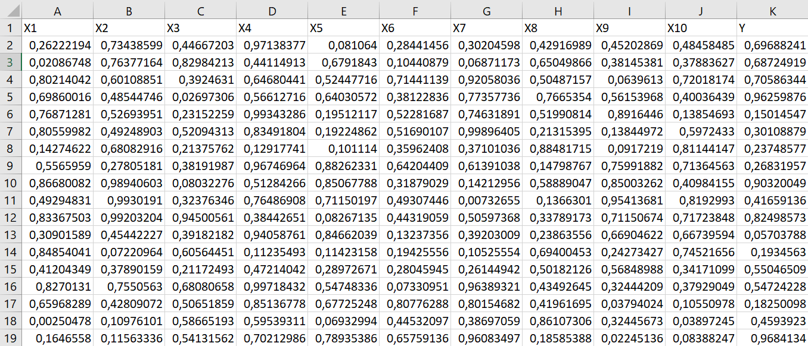
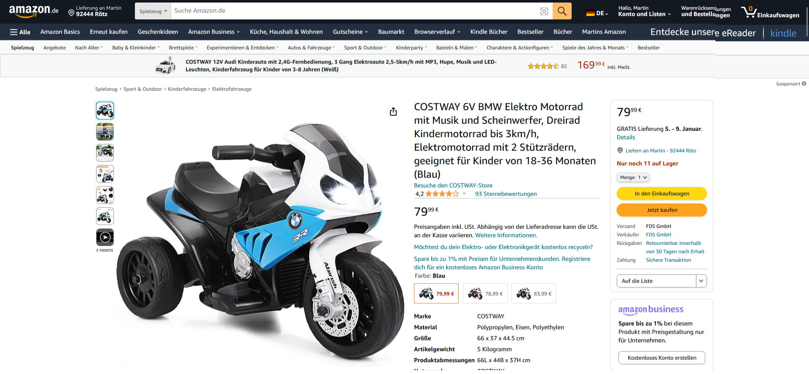
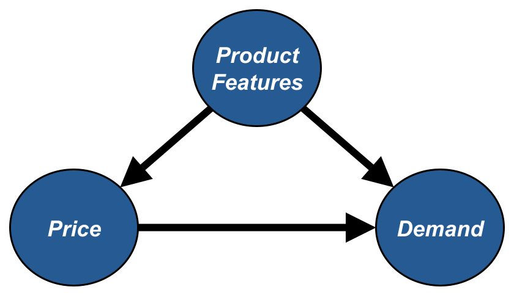
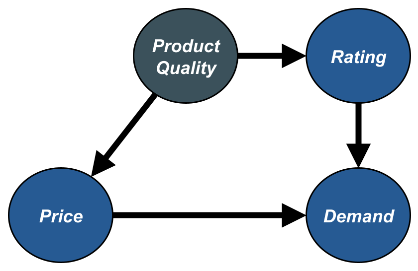
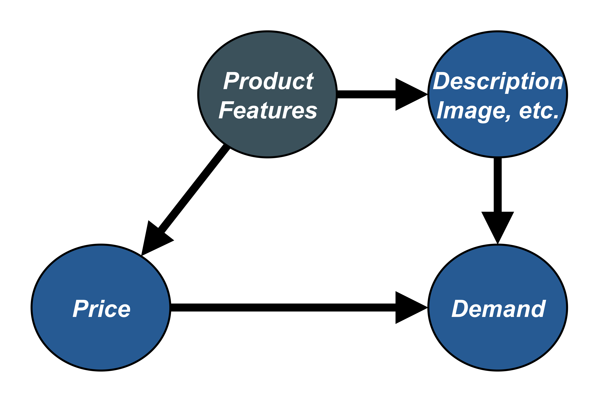
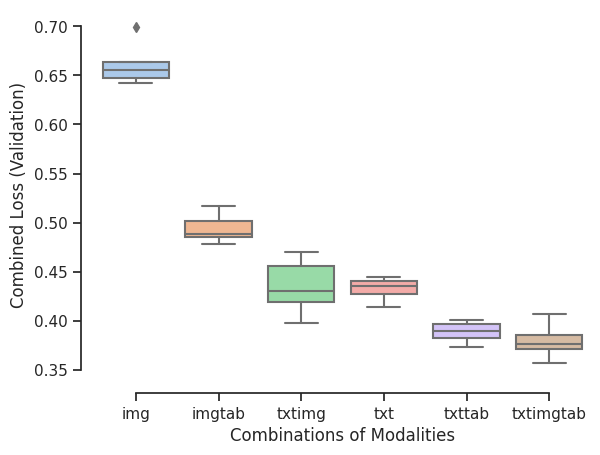
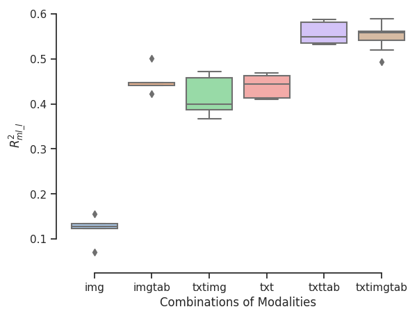
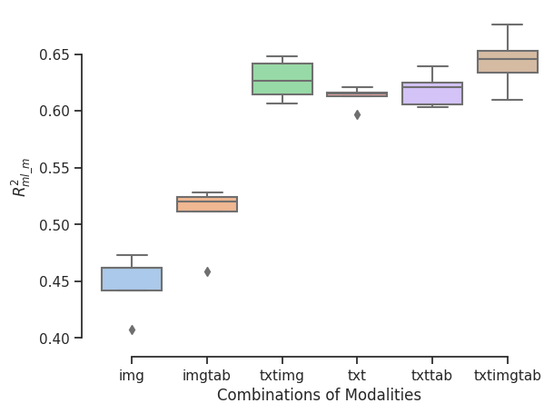
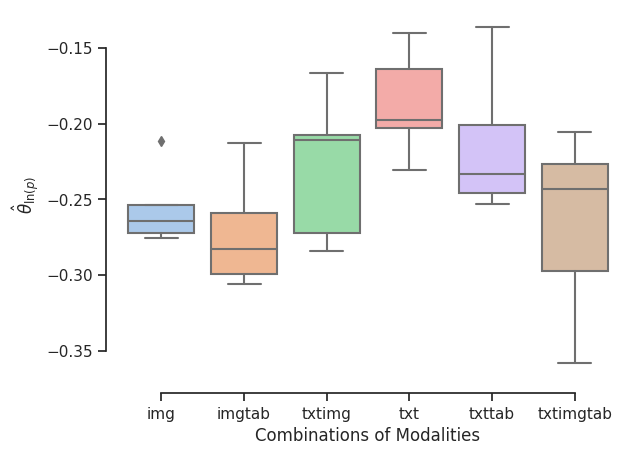

<h2 style="text-align: left; margin-top: 1.5cm;">DoubleMLDeep: Estimation of Causal Effects with LLMs and Multimodal Data</h2>

Ausschuss für Ökonometrie   23.03.2024

Sven Klaassen   <small>University of Hamburg   Economic AI</small>

Jan Teichert-Kluge   <small>University of Hamburg</small>

Philipp Bach   <small>University of Hamburg   Economic AI</small>

Victor Chernozhukov   <small>Massachusetts Institute of Technology</small>

 <b> Martin Spindler   <small>University of Hamburg   Economic AI</small> </b> 

# Motivation

## Motivation
{width=350}

## Motivation

{width=350}

## Motivation

{width=350} {width=350}

## Motivation

## Motivation

## Motivation

* Text and images contain important information for causal estimation.
* Here: Multimodal data as confounders
* Integrating of multimodal data into the Double / Debiased Machine Learning (DML)
* Applications in Marketing, Medicine / Health, Finance, ....
* Literature: @klaassen2024doublemldeep, @DoubleMLDeep

## Application

 Image Data

Text Data

Tabular Data

## Application: Estimation of  Price Elasticity
* Understanding price elasticity is crucial for economic analysis and business decisions
  - It influences strategies, pricing, and market dynamics
* Traditional causal methods rely on structured data, limiting their applicability
* Utilizing unstructured data enhances decision-making
* Sources like images and text contain valuable insights
  - Contain rich hidden information about unobserved confounding variables

## Double Machine Learning

#### Partially linear regression model (PLR) 

$$
\begin{align*}
&Y = D \theta_0 + g_0(X) + \varepsilon, & &\mathbb{E}[\varepsilon| P,X] = 0, \\
&D = m_0(X) + V, & &\mathbb{E}[V | X] = 0,
\end{align*}
$$

with 

:::: {.columns}

::: {.column width="50%"}

- Outcome $Y$, e.g. Demand $\ln (Q)$
- Treatment variable $D$, e.g. Price $\ln (P)$
- Additional product features $X = (X_1, \dots)$
- Stochastic errors $\varepsilon$ and $V$

:::

::: {.column width="50%"}

:::
::::

$\Rightarrow$ The causal parameter $\theta_0$ can be interpreted as price elasticity of demand!

## Double/Debiased Machine Learning (DML)

#### Double/Debiased Machine Learning (DML)

- Use machine learning methods to fit 
$$
\begin{align*}
l_0(X)&:=\mathbb{E}[Y||X]\\
m_0(X)&:=\mathbb{E}[D|X]
\end{align*}
$$
- Construct the orthogonalized score (either cross-fitting or split the sample) for a fitted nuisance learner $\hat{\eta}_0:=(\hat{l}_0, \hat{m}_0)$
$$
\psi(W,\theta,\hat{\eta}_0) := \Big(Y - \hat{l}_0(X) - \theta\big(D-\hat{m}_0(X)\big)\Big)\Big(D-\hat{m}_0(X)\Big) 
$$
- Compute the estimate as the solution of 
$$
0 = \frac{1}{n}\sum_{i=1}^n \psi(W,\hat{\theta}_0,\hat{\eta}_0)
$$

##  Double/Debiased Machine Learning (DML)

 

- Assumptions for the nuisance elements (see @dml2018)
$\lVert \hat{m}_0 - m_0 \rVert_{P,2} \times \big( \lVert \hat{m}_0 - m_0 \rVert_{P,2} +  \lVert \hat{\ell}_0 - \ell_0\rVert _{P,2}\big) \le \delta_N N^{-1/2}$

- Under some regularity conditions the estimator $\hat{\theta}_0$ concentrates in $1/\sqrt{n}$-neighborhood of $\theta_0$ and
$$
\sqrt{n}(\hat{\theta}_0 - \theta_0) \to \mathcal{N}(0,\sigma^2)
$$

. . .

$\Rightarrow$ simple approach to control for product features, *if they can be used for ML models!*

## Application

- A presumably very important feature to consider might be product quality. How to determine product quality? Maybe use average rating, number of reviews, etc.

{width=500}

. . .

$\Rightarrow$ *Additionally rely on product description and images to describe the product feature!*

# DoubleML Deep

## DoubleML Deep - Motivation

- Use product description and image *additionally* to conventional tabular features

{width=500}

## DoubleML Deep - Module Structure

{width=450}

## DoubleML Deep - Workflow

. . . 

$\Rightarrow$ More details can be found in  @klaassen2024doublemldeep

## DoubleML Deep - More Details

 

- Use pretrained models for unstructured data e.g. Bert and Beit

- Basic models for tabular data seem sufficient

- Monitor the nuisance losses
  - $\lVert \hat{l}_0 - \ln(Q) \rVert_{P,2} \le \lVert \hat{l}_0 -l_0 \rVert_{P,2} + \sigma_{\tilde{\epsilon}}$
  - $\lVert \hat{m}_0 - \ln(P) \rVert_{P,2} \le \lVert \hat{m}_0 - m_0 \rVert_{P,2} + \sigma_V$

# Application

## Amazon Toys Dataset

- Public Data from the Amazon sales platform from category toys and games for subcategories vehicles, cars and trucks.
- Using the Sales Rank as a proxy for quantities, as shown in @bajari2023hedonic.

| Variable   | Description |
| --------   | ------- |
| Sales Rank | Sales rank as weighted mean for the last 30 days  |
| Price      | Price as weighted mean for the last 30 days       |
| Text       | Combination of Title, Category, Description, etc. |
| Image      | First Image of the product                        |

## Amazon Toys Dataset
:::: {.columns .my-table}

::: {.column width="50%"}

**Continous Variables**

  * Reviews: Rating                                   
  * Reviews: Review Count                             
  * New Offer Count: Current                          
  * Count of retrieved live offers: New, FBA          
  * Count of retrieved live offers: New, FBM     

:::

::: {.column width="50%"}
**Categorical Variables**

  * Lightning Deals: Upcoming Deal  
  * Buy Box: Is FBA      

:::

::::

Scatterplots with OLS Regression of Tabular Variables and $\ln(Q)$

## Amazon Toys Dataset
#### Data Examples

:::: {.columns}

::: {.column width="50%"}

Kinsmart Set of 4 McLaren 720s Toy | ...

:::

::: {.column width="50%"}

Pixar Cars Mack Uncle Lightning...

:::

::::

## Baseline

:::: {.columns}

::: {.column width="45%"}

* Baseline estimate with tabular covariates, OLS model for regression 
  - $\ln(Q) = \theta_0 \ln(P) + \beta^T X + \epsilon$
    - $R^2 = 0.330$

| 2.5 %   | $\theta$ | 97.5 % |
| --------   | ------- | ------- |
| -0.072 | -0.046 | -0.019 |

:::

::: {.column width="55%"}

:::

::::

## Baseline

:::: {.columns}

::: {.column width="45%"}

* Estimate with tabular data as covariates $X$ in $\texttt{DoubleMLPLR}$ model with $\texttt{RandomForest}$ regressors
  - $l_0(X) := \mathbb{E}[\ln(Q)|X]$
    - $R^2_{l_0} = 0.5986$
  - $m_0(X) := \mathbb{E}[\ln(P)|X]$
    - $R^2_{m_0} = 0.1884$

| 2.5 %   | $\theta$ | 97.5 % |
| --------   | ------- | ------- |
| -0.132 | -0.1098 | -0.080 |

:::

::: {.column width="55%"}

:::

::::

## Deep Learning Models

* In this study, a variety of input data combinations were used to train $\texttt{DoubleMLPLRDeep}$ models [^top]:

| Key | Used Confounders |
| --------   | ------- |
| $\texttt{img}$ | $X = (X_{img})$ |
| $\texttt{imgtab}$ | $X = (X_{img}, X_{tab})$ |
| $\texttt{txtimg}$ | $X = (X_{txt}, X_{img})$ |
| $\texttt{txt}$ | $X = (X_{txt})$ |
| $\texttt{txttab}$ | $X = (X_{txt}, X_{tab})$ |
| $\texttt{txtimgtab}$ | $X = (X_{txt}, X_{img}, X_{tab})$ |

. . .

$\Rightarrow$ The aim is to emphasize the benefits of utilizing unstructured data.

[^top]: Subsequently, the top 5 performing instances for each combination were evaluated based on the minimum RMSE score of the validation data.

## Deep Learning Models: RMSE-Scores

:::: {.columns}

::: {.column width="50%"}

- Combined RMSE Score (Training)

:::

::: {.column width="50%"}

- Combined RMSE Score (Validation)

:::

::::

## Deep Learning Models: $R^2$-Scores

:::: {.columns}

::: {.column width="50%"}

- $R^2$ of log(Quantity) on Validation Set

:::

::: {.column width="50%"}

- $R^2$ of log(Price) on Validation Set

:::

::::

## (First) Results

:::: {.columns}

::: {.column width="50%"}

* Using different combinations of tabular, image and text data we obtain the following estimates

:::

::: {.column width="50%"}

:::

::::

## Comparison to Baseline Estimates
| Model | Covariates | $R^2_{l_0}$ |$R^2_{m_0}$ | $\hat{\theta}_0$
| --- | --- | --- | --- | --- |
| $\texttt{OLS}$ | $X=X_{tab}$ | $0.3300$ | - | $-0.0455$ |
| $\texttt{DoubleMLPLR}$ | $X=X_{tab}$ | $0.5986$ | $0.1884$ | $-0.1098$ |
| $\texttt{DoubleMLPLRDeep}$[^1] | $X=(X_{tab}, X_{txt}, X_{img})$ | $0.5990$	 | $0.6765$ | $-0.2794$|

{width=800}

[^1]: Mean values of the $\texttt{DoubleMLDeep}$ Model with tabular, text and image data as covariates.

## Outline

 

- Semi-synthetical data for evaluation

- Further applications (Finance, Medicine)

- Extensions of the [DoubleML package](https://docs.doubleml.org/stable/index.html)

- Using multiple time periods and controlling for unobserved confounder

## Double Machine Learning

## Veridical Data Science

# References

## References

::: {#refs}
:::

## Affiliations

University of Hamburg

<small>https://www.bwl.uni-hamburg.de/en/statistik/allgemein.html</small>

**Thanks for your Attention!**

