

<h2 style="text-align: left; margin-top: 1.5cm;">Estimating Price Elasticities with Text and Images</h2>

<b>Australian National University</b> Research School of Economics: Computational Economics Series   Tuesday, 11 June 2024

Sven Klaassen   <small>University of Hamburg   Economic AI</small>

<b>Jan Teichert-Kluge   <small>University of Hamburg</small></b>

Philipp Bach   <small>University of Hamburg   Economic AI</small>

Victor Chernozhukov   <small>Massachusetts Institute of Technology</small>

 Martin Spindler   <small>University of Hamburg   Economic AI</small> 

# Motivation

## Motivation

::: {.column width="45%" }

- Causal Inference mainly relies on tabular data

{fig-align="left"}

:::

::: {.column width="45%"}

- In a lot of applications additional unstructured data is available

{fig-align="right"}

:::

. . .

* We consider multimodal data as **confounders**
* Applications in Marketing, Medicine / Health, Finance, ....
  * Price elasticity of demand
  * Estimation of treatment effects conditioning on X-ray images 

## Motivating Example - PLR

#### Partially linear regression model (PLR) 

$$
\begin{align}
Y &= \theta_0 D + g_0(X) + \varepsilon, & \mathbb{E}[\varepsilon | X, D] = 0 \label{eq:plr1} \\
D &= m_0(X) + \vartheta, & \mathbb{E}[\vartheta | X] = 0 \label{eq:plr2}
\end{align}
$$

with 

:::: {.columns}

::: {.column width="50%"}

- $Y$ - outcome variable
- $D$ - policy/treatment variable
- $X = (X_1, \dots)^T$ - vector of additional controls
- $\varepsilon$, $\vartheta$ - stochastic errors

:::

::: {.column width="50%"}

{width=300}

:::

::::

## Motivating Example - Regularization Bias

* What if we simply plug-in ML predictions $\hat{g}(X)$ for $g_0(X)$ into
$Y = \theta_0D + g_0(X) + \varepsilon$?

 

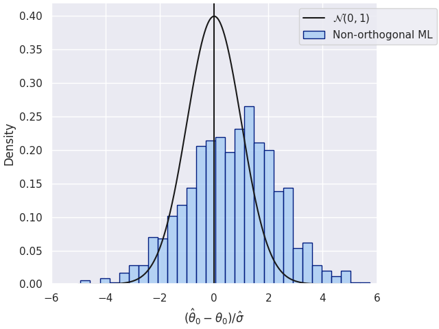{width=50%}

 

## Motivating Example - Orthogonalization

*  *Frisch-Waugh-Lovell* style approach: $\theta_0$ can be consistently estimated by **partialling out** $X$, i.e,

    1. Predict $Y$ and $D$ by $\mathbb{E}[Y|X]$ and $\mathbb{E}[D|X]$, obtained using ML methods
    2. Residualize $\tilde{Y} = Y - \mathbb{E}[Y|X]$ and $\tilde{D} = D - \mathbb{E}[D|X]$
    3.  Regress $\tilde{Y}$ on $\tilde{D}$ to obtain $\hat{\theta}$

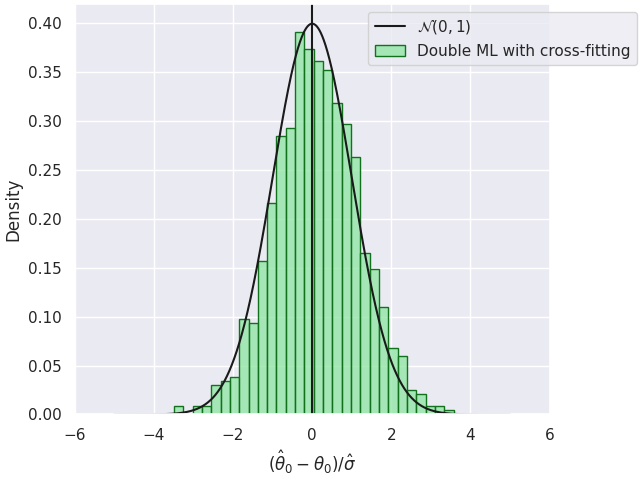{width=40%}

## Double/Debiased Machine Learning (DML)

- Use machine learning methods to fit 
$$
\begin{align*}
l_0(X)&:=\mathbb{E}[Y|X]\\
m_0(X)&:=\mathbb{E}[D|X]
\end{align*}
$$
- Construct the orthogonalized score (either cross-fitting or split the sample) for a fitted nuisance learner $\hat{\eta}:=(\hat{l}, \hat{m})$
$$
\psi(W,\theta,\hat{\eta}) := \Big(Y - \hat{l}(X) - \theta\big(D-\hat{m}(X)\big)\Big)\Big(D-\hat{m}(X)\Big) 
$$
- Compute the estimate as the solution of 
$$
0 = \frac{1}{n}\sum_{i=1}^n \psi(W,\hat{\theta},\hat{\eta})
$$

##  Double/Debiased Machine Learning (DML)

- **Neyman Orthogonality** 
  $$
  \left.\partial_\eta \mathbb{E}[\psi(W; \theta_0, \eta)] \right|_{\eta=\eta_0} = 0
  $$
  ensures that the moment condition identifying $\theta_0$ is **insensitive to small pertubations** of the nuisance function $\eta$ around $\eta_0$

- Assumptions for the nuisance elements (see @dml2018)
$\lVert \hat{m} - m_0 \rVert_{P,2} \times \big( \lVert \hat{m} - m_0 \rVert_{P,2} +  \lVert \hat{\ell} - \ell_0\rVert _{P,2}\big) \le \delta_N N^{-1/2}$

- Under some regularity conditions the estimator $\hat{\theta}$ concentrates in $1/\sqrt{n}$-neighborhood of $\theta_0$ and
$$
\sqrt{n}(\hat{\theta} - \theta_0) \to \mathcal{N}(0,\sigma^2)
$$

. . .

$\Rightarrow$ simple approach to control for confounders, *if they can be used for ML models!*

# DoubleML Deep

## DoubleML Deep - Motivation

- Use multimodal data (text and images) *additionally* to conventional tabular features

{width=750}

::: {.notes}
  
:::

## DoubleML Deep - Module Structure

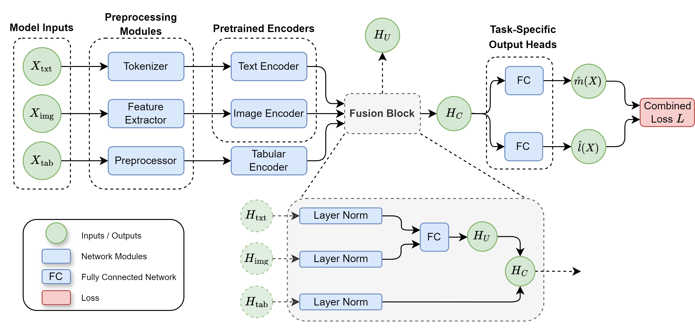{width=750}

## DoubleML Deep - Workflow

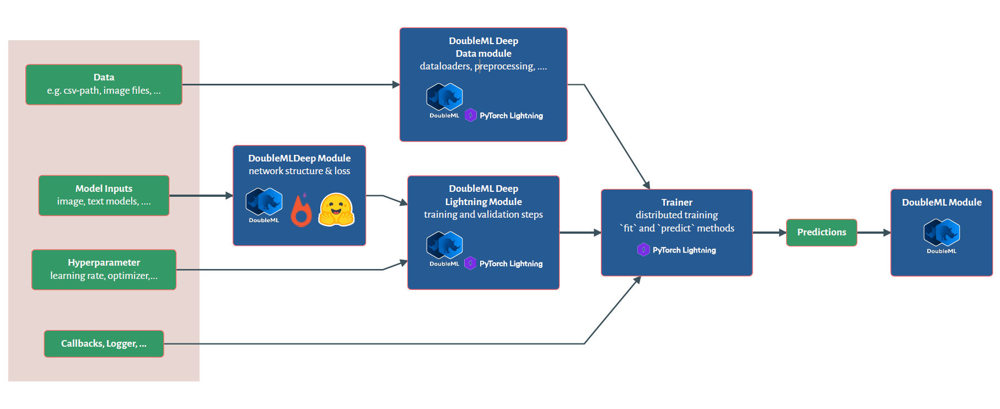

::: {.notes}
Now I would like to briefly explain the workflow of DoubleMLDeep in Python.
wor
First of all, some necessary input parameters must be defined. 
Then the actual DoubleMLDeep network can be created, which uses Hugging Face Transformer models and the Pytorch framework, among other things.

A DoubleMLDeep Data Module must be created and handles the various input data such as texts and images. This uses the Pytorch Lightning Framework.

The DoubleMLDeep Lightning Module also uses Pytorch Lightning and contains additional training parameters.

The network can now be trained with the pytorch Lightning Trainer. The corresponding predictions in the DoubleML package can then be used to obtain the estimate of the causal parameter. 
:::

## DoubleML Deep - More Details

 

- Use pretrained models for unstructured data e.g. Bert and Beit

- Basic models for tabular data seem sufficient

- Monitor the nuisance losses
  - $\lVert Y - \hat{l}(X) \rVert_{P,2} \le \lVert l_0(X) - \hat{l}(X) \rVert_{P,2} + \sigma_{\epsilon}$
  - $\lVert D - \hat{m}(X) \rVert_{P,2} \le \lVert m_0(X) - \hat{m}(X)\rVert_{P, 2} + \sigma_{\vartheta}$

::: {.notes}
- **Unstructured Data Models:** We employ pre-trained models like BERT and BEiT to extract valuable information from unstructured data, including product descriptions and images.

- **Tabular Data Models:** Basic models for tabular data have proven to be effective.

- **Monitoring Nuisance Losses:** To ensure the reliability of our estimations, we diligently monitor nuisance losses. The following conditions are crucial for assessing the quality of our models:

  - $\lVert Y - \hat{l}(X) \rVert_{P,2} &\le \lVert l_0 - \hat{l}(X) \rVert_{P,2} + \sigma_{\epsilon}$ 

  - $ \lVert D - \hat{m}(X) \rVert_{P,2} &\le \lVert m_0(X) - \hat{m}(X)\rVert_{P,2} + \sigma_{\vartheta}$

  These conditions help maintain the validity of our estimates by ensuring that the discrepancies between our estimated nuisance functions and their true counterparts, along with stochastic errors, remain within acceptable bounds.
:::

# Semi-Synthetic Data

## Original Datasets

- We generate a semi-synthetic dataset with a known treatment effect parameter
- To generate credible confounding wil be based on the **labels** or **outcomes** of the corresponding supervised learning task

- We use the following datasets:

| Modality   | Dataset | Target $\tilde{X}$  | Control $X$  |
| --------   | ------- | --------   | ------- |
| Tabular    | DIAMONDS   @{ggplot2_book}                  | $\log(\text{Price})$ | Carat, Cut, Color, Clarity, ... |
| Text       | IMDB   @{maas-EtAl:2011:ACL-HLT2011}        | Sentiment           | Review Text |
| Image      | CIFAR-10   @{Krizhevsky09learningmultiple}  | Label               | Image |

::: {.notes}

 ...

:::

## Data Generating Process

We generate a semi-synthetic dataset according to the underlying PLR model
$$
\begin{align}
Y &= \theta_0 D + \tilde{g}_0(\tilde{X}) + \varepsilon, \\
D &= \tilde{m}_0(\tilde{X}) + \vartheta, 
\end{align}
$$
where $\tilde{X}= (\tilde{X}_{\text{tab}}, \tilde{X}_{\text{txt}}, \tilde{X}_{\text{img}})$ with the following additive structure
$$
\begin{align}
\tilde{g}_0(\tilde{X}) &= \sum_{\text{mod}\in\{\text{tab},\text{txt},\text{img}\}} \tilde{g}_{\text{mod}}(\tilde{X}_{\text{mod}}) \\
\tilde{m}_0(\tilde{X}) &= \sum_{\text{mod}\in\{\text{tab},\text{txt},\text{img}\}} \tilde{m}_{\text{mod}}(\tilde{X}_{\text{mod}}) 
\end{align}
$$
and $\varepsilon, \vartheta \sim \mathcal{N}(0, 1)$.

::: {.notes}

...

:::

## Data Generating Process

* The effect on the outcome $Y$ is generated via a standardized version of target variable to balance the confounding impact of all modalities:
$$
\begin{align}
    \tilde{g}_{\text{mod}}(\tilde{X}_{\text{mod}}) = \frac{\tilde{X}_{\text{mod}} - \mathbb{E}[\tilde{X}_{\text{mod}}]}{\sigma_{\tilde{X}_{\text{mod}}}}, \quad \text{mod}\in\{\text{tab}, \text{txt}, \text{img}\}
\end{align}
$$
* Further, to ensure a strong confounding, the impact on the treatment $D$ is defined via:
$$
\begin{align}
    \tilde{m}_{\text{mod}}(\tilde{X}_{\text{mod}}) = -\tilde{g}_{\text{mod}}(\tilde{X}_{\text{mod}}), \quad \text{mod}\in\{\text{tab}, \text{txt}, \text{img}\}
\end{align}
$$

* The treatment effect is set to $\theta_0=0.5$ with $n=50.000$ samples in the dataset

* Both $\tilde{g}_0(X)$ and $\tilde{m}_0(X)$ are rescaled to ensure a signal-to-noise ratio of $2$ for $Y$ and $D$ (given unit variances of the error terms)

::: {.notes}

...

:::

## Challenges

* Dependency on the target of the modality $\tilde{X}_{\text{mod}}$
  - Might not be fully explained by the corresponding features $X_{\text{mod}}$
  - E.g. price of diamonds can not be fully explained by the carat, cut, color, etc.
* Consequently, the estimate $\hat{\theta}$ might only be able to account for the part of confounding which can be explained by the input features:
$$
\begin{align}
    \tilde{X}_{\text{mod}} = \mathbb{E}[\tilde{X}_{\text{mod}}|X_{\text{mod}}] + U_{\text{mod}},
\end{align}
$$
where $U_{\text{mod}}$ can not be controlled for

## Challenges

* Due to the negative sign and the additive structure, the confounding effect will ensure that higher outcomes $Y$ occur with lower treatment values $D$, creating a **negative bias**
- The independence of all three original datasets and the additive negative confounding results in a negative bias even if we only control for a subset of confounding factors

{width=500}

## Bounds for the estimation of $\theta_0$

* Since all modalities contribute a negative bias, the semi-synthetic dataset can be used as a benchmark with an oracle upper bound of an effect estimate of 
$$
\theta_0=0.5
$$
* For the lower bound, one can not account for confounding at all and evaluate a basic ordinary least squares model with outcome $Y$ on the treatment variable $D$ (excluding all confounding variables)
$$
\hat{\theta}_{\text{OLS}} = -0.4594
$$

## Bounds for the estimation of $\eta_0$

* To access the predictive performance of the nuisance models, we can rely on oracle predictions of
$$
\begin{align}
    \tilde{m}_0(\tilde{X}):= \mathbb{E}[D|\tilde{X}] \\
    \tilde{l}_0(\tilde{X}):= \mathbb{E}[Y|\tilde{X}] &= \theta_0 \tilde{m}_0(\tilde{X}) + \tilde{g}_0(\tilde{X})
\end{align}
$$
* Evaluating the oracle predictions $\tilde{m}_0(\tilde{X})$ and $\tilde{l}_0(\tilde{X})$ results in the following upper bounds for the performance of the nuisance estimators
$$
\begin{align}
    R^2(D, \tilde{m}_0(\tilde{X})) &= 0.6713\\
    R^2(Y, \tilde{l}_0(\tilde{X})) &= 0.5845
\end{align}
$$
on the whole dataset of $n=50.000$ observations

## Bounds for the estimation of $\eta_0$

* In order to compare the predictive performance of different models, a relative $r^2$-score with respect to the upper bound is defined as
$$
\begin{align}
    0 \leq r^2(D, \hat{m}) &:= \frac{R^2(D, \hat{m}(X))}{R^2(D, \tilde{m}_0(\tilde{X}))} \leq 1\\
    0 \leq r^2(Y, \hat{l}) &:= \frac{R^2(Y, \hat{l}(X))}{R^2(Y, \tilde{l}_0(\tilde{X}))} \leq 1
\end{align}
$$

## Models

:::: {.columns}

::: {.column width="30%"}

* **Baseline Model**
  - Standard DML approach, relying only on tabular data $X_{\text{tab}}$      
  - Based on the LightGBM package for estimation of the nuisance elements

:::

::: {.column width="30%"}

* **Deep Model**
  - Uses the out-of-sample predictions of $\hat{m}(X)$ and $\hat{l}(X)$ generated from the model    
  - Based on the RoBERTa Model for text modality, a VIT Model for images and a SAINT model for the tabular data

:::

::: {.column width="30%"}

* **Embedding Model**
  - Generated embedding $H_E$ is used together with the tabular features $X_{\text{tab}}$ as input for LightGBM
  - Based on the RoBERTa Model for text modality, a VIT Model for images and a SAINT model for the tabular data

:::

::::

## Simulation Results

 
 

Results of Simulation Study. Reported: mean ± sd. over five
random train-test splits

|   | Baseline | Embedding | Deep |
|---|----------|-----------|------|
| $r^2(Y, \hat{l}_0)$ | $0.31  \pm  0.01$ | $0.87 \pm  0.02$ | $\mathbf{0.90 \pm  0.01}$ |
| $r^2(D, \hat{m}_0)$ | $0.31 \pm  0.01$ | $0.87 \pm  0.02$ | $\mathbf{0.90 \pm  0.01}$ |
| $\hat{\theta}$      | $-0.32 \pm  0.01$ | $\mathbf{0.28 \pm  0.01}$ | $0.27 \pm  0.01$ |

*Higher = better (best in bold)*

## Simulation Results - Performance of $\hat{\theta}$

# Application

## Application: Estimation of  Price Elasticity

* Understanding price elasticity is crucial for economic analysis and business decisions
  - It influences strategies, pricing, and market dynamics
* Specifically in online marketplaces, unstructured data is available

 Image Data

Text Data

Tabular Data

## Amazon Toys Dataset

- Public Data from the Amazon sales platform from category toys and games for subcategories vehicles, cars and trucks.
- Using the Sales Rank as a proxy for quantities, as shown in @bajari2023hedonic.

| Variable   | Description |
| --------   | ------- |
| Sales Rank | Sales rank as weighted mean for the last 30 days  |
| Price      | Price as weighted mean for the last 30 days       |
| Text       | Combination of Title, Category, Description, etc. |
| Image      | Image of the product                        |

## Amazon Toys Dataset
:::: {.columns .my-table}

::: {.column width="50%"}

**Continous Variables**

  * Reviews: Rating                                   
  * Reviews: Review Count                             
  * New Offer Count: Current                          
  * Count of retrieved live offers: New, FBA          
  * Count of retrieved live offers: New, FBM     

:::

::: {.column width="50%"}
**Categorical Variables**

  * Lightning Deals: Upcoming Deal  
  * Buy Box: Is FBA      

:::

::::

Scatterplots with OLS Regression of Tabular Variables and $\ln(Q)$
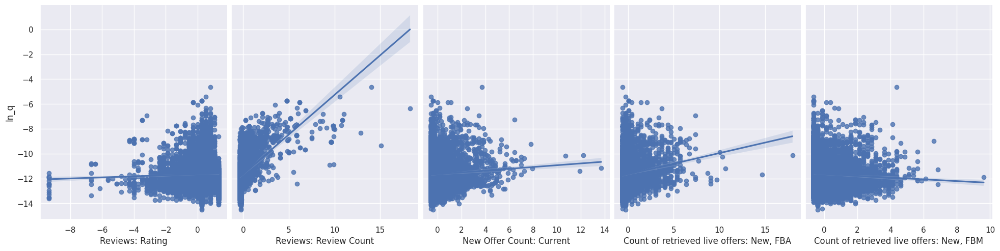

## Model

- Run a simple log-log regression model
- Images and Text block backdoor path from price to demand (or sales rank)

$$
\ln(Q_{}) = \theta_0 \ln(P) + g_0(X) + \epsilon
$$

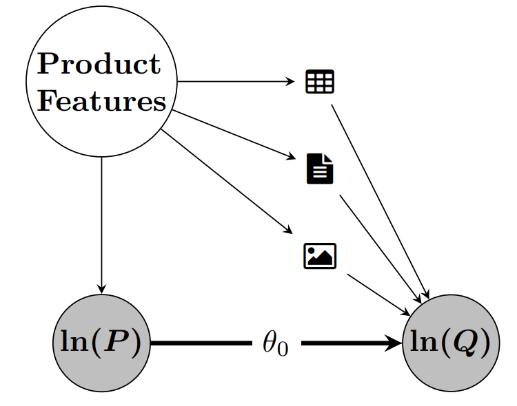{width=300}

. . .

$\Rightarrow$ The causal parameter $\theta_0$ can be interpreted as price elasticity of demand!

## Baseline OLS Model

:::: {.columns}

::: {.column width="45%"}

- Baseline estimate with tabular covariates $X_{\text{tab}}$
- OLS:
$$
\begin{align*}
  \ln(Q) =&\ \theta_0 \ln(P) + \beta^T X_{\text{tab}} + \epsilon
\end{align*}
$$
- $R^2 = 0.330$

| 2.5 %   | $\hat{\theta}$ | 97.5 % |
| --------   | ------- | ------- |
| -0.072 | -0.046 | -0.019 |

:::

::: {.column width="55%"}

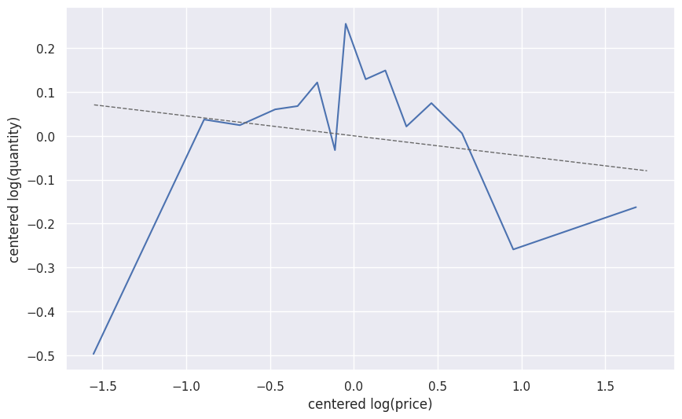

:::

::::

## Baseline DML Model

:::: {.columns}

::: {.column width="45%"}

* Estimate with tabular data as covariates $X_{\text{tab}}$ in $\texttt{DoubleMLPLR}$ model with $\texttt{RandomForest}$ regressors
  - $l_0(X_{\text{tab}}) := \mathbb{E}[\ln(Q)|X_{\text{tab}}]$
    - $R^2_{l_0} = 0.5986$
  - $m_0(X_{\text{tab}}) := \mathbb{E}[\ln(P)|X_{\text{tab}}]$
    - $R^2_{m_0} = 0.1884$

| 2.5 %   | $\theta$ | 97.5 % |
| --------   | ------- | ------- |
| -0.132 | -0.1098 | -0.080 |

:::

::: {.column width="55%"}

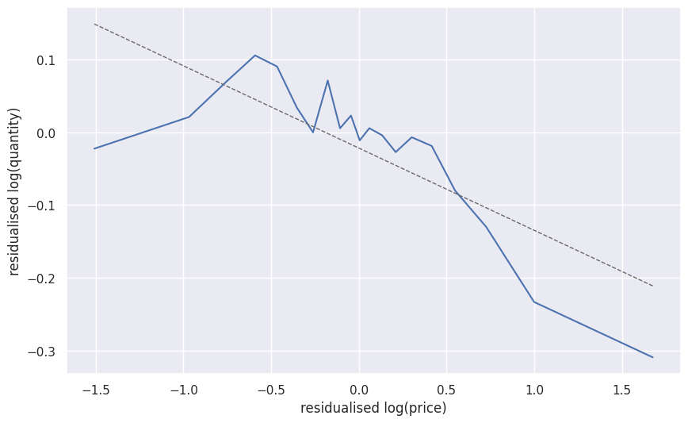

:::

::::

## Deep Learning Models

* In this study, a variety of input data combinations were used to train $\texttt{DoubleMLPLRDeep}$ models [^top]:

| Key | Used Confounders |
| --------   | ------- |
| $\texttt{img}$ | $X = (X_{img})$ |
| $\texttt{imgtab}$ | $X = (X_{img}, X_{tab})$ |
| $\texttt{txtimg}$ | $X = (X_{txt}, X_{img})$ |
| $\texttt{txt}$ | $X = (X_{txt})$ |
| $\texttt{txttab}$ | $X = (X_{txt}, X_{tab})$ |
| $\texttt{txtimgtab}$ | $X = (X_{txt}, X_{img}, X_{tab})$ |

. . .

$\Rightarrow$ The aim is to emphasize the benefits of utilizing unstructured data.

[^top]: Subsequently, the top 5 performing instances for each combination were evaluated based on the minimum RMSE score of the validation data.

## Deep Learning Models: RMSE-Scores

:::: {.columns}

::: {.column width="50%"}

- Combined RMSE Score (Training)

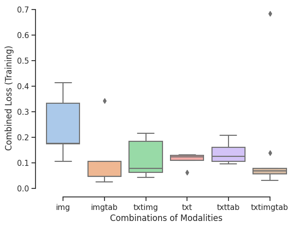

:::

::: {.column width="50%"}

- Combined RMSE Score (Validation)

:::

::::

## Deep Learning Models: $R^2$-Scores

:::: {.columns}

::: {.column width="50%"}

- $R^2$ of log(Quantity) on Validation Set

:::

::: {.column width="50%"}

- $R^2$ of log(Price) on Validation Set

:::

::::

## (First) Results

:::: {.columns}

::: {.column width="50%"}

* Using different combinations of tabular, image and text data we obtain the following estimates

:::

::: {.column width="50%"}

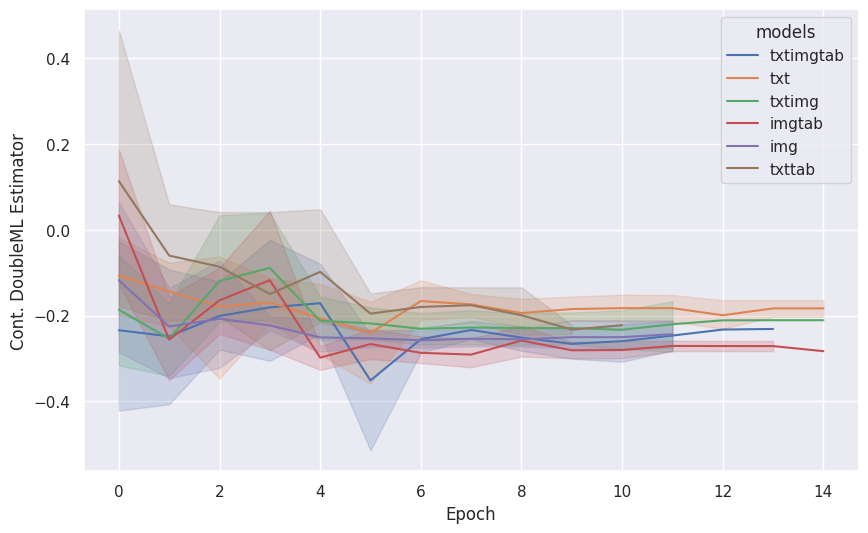

:::

::::

## Comparison to Baseline Estimates
| Model | Covariates | $R^2_{l_0}$ |$R^2_{m_0}$ | $\hat{\theta}_0$
| --- | --- | --- | --- | --- |
| $\texttt{OLS}$ | $X=X_{tab}$ | $0.3300$ | - | $-0.0455$ |
| $\texttt{DoubleMLPLR}$ | $X=X_{tab}$ | $0.5986$ | $0.1884$ | $-0.1098$ |
| $\texttt{DoubleMLPLRDeep}$[^1] | $X=(X_{tab}, X_{txt}, X_{img})$ | $0.5990$	 | $0.6765$ | $-0.2794$|

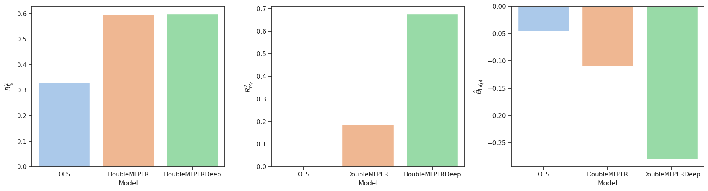{width=800}

[^1]: Mean values of the $\texttt{DoubleMLDeep}$ Model with tabular, text and image data as covariates.

## More on Double Machine Learning

:::: {.columns}

::: {.column width="75%"}

#### Papers & Book

- [CausalML Book](https://causalml-book.org/)

* R package- with a nontechnical introduction to DML: @DoubleMLR

* Python package: @bach2022doubleml

  

#### Software implementation:
* <https://github.com/DoubleML/doubleml-for-py>
* <https://github.com/DoubleML/doubleml-for-r> 
* Docu and examples: [docs.doubleml.org](https://docs.doubleml.org/stable/index.html)

:::

::: {.column width="25%"}

:::

::::

## Thank you!

#### GitHub Repository

If you like our package, you can leave us a :star: on [GitHub](https://github.com/DoubleML/doubleml-for-py)

#### Contact

In case you have questions or comments, feel free to contact me

<jan.teichertkluge@uni-hamburg.de>

# References

## References

::: {#refs}
:::

# Appendix

## Amazon Toys Dataset
#### Data Examples

:::: {.columns}

::: {.column width="50%"}

Kinsmart Set of 4 McLaren 720s Toy | ...

:::

::: {.column width="50%"}

Pixar Cars Mack Uncle Lightning...

:::

::::

## Neyman Orthogonality

The naive approach minimizes the following MSE

\begin{align}
min_{\theta} \mathbb{E}[(Y - D\theta_0 - g_0(X))^2]
\end{align}

This implies the following moment equation

\begin{align}
\mathbb{E}[\underbrace{(Y - D\theta_0 - g_0(X))D}_{=:\psi (W, \theta_0, \eta)}]&=0
\end{align}

. . .

Whereas for the partialling-out approach minimizes

\begin{align}
min_{\theta} \mathbb{E}\big[\big(Y - \mathbb{E}[Y|X] - (D-\mathbb{E}[D|X])\theta\big)^2\big]
\end{align}

which implies

\begin{align}
\mathbb{E}\big[\underbrace{\big(Y - \mathbb{E}[Y|X] - (D-\mathbb{E}[D|X])\theta\big)(D-\mathbb{E}[D|X])}_{=:\psi (W, \theta_0, \eta)}\big]&=0
\end{align}

## Neyman Orthogonality

:::: {.columns}

::: {.column width="50%"}

#### Naive approach

\begin{align}
\psi (W, \theta_0, \eta) = & (Y - D\theta_0 - g_0(X))D
\end{align}

 

Regression adjustment score

\begin{align}
\eta &= g(X), \\
\eta_0 &= g_0(X).
\end{align}

:::

::: {.column width="50%"}

#### FWL partialling out

\begin{align}
\psi (W, \theta_0, \eta_0) = &  \Big((Y- E[Y|X])\\
&-(D-E[D|X])\theta_0\Big)\\
& (D-E[D|X])
\end{align}

Neyman-orthogonal score (Frisch-Waugh-Lovell)

\begin{align}
\eta &= (\ell(X), m(X)), \\
\eta_0 &= ( \ell_0(X), m_0(X)), \\
&= ( \mathbb{E} [Y \mid X], \mathbb{E}[D \mid X]).
\end{align}

:::

::::

## DML Key Ingredients

#### 1. Neyman Orthogonality

* Inference is based on a moment condition that satisfies the **Neyman orthogonality condition** $\psi(W; \theta, \eta)$
$$E[\psi(W; \theta_0, \eta_0)] = 0,$$

* where $W:=(Y,D,X,Z)$ and with $\theta_0$ being the unique solution that obeys the **Neyman orthogonality condition**
$$\left.\partial_\eta \mathbb{E}[\psi(W; \theta_0, \eta)] \right|_{\eta=\eta_0} = 0.$$

* $\partial_{\eta}$ denotes the pathwise (Gateaux) derivative operator

## DML Key Ingredients

#### 1. Neyman Orthogonality

* **Neyman orthogonality** ensures that the **moment condition** identifying $\theta_0$ is **insensitive to small pertubations** of the nuisance function $\eta$ around $\eta_0$

* Using a Neyman-orthogonal score **eliminates the first order biases** arising from the replacement of $\eta_0$ with a ML estimator $\hat{\eta}_0$

* PLR example: Partialling-out score function
$$\psi(\cdot)= (Y-E[Y|X]-\theta (D - E[D|X]))(D-E[D|X])$$

## DML Key Ingredients

#### 2. High-Quality Machine Learning Estimators

* The nuisance parameters are estimated with high-quality (fast-enough converging) machine learning methods.

* Different structural assumptions on $\eta_0$ lead to the use of different machine-learning tools for estimating $\eta_0$ @dml2018 (Section 3)

* Rate requirements depend on the causal model and orthogonal score, e.g. (see @dml2018), 
    * PLR, partialling out: $\lVert \hat{m}_0 - m_0 \rVert_{P,2} \times \big( \lVert \hat{m}_0 - m_0 \rVert_{P,2} +  \lVert \hat{\ell}_0 - \ell_0\rVert _{P,2}\big) \le \delta_N N^{-1/2}$
    * IRM/DR score, ATE: $\lVert \hat{m}_0 - m_0 \rVert_{P,2} \times \lVert \hat{\ell}_0 - \ell_0\rVert _{P,2} \le \delta_N N^{-1/2}$

## DML Key Ingredients

#### 3. Sample Splitting

* To avoid the biases arising from overfitting, a form of **sample splitting** is used at the stage of producing the estimator of the main parameter $\theta_0$.

* Efficiency gains by using cross-fitting (swapping roles of samples for train / hold-out)

<iframe width="650" height="385" src="https://www.youtube.com/embed/NWEoLe8mZqM?si=YQg6wjRRzIjQ_Rwr" title="YouTube video player" frameborder="0" allow="accelerometer; autoplay; clipboard-write; encrypted-media; gyroscope; picture-in-picture" allowfullscreen></iframe>

## DML Key Ingredients

#### Main result in @dml2018

> There exist regularity conditions, such that the DML estimator $\tilde{\theta}_0$ concentrates in a $1/\sqrt{N}$-neighborhood of $\theta_0$ and the sampling error is approximately
$$\sqrt{N}(\tilde{\theta}_0 - \theta_0) \sim N(0, \sigma^2),$$
with
$$\begin{align}\begin{aligned}\sigma^2 := J_0^{-2} \mathbb{E}(\psi^2(W; \theta_0, \eta_0)),\\J_0 = \mathbb{E}(\psi_a(W; \eta_0)).\end{aligned}\end{align}$$

* See [this example](https://doubleml.shinyapps.io/BasicsDMLApp/) based on @dml2018

