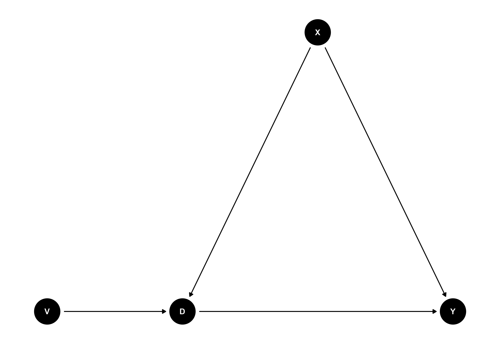

---
title: "Behavioral Dynamics in Negotiations: How Specific Verbal Behaviors Shape Outcomes and Processes"
subtitle: "A (Causal) Data Science Perspective"
---


# Introduction and Setup {transition="concave-in"}

## Setup

- I have used Python with the following libraries to analyze the data and create the presentation: numpy, pandas, matplotlib, seaborn, sklearn, scipy, statsmodels, and doubleml.

- Check the versions:
```{python}
# Checking the version of all the specified Python libraries
import numpy as np
import pandas as pd
import matplotlib
import seaborn as sns
import sklearn
import scipy
import statsmodels as sm
import doubleml as dml

# Creating a dictionary to store the library names and their versions
library_versions = {
    'numpy': np.__version__,
    'pandas': pd.__version__,
    'matplotlib': matplotlib.__version__,
    'seaborn': sns.__version__,
    'sklearn': sklearn.__version__,
    'scipy': scipy.__version__,
    'statsmodels': sm.__version__,
    'doubleml': dml.__version__
}

print(library_versions)

```


## Setup

:::{style="font-size: 75%;"}
- Load and prepare the data and check the first few rows:
```{python}
import numpy as np
import pandas as pd
import matplotlib
import matplotlib.pyplot as plt
import seaborn as sns
from sklearn import metrics
from sklearn.dummy import DummyClassifier
from sklearn.model_selection import cross_val_score
from sklearn.linear_model import LogisticRegressionCV
from sklearn.model_selection import train_test_split
from sklearn.preprocessing import Normalizer
from sklearn.preprocessing import scale
from sklearn.preprocessing import StandardScaler

import scipy.stats as stats
import statsmodels.api as sm
from statsmodels.formula.api import ols, logit

sns.set_theme() # project_1\Eigenschaften_Videos_2025.xlsx
df = pd.read_excel(r"../Unterschiede_Agreement_Impasse_DF.xlsx")
df_vid = pd.read_excel(r"../Eigenschaften_Videos_2025.xlsx")
df["num_label"] = df["LABEL"]
df["num_label"].replace({"Agree": 1, "Impasse": 0}, inplace=True)
df.drop(columns=["Others", "Ommission"], inplace=True) # Drop Others Col? TO DO: @JE

df.rename(columns={col: col.strip() for col in df.columns}, inplace=True)
# Single / Multi - Issue Offer durch Activity ergänzen
matplotlib.style.use("../apa.mplstyle") # selecting the style sheet

df = pd.merge(left=df, right=df_vid, left_on="Set", right_on="Set / Bezeichnung Interact")
df.drop(columns=["Set", "Video-Nr.", "Set / Bezeichnung Interact"], inplace=True)
df.rename(columns={"Single-issue offer": "Single-issue activity",
                   "Multi-issue offer": "Multi-issue activity"},
          inplace=True)
behav_cols = [col for col in df.columns if col not in df_vid.columns]

df.head()
```

:::


## Introduction

- The data consists of $n=40$ negotiations with $Y \in \{0, 1\}$ different outcomes ($1=\text{Agree}$, $0=\text{Impasse}$).
- The negotiations were recorded and then analyzed for $B \in \mathbb{N}^{b=47}$ specific verbal behaviors (Count Data).
- We are in a high-dimensional setting with $b=47$ verbal behaviors $B$
- The data also contains $X \in \mathbb{R}^{p}$ covariates that describe the negotiation context and the negotiators (Spoken Language, Team Sizes).
- The goal is to understand how these verbal behaviors shape the negotiation outcomes.
- We will use a causal data science perspective to analyze the data and draw insights.

## Some descriptive statistics

```{python}
df_summed = df[behav_cols].drop(columns=["num_label"]).groupby("LABEL").sum()
df_summed.T.sort_values(by=["Impasse", "Agree"]).plot.barh(stacked=True, figsize=(8,6))
plt.legend(title = 'Negotiation Outcome')
#df_summed.sort_values(by=0).plot.barh(figsize=(8,12), legend=False)
plt.title("Count of Verbal Behaviors by Negotiation Outcome")
plt.xlabel("Count of Verbal Behaviors")
plt.ylabel("Verbal Behaviors")
plt.show()
```

## Differences in Verbal Behaviors by Outcome

:::{style="font-size: 75%;"}

```{python}
import pandas as pd
import numpy as np
from scipy.stats import shapiro, levene, ttest_ind, mannwhitneyu
from statsmodels.stats.multitest import multipletests
from sklearn.preprocessing import PowerTransformer

def subgroup_analysis_two_groups(df, group_col, feature_cols):
    results = []
    pt = PowerTransformer()

    # Scale the data
    X_df = df[feature_cols]
    Y_df = df[[group_col]]
    X_scaled = pd.DataFrame(pt.fit_transform(X_df), index=X_df.index, columns=X_df.columns)
    df_scaled = X_scaled.join(Y_df)

    # Separate groups
    group_0 = df[df[group_col] == 0]
    group_1 = df[df[group_col] == 1]
    group_0_scaled = df_scaled[df_scaled[group_col] == 0]
    group_1_scaled = df_scaled[df_scaled[group_col] == 1]

    for column in feature_cols:
        # Original data analysis
        _, p_norm0 = shapiro(group_0[column])
        _, p_norm1 = shapiro(group_1[column])
        _, p_var = levene(group_0[column], group_1[column])

        if p_norm0 > 0.05 and p_norm1 > 0.05 and p_var > 0.05:
            # Standard t-test
            t_stat, p_value = ttest_ind(group_0[column], group_1[column])
            test_type = 'Standard t-test'
        elif p_norm0 > 0.05 and p_norm1 > 0.05:
            # Welch's t-test
            t_stat, p_value = ttest_ind(group_0[column], group_1[column], equal_var=False)
            test_type = "Welch's t-test"
        else:
            # Mann-Whitney U test
            t_stat, p_value = mannwhitneyu(group_0[column], group_1[column])
            test_type = 'Mann-Whitney U test'

        mean_diff = group_0[column].mean() - group_1[column].mean()

        # Scaled data analysis
        _, p_norm0_scaled = shapiro(group_0_scaled[column])
        _, p_norm1_scaled = shapiro(group_1_scaled[column])
        _, p_var_scaled = levene(group_0_scaled[column], group_1_scaled[column])

        if p_norm0_scaled > 0.05 and p_norm1_scaled > 0.05 and p_var_scaled > 0.05:
            t_stat_scaled, p_value_scaled = ttest_ind(group_0_scaled[column], group_1_scaled[column])
            test_type_scaled = 'Standard t-test'
        elif p_norm0_scaled > 0.05 and p_norm1_scaled > 0.05:
            t_stat_scaled, p_value_scaled = ttest_ind(group_0_scaled[column], group_1_scaled[column], equal_var=False)
            test_type_scaled = "Welch's t-test"
        else:
            t_stat_scaled, p_value_scaled = mannwhitneyu(group_0_scaled[column], group_1_scaled[column])
            test_type_scaled = 'Mann-Whitney U test'

        mean_diff_scaled = group_0_scaled[column].mean() - group_1_scaled[column].mean()

        results.append({
            'feature': column,
            'test_type': test_type,
            'test_stat': t_stat,
            'p_value': p_value,
            'mean_difference': mean_diff,
            'scaled_test_type': test_type_scaled,
            'scaled_test_stat': t_stat_scaled,
            'scaled_p_value': p_value_scaled,
            'scaled_mean_difference': mean_diff_scaled
        })

    # Adjust p-values for multiple testing
    p_values = [result['p_value'] for result in results]
    _, adjusted_p_values, _, _ = multipletests(p_values, method='bonferroni')

    for i, result in enumerate(results):
        result['adjusted_p_value'] = adjusted_p_values[i]

    results_df = pd.DataFrame(results)
    return results_df


result_outcome_diff = subgroup_analysis_two_groups(df, "num_label", behav_cols[:-2])
result_outcome_diff.sort_values(by="p_value", ascending=True)
```

:::

## Differences in Verbal Behaviors by Outcome

- The process of subgroup analysis was conducted to compare the verbal behaviors between the two negotiation outcomes (Agree and Impasse).
- This yields a first subset $\tilde{B}_1 \subset B$ of verbal behaviors that show significant differences between the two outcomes.
- We will use this subset to further analyze the data and build a predictive model.

```{python}	
s1 = list(result_outcome_diff[result_outcome_diff["p_value"] < 0.05]["feature"].values)
print(s1)
```

## Differences in Verbal Behaviors by Language

- We can also analyze the differences in verbal behaviors based on the spoken language.
- This will help us understand how the language used in negotiations affects the outcomes.
- But we have to use another approach to handle the categorical variable "Language" because we have more than two groups.

:::{style="font-size: 75%;"}

```{python}
import pandas as pd
import numpy as np
from scipy.stats import shapiro, levene, f_oneway, kruskal, ttest_ind
from statsmodels.stats.multitest import multipletests

def subgroup_analysis(df, group_col, variable_cols):
    results = []
    for variable in variable_cols:
        # print(f"Analyzing {variable}...")

        groups = [df[df[group_col] == group][variable] for group in df[group_col].unique()]

        # Check normality (Shapiro-Wilk test)
        normality_results = [shapiro(group)[1] for group in groups]
        is_normal = all(p > 0.05 for p in normality_results)

        # Check homogeneity of variances (Levene's test)
        homogeneity_p = levene(*groups)[1]
        is_homogeneous = homogeneity_p > 0.05

        # Choose the appropriate test
        if is_normal and is_homogeneous:
            # One-way ANOVA
            test_stat, p_value = f_oneway(*groups)
            test_name = "One-way ANOVA"
        elif is_normal and not is_homogeneous:
            # Welch's ANOVA
            test_stat, p_value = f_oneway(*groups)  # Note: Welch's ANOVA implementation would require an external library like `pingouin`
            test_name = "Welch's ANOVA (approximate)"
        else:
            # Kruskal-Wallis H-test
            test_stat, p_value = kruskal(*groups)
            test_name = "Kruskal-Wallis H-test"

        results.append({
            'variable': variable,
            'test_name': test_name,
            'test_statistic': test_stat,
            'p_value': p_value,
            'normality_p_values': normality_results,
            'homogeneity_p_value': homogeneity_p
        })

    # Adjust p-values for multiple testing (Bonferroni correction)
    p_values = [result['p_value'] for result in results]
    _, adjusted_p_values, _, _ = multipletests(p_values, method='bonferroni')

    for i, result in enumerate(results):
        result['adjusted_p_value'] = adjusted_p_values[i]

    results_df = pd.DataFrame(results)
    return results_df
  
result_lang_diff = subgroup_analysis(df, 'Sprache', behav_cols[:-2])

result_lang_diff.sort_values(by="p_value", ascending=True)

```

:::

## Differences in Verbal Behaviors by Language

```{python}
result_lang_diff.set_index("variable")["p_value"].sort_values(ascending=False).plot.barh(figsize=(8,6), legend=False)
plt.axvline(0.05, linestyle="--")
plt.title("p-values for differences in means for language subgroups")
plt.xlabel("p-value")
plt.ylabel("Verbal Behaviors")
plt.show()
```

# Main Analysis {transition="concave-out"}

## Causal Data Science Perspective

- We will use a causal data science perspective to analyze the data.
- The goal is to understand the causal relationships between the verbal behaviors and the negotiation outcomes.
- We will use different appraoches to estimate the causal effects:
    - Penalized Logistic Regression
    - Penalized Linear Regression (LASSO) as Linear Probability Model (LPM)
      - Both Methods as a Baseline Comparison
    - Double / Post Selection Methods (following Belloni)
    - Double Machine Learning (DML)
      - DML Setting for Partially Linear Models with LASSO
      - DML Setting for Partially Linear Models with Non-Linear Models

## Variable Importance

- We will start by analyzing the variable importance using the penalized methods.
- This will help us identify the most important behaviors that influence the negotiation outcomes.
- We will use the LASSO method to perform variable selection and build a predictive model.
- For robustness we repeat the analysis with different train-test splits for $N_{VI}$ times.
- We yield a subset $\tilde{B}_2 \subset B$ of verbal behaviors that are important for predicting the negotiation outcomes.
  - Condition for inclusion: Variable is selected in at least 50% of the runs.
  - Formal: $\tilde{B}_2 = \{b \in B \mid \frac{1}{N_{VI}} \sum_{i=1}^{N_{VI}} \mathbb{1}_{b \in \tilde{B}_2^{(i)}} \geq 0.5\}$

## Variable Importance

:::{style="font-size: 75%;"}
```{python}	
from sklearn.model_selection import RepeatedKFold, cross_validate
from sklearn.compose import TransformedTargetRegressor
from sklearn.linear_model import Ridge
from sklearn.pipeline import make_pipeline
from sklearn.compose import make_column_transformer
from sklearn.preprocessing import PowerTransformer
from sklearn.preprocessing import FunctionTransformer

num_features = behav_cols[:-2]
X_df = df[behav_cols[:-2]]
Y_df = df["num_label"]

clf = LogisticRegressionCV(penalty="l1", solver="liblinear", max_iter=10000)

np.random.seed(450)

preprocessor = make_column_transformer(
    (PowerTransformer(), num_features),
    #(FunctionTransformer(np.sqrt), num_features),
    remainder="passthrough",
    verbose_feature_names_out=False,  # avoid to prepend the preprocessor names
)


prpr = FunctionTransformer(np.sqrt)


model = make_pipeline(
    preprocessor,
    #prpr,
    clf,
)

cv = RepeatedKFold(n_splits=10, n_repeats=20, random_state=420)
cv_model = cross_validate(
    model,
    X_df,
    Y_df,
    cv=cv,
    scoring="accuracy",
    return_estimator=True,
)

print(cv_model["test_score"].mean(), cv_model["test_score"].std())

scores = cross_val_score(
    clf, X_df, Y_df, cv=5, scoring='accuracy')

print(f"Average Acc.: {scores.mean()} with std {scores.std()}")
```
:::

## Variable Importance

```{python}
coefs = pd.DataFrame(
    [
        est[-1].coef_.squeeze() * preprocessor.fit_transform(X_df.iloc[train_idx]).std(axis=0)
        for est, (train_idx, _) in zip(cv_model["estimator"], cv.split(X_df, Y_df))
    ],
    columns=num_features,
)
coefs_nonzero = coefs.replace(0, np.NaN)
coefs_nonzero.describe()
sort_col = list({k: v for k, v in sorted(dict(coefs_nonzero.count()).items(), key=lambda item: item[1], reverse=True)}.keys())

plt.figure(figsize=(8, 6))
sns.stripplot(data=coefs_nonzero[sort_col], orient="h", palette="dark:k", alpha=0.1, jitter=True)
sns.boxplot(data=coefs_nonzero[sort_col], orient="h", color="lightblue", saturation=0.5, whis=10)
plt.axvline(x=0, color=".5")
plt.xlabel("Coefficient Importance")
plt.title("Coefficient importance and its variability")
# plt.suptitle("Elastic Net Model, small regularization")
plt.subplots_adjust(left=0.3)
plt.show()
```

## Variable Importance

```{python}
coef_count = pd.DataFrame((coefs != 0).sum(), columns=["Non-Zero Count"]).sort_values("Non-Zero Count", ascending=True)
coef_count.plot.barh(figsize=(8, 6), legend=False, xlabel="Non-Zero Count")
plt.axvline(100, linestyle="--")
plt.xlim(0, 200)
plt.title("Number of Non-Zero Coefficients in penalized Logit Model")
plt.show()
```

## Variable Importance

- The variable importance analysis using the penalized logistic regression method yields a subset $\tilde{B}_2$ of verbal behaviors that are important for predicting the negotiation outcomes.

```{python}
s2 = list(coef_count[coef_count["Non-Zero Count"] > 100].index)
print(s2)
```

- Compare $\tilde{B}_2$ with $\tilde{B}_1$ to identify the most important verbal behaviors that influence the negotiation outcomes:
  - $\tilde{B}_{1 \cap 2} = \tilde{B}_1 \cap \tilde{B}_2$

```{python}
important_behaviors = set(s1).intersection(set(s2))
print(important_behaviors)
```


## A deeper dive into the important behaviors

- We will now analyze the important behaviors in more detail.
- We want to show the distrubution of these behaviors for the two negotiation outcomes.
- This will help us understand how these behaviors differ between the outcomes.

## A deeper dive into the important behaviors

```{python}
fig, axs = plt.subplots(4, 3, figsize=(10, 8))
axs = axs.flatten()
for i, col in enumerate(s2):
    sns.histplot(data=df, x=col, hue='num_label', kde=True, ax=axs[i], legend=False)
    axs[i].set_title(col)
    axs[i].set_xlim(0,)

plt.tight_layout()
plt.show()
```

## A deeper dive into the important behaviors

- We can also analyze the relationship between the important behaviors and the negotiation outcomes.
- We will use scatter plots to visualize this relationship.
- This will help us understand how these behaviors influence the negotiation outcomes.

## A deeper dive into the important behaviors

```{python}
fig, axs = plt.subplots(4, 3, figsize=(10, 8))
axs = axs.flatten()
for i, col in enumerate(s2):
    sns.scatterplot(data=df, x=col, y='num_label', ax=axs[i])
    sns.regplot(data=df, x=col, y='num_label', ax=axs[i], scatter=False, color='red')
    axs[i].set_title(col)
    axs[i].set_xlim(0,)
    axs[i].set_ylim(-0.2, 1.2)

plt.tight_layout()
plt.show()
```

# Causal Inference {transition="concave-in"}

## Causal Inference with Double Machine Learning

- We will now use the Double Machine Learning (DML) approach to estimate the causal effects of the verbal behaviors on the negotiation outcomes.

Consider the following DAG

{width="50%"}


## What is Double/Debiased Machine Learning (DML)?

- DML is a general framework for **causal inference** and estimation of causal parameters based on **machine learning**

$$\begin{align*}
&Y = D \theta_0 + g_0(X) + \zeta, & &\mathbb{E}[\zeta | D,X] = 0, \\
&D = m_0(X) + V, & &\mathbb{E}[V | X] = 0,
\end{align*}
$$

with 

:::: {.columns}

::: {.column width="50%"}

* Outcome variable $Y$
* Policy or treatment variable of interest $D$
* High-dimensional vector of confounding covariates $X = (X_1, \ldots, X_p)$
* Stochastic errors $\zeta$ and $V$

:::

::: {.column width="50%"}



:::

::::


## What is Double/Debiased Machine Learning (DML)?

*  Remember the *Frisch-Waugh-Lovell* (FWL) Theorem in a **linear regression model**

$$Y = D \theta_0 + X'\beta + \varepsilon$$

* $\theta_0$ can be consistently estimated by **partialling out** $X$, i.e,

    1. OLS regression of $Y$ on $X$: $\tilde{\beta} = (X'X)^{-1} X'Y$ $\rightarrow$ Residuals $\hat{\varepsilon}$
    
    2. OLS regression of $D$ on $X$: $\tilde{\gamma} = (X'X)^{-1} X'D$ $\rightarrow$ Residuals $\hat{\zeta}$
    
    3. Final OLS regression of $\hat{\varepsilon}$ on $\hat{\zeta}$

* Orthogonalization: The idea of the FWL Theorem can be generalized to using ML estimators instead of OLS

* Using an orthogonal score leads to an asymptotically normal estimator $\hat{\theta}_0$


## What is Double/Debiased Machine Learning (DML)?


**Neyman Orthogonality**

:::: {.columns}

::: {.column width="50%"}

**Naive approach**

\begin{align}
\psi (W, \theta_0, \eta) = & (Y - D\theta_0 - g_0(X))D
\end{align}

<br>

**Regression adjustment score**

\begin{align}
\eta &= g(X), \\
\eta_0 &= g_0(X),
\end{align}


:::

::: {.column width="50%"}


**FWL partialling out**

\begin{align}
\psi (W, \theta_0, \eta_0) = &  \Big((Y- E[Y|X])\\
&-(D-E[D|X])\theta_0\Big)\\
& (D-E[D|X])
\end{align}

**Neyman-orthogonal score (Frisch-Waugh-Lovell)**

\begin{align}
\eta &= (\ell(X), m(X)), \\
\eta_0 &= ( \ell_0(X), m_0(X)) \\
&= ( \mathbb{E} [Y \mid X], \mathbb{E}[D \mid X])
\end{align}

:::

::::

## DML with Partially Linear Models

- We will use the DML approach to estimate the causal effects of the verbal behaviors on the negotiation outcomes.
- We will consider a partially linear model with LASSO for the high-dimensional confounders.
- The model can be written as follows:
  - $S = \tilde{B} \theta_0 + g_0(X) + \zeta$
  - $\tilde{B} = m_0(X) + V$
- We will use the `DoubleML` package to implement the DML approach.
- Compare to the standard Linear Probability Model (LPM) for interpretation.
  - Coefficients in LPM are not bounded between $-1$ and $1$.
- The Partially Linear Model is not tailored to the binary nature of the outcome variable, but it is a good starting point.
  - In Theory, we can use the PLM to estimate the ATE on the latent scale $y^*$ (which we want to know) with some decision threshold $\tau$ yielding the observable proxy $y$ for $y^*$:
  - $y = 1 \text{ if } y^* > \tau \text{ else } 0$
  - $ATE = \mathbb{E}[y^* |X, D, y=1] - \mathbb{E}[y^* | X, D, y=0]$


## DML with Partially Linear Models using LASSO

:::{style="font-size: 75%;"}
```{python}
np.random.seed(1234)
subset = [var for var in s2 if var not in []]

import doubleml as dml
from lightgbm import LGBMRegressor, LGBMClassifier

full_d = behav_cols[:-2]

team1_dummy = pd.get_dummies(df["Anzahl Verhandelnde Team 1"], prefix="Team1")
team2_dummy = pd.get_dummies(df["Anzahl Verhandelnde Team 2"], prefix="Team2")
lang_dummy = pd.get_dummies(df["Sprache"])
dml_df = pd.concat(
    [df, 
    lang_dummy * 1,
    team1_dummy * 1,
    team2_dummy * 1,
    ], 
    axis=1
)

confound = list(lang_dummy.columns) + list(team1_dummy.columns) + list(team2_dummy.columns)
confound_with_others = confound + [var for var in full_d if var not in subset]

#prpr = FunctionTransformer(np.sqrt)
#dml_df[subset] = prpr.fit_transform(dml_df[subset])
# Initialize the DoubleMLData object


# Eigentlich nicht so sinnvoll, da widerspruch gegen selection / in post-inference.
# dml_data = dml.DoubleMLData(
#     dml_df,
#     y_col='num_label',
#     x_cols=confound_with_others,
#     d_cols=subset
# )

dml_data_sub_only = dml.DoubleMLData(
    dml_df,
    y_col='num_label',
    x_cols=confound,
    d_cols=subset
)

dml_data_full = dml.DoubleMLData(
    dml_df,
    y_col='num_label',
    x_cols=confound,
    d_cols=full_d,
)

from sklearn.metrics import r2_score, accuracy_score

def plot_dml_res(df):
    plt.figure(figsize=(10, 6))
    plt.errorbar(df.index, df["coef"], yerr=[df["coef"] - df["2.5 %"], df["97.5 %"] - df["coef"]], fmt='o', capsize=5, label='Coefficient with 95% CI')
    plt.axhline(0, color='gray', linestyle='--', linewidth=1)
    plt.xticks(rotation=45, ha='right')
    plt.title("Coefficient Values with 95% Confidence Intervals")
    plt.xlabel("Variables")
    plt.ylabel("Coefficient")
    plt.tight_layout()
    plt.legend()
    plt.show()


def safe_r2_score(y_true, y_pred):
    subset = np.isfinite(y_true)
    return r2_score(
        y_true=y_true[subset],
        y_pred=y_pred[subset],
        force_finite=True
    )

def acc(y_true, y_pred):
    subset = np.logical_not(np.isnan(y_true))
    return accuracy_score(
        y_true=y_true[subset], 
        y_pred=y_pred[subset]
    )


from sklearn.linear_model import LogisticRegressionCV, LogisticRegression, LassoCV, PoissonRegressor, LinearRegression
from sklearn.pipeline import make_pipeline
from sklearn.preprocessing import StandardScaler

lasso_reg = make_pipeline(
    FunctionTransformer(np.sqrt),
    StandardScaler(),
    LassoCV(cv=4, random_state=42, max_iter=10000)
)

ols_reg = make_pipeline(
    FunctionTransformer(np.sqrt),
    StandardScaler(),
    LinearRegression()
)

poisson_reg = make_pipeline(
    FunctionTransformer(np.sqrt),
    StandardScaler(),
    #LassoCV(cv=3, random_state=42)
    PoissonRegressor(alpha=1, max_iter=10000)
)

lasso_class = make_pipeline(
    FunctionTransformer(np.sqrt),
    StandardScaler(),
    LogisticRegressionCV(
        penalty='l2', 
        cv=4, 
        random_state=42, 
        max_iter=10000
        )
)

ols_class = make_pipeline(
    FunctionTransformer(np.sqrt),
    StandardScaler(),
    LogisticRegression(penalty=None, random_state=42, max_iter=10000)
)

dml_plr_sub_lasso = dml.DoubleMLPLR(
    dml_data_sub_only,
    ml_l = ols_class,
    ml_m = lasso_reg,
    n_folds=4,
    n_rep=10,
    score='partialling out'
)
```
:::

- Lets use the DML PLM Model on the Subset of Important Behaviors $\tilde{B}_2$.
```{python}
dml_plr_sub_lasso.fit()
plot_dml_res(dml_plr_sub_lasso.summary.sort_values("P>|t|", ascending=True).where(dml_plr_sub_lasso.summary["P>|t|"] < 0.05).dropna())
```


## DML with Partially Linear Models using LASSO

- And maybe on the full set of Behaviors $B$.
```{python}
dml_plr_full_lasso = dml.DoubleMLPLR(
    dml_data_full,
    ml_l = lasso_class,
    ml_m = lasso_reg,
    n_folds=4,
    n_rep=10,
    score='partialling out'
)
dml_plr_full_lasso.fit()
plot_dml_res(dml_plr_full_lasso.summary.sort_values("P>|t|", ascending=True).where(dml_plr_full_lasso.summary["P>|t|"] < 0.05).dropna())
```


## DML with Partially Linear Models using Non Linear Methods

- We will now use the DML approach with non-linear methods to estimate the causal effects of the subset $\tilde{B}_2$ of verbal behaviors on the negotiation outcomes.

```{python}
from flaml import AutoML

automl_l = AutoML()
automl_l.fit(
    X_train=dml_df[confound + subset].values, 
    y_train=dml_df["num_label"].values, 
    task="classification",
    metric="f1",
    time_budget=60,
    verbose=1,
  )

from lightgbm import LGBMRegressor
from catboost import CatBoostRegressor, CatBoostClassifier


dml_plr_subset_autoboost = dml.DoubleMLPLR(
    dml_data_sub_only,
    ml_l = automl_l.model.estimator,
    ml_m = LGBMRegressor(verbose=-1, learning_rate=0.1, n_estimators=1000),
    n_folds=4,
    n_rep=5,
    score='partialling out'
)

dml_plr_subset_autoboost.fit()
plot_dml_res(dml_plr_subset_autoboost.summary.sort_values("P>|t|", ascending=True).where(dml_plr_subset_autoboost.summary["P>|t|"] < 0.05).dropna())

```

## DML with Partially Linear Models using Non Linear Methods

-And now again of the full set $B$ of verbal behaviors on the negotiation outcomes.

```{python}

dml_plr_full_autoboost = dml.DoubleMLPLR(
    dml_data_full,
    ml_l = automl_l.model.estimator,
    ml_m = LGBMRegressor(verbose=-1, learning_rate=0.1, n_estimators=1000),
    n_folds=4,
    n_rep=5,
    score='partialling out'
)

dml_plr_full_autoboost.fit()
plot_dml_res(dml_plr_full_autoboost.summary.sort_values("P>|t|", ascending=True).where(dml_plr_full_autoboost.summary["P>|t|"] < 0.05).dropna())

```

## DML with Partially Linear Models using AutoML

```{python}
## DML with Partially Linear Models using AutoML
from flaml import AutoML

class AutoMLRegressor(AutoML):
    def __init__(self, **kwargs):
        kwargs['task'] = 'regression'  # Explicitly set the task to regression
        super().__init__(**kwargs)

    def set_params(self, **kwargs):
        for key, value in kwargs.items():
            setattr(self, key, value)
        return self

    def get_params(self, deep=True):
        params = super().get_params(deep)
        return params

    def fit(self, X_train, y_train, **kwargs):
        super().fit(X_train, y_train, **kwargs)

    def predict(self, X):
        return super().predict(X)

    def score(self, X, y):
        return super().score(X, y)

learners = ['lgbm', 'rf', 'xgboost', 'xgb_limitdepth', 'histgb']

dml_plr_sub_auto = dml.DoubleMLPLR(
    dml_data_sub_only,
    ml_l = automl_l.model.estimator,
    ml_m = AutoMLRegressor(
        time_budget=30,
        metric="rmse",
        estimator_list=learners,
        ),
    n_folds=4,
    n_rep=5,
    score='partialling out'
)

# dml_plr_sub_auto.fit()

# plot_dml_res(dml_plr_sub_auto.summary.sort_values("P>|t|", ascending=True).where(dml_plr_sub_auto.summary["P>|t|"] < 0.05).dropna())

print("Commented out due to long runtime")

```

## Inference with Double / Post Selection Methods

- Novel approaches to estimate and construct confidence regions for a key regression parameter of interest $\theta_0$. 
- These methods enable estimation of  $\theta_0$ at the $\sqrt{n}$ rate even when the total number of other regressors (controls), $p$, exceeds the sample size $n$, under sparsity assumptions. 
  - By sparsity, we mean that only $s$ unknown controls are required to accurately approximate the nuisance part of the regression function, where $s$ is smaller than $n$. Crucially, the resulting estimators and confidence regions are “honest,” in the sense that their theoretical properties hold uniformly over all $s$-sparse models.
- These estimators are semiparametrically efficient because they achieve the semiparametric efficiency bounds for this class of models.

## Inference with Double / Post Selection Methods

- We use the algorithm proposed by Belloni et al. (2014) to estimate the causal effects of the verbal behaviors on the negotiation outcomes.
- So far, we have estimated the coefficients $\theta_0$ using the DML approach which ignores the binary nature of the outcome variable and its properties.
- We will now use the post-lasso-logistic regression to estimate the causal effects of the verbal behaviors on the negotiation outcomes.
- Our score function respects the binary outcome by using the logistic link function $G(t) = \frac{1}{1 + \exp(-t)}$.

## Inference with Double / Post Selection Methods


1. Run a post-lasso-logistic regression of $Y_i$ on $D_i$ and $X_i$:
   $$
   (\hat{\alpha}, \hat{\beta}) \in \arg \min_{\alpha, \beta} \mathbb{E}_n[\Lambda_i(\alpha,\beta)] +\frac{\lambda_1}{n} ||(\alpha, \beta)||_1
   $$
   $$
   (\tilde{\alpha}, \tilde{\beta}) \in \arg \min_{\alpha, \beta} \mathbb{E}_n[\Lambda_i(\alpha,\beta)]: \text{support}(\beta) \subset \text{support}(\tilde{\beta}).
   $$

2. Compute $X_i' \tilde{\beta}$ and weight:
   $$
   \hat{w}_i=G'(D_i \tilde{\alpha})+ X_i'\tilde{\beta}, \quad
   \hat{\sigma}^2_i=\text{Var}(Y_i|D_i,X_i)=G(D_i \tilde{\alpha} + X_i' \tilde{\beta})\{1-G(D_i \tilde{\alpha} + X_i' \tilde{\beta})\}.
   $$

3. Run a post-lasso OLS regression:
   $$
   \hat{\theta} \in \arg \min_{\theta} \mathbb{E}_n[\hat{f}^2_i(D_i - X'_i \theta)^2]  + \frac{\lambda_2}{n} ||\Gamma \theta||_1.
   $$
   Keep residual $\hat{v}_i:=\hat{f}_i(D_i - X'_i \tilde{\theta})$ and instrument $\hat{z}_i:=\hat{v}_i/\sqrt{\hat{\sigma}_i}$.

4. Run an instrumental Logistic regression of $Y_i - X'_i \tilde{\beta}$ on $D_i$ using $\hat{z}_i$ as the instrument:
   $$
   \check{\alpha} \in \arg \inf_{\alpha\in\mathcal{A}} L_n(\alpha),
   $$
   where
   $$
   L_n(\alpha) = \frac{|\mathbb{E}_n[\{Y_i - G(D_i \alpha+ X'_i \tilde{\beta})\}z_i]|^2}{\mathbb{E}_n[\{Y_i-G(D_i \alpha +X'_i \tilde{\beta})\}^2 \hat{z}^2_i]}.
   $$
   Compute confidence region with:
   $$
   \{\alpha \in \mathbb{R}:|\alpha - \tilde{\alpha}| \leq \hat{\Sigma}_n \Phi^{-1}(1- \xi/2)/\sqrt{n}\}.
   $$


## Inference with Double / Post Selection Methods

* Unfortunately, the implementation is not 100% correct.
    - Maybe this is not valid inference.

:::{style="font-size: 75%;"}

```{python}
import numpy as np
from sklearn.linear_model import LogisticRegressionCV, LogisticRegression, LassoCV, Lasso
import statsmodels.api as sm
from sklearn.model_selection import KFold

class DMLLogisticRegressor:
    """
    Double Machine Learning for logistic regression with multiple continuous treatments.
    
    This estimator uses cross-fitted post-Lasso regressions to select controls and 
    construct instruments, then estimates treatment effects via an orthogonalized logistic regression.
    """
    def __init__(self, n_folds=4, penalty_mode='data-driven', 
                 C_outcome=None, alpha_outcome=None, alpha_instrument=None, 
                 random_state=None, max_iter=8000, treatment_names=None):
        """
        Initialize the DML logistic regressor.
        
        Parameters:
        - n_folds: int, number of folds for cross-fitting (default 5).
        - penalty_mode: 'data-driven' (default) to select penalties via cross-validation, 
                        or 'manual' to use user-specified penalties.
        - C_outcome or alpha_outcome: Penalty parameter for outcome Lasso-logistic. 
                        If penalty_mode='manual', provide one of:
                          * C_outcome: float, inverse regularization strength for LogisticRegression (like 1/λ).
                          * alpha_outcome: float, regularization strength (λ) for logistic (if using an alternative solver).
                        If data-driven, these are ignored.
        - alpha_instrument: float, regularization strength (λ) for Lasso in treatment models (if manual).
        - random_state: int or None, random seed for cross-fitting splits (and CV if used).
        """
        self.n_folds = n_folds
        self.penalty_mode = penalty_mode
        # Penalty parameters (used if manual mode)
        self.C_outcome = C_outcome
        self.alpha_outcome = alpha_outcome
        self.alpha_instrument = alpha_instrument
        self.random_state = random_state
        self.max_iter = max_iter
        
        # Attributes to be set after fitting
        self.coef_ = None         # Estimated treatment effect coefficients (array of shape (n_treatments,))
        self.std_errors_ = None   # Standard errors for coefficients
        self.conf_int_ = None     # Confidence intervals for coefficients (e.g., 95%)
        self.p_values_ = None     # p-values for hypothesis test of coef = 0
        self.selected_controls_outcome_ = None    # indices of controls selected in outcome model
        self.selected_controls_treatment_ = None  # list of indices selected in each treatment model
        self.n_treatments_ = None
        self.n_controls_ = None
        self.treatment_names = treatment_names

    def fit(self, X, D, y):
        """
        Fit the DML logistic model on data.
        
        Parameters:
        - X: numpy array of shape (n_samples, p) for control covariates.
        - D: numpy array of shape (n_samples, k) for treatment variables (continuous).
        - y: numpy array of shape (n_samples,) for binary outcome (0/1).
        """
        X = np.asarray(X)
        D = np.asarray(D)
        y = np.asarray(y)
        n, p = X.shape
        # Determine number of treatments k. If D is 1d, reshape to (n,1)
        if D.ndim == 1:
            D = D.reshape(-1, 1)
        k = D.shape[1]
        self.n_treatments_ = k
        self.n_controls_ = p
        
        # Prepare cross-fitting splits
        kf = KFold(n_splits=self.n_folds, shuffle=True, random_state=self.random_state)
        # Arrays to collect out-of-fold predictions/residuals
        offsets = np.zeros(n)               # offset for outcome (X * beta_hat)
        instruments = np.zeros((n, k))      # residualized treatments z for each treatment
        
        # Keep track of selected features (optional, for inspection)
        selected_controls_outcome = []
        selected_controls_treatment = [None] * k  # list of lists for each treatment
        
        # Loop over folds for cross-fitting
        for train_idx, test_idx in kf.split(X):
            X_train, X_test = X[train_idx], X[test_idx]
            D_train, D_test = D[train_idx], D[test_idx]
            y_train, y_test = y[train_idx], y[test_idx]
            
            # === Step 1: Post-Lasso Logistic Regression of Y on (D, X) ===
            # Combine D and X for the logistic model
            X_comb_train = np.hstack([D_train, X_train])
            X_comb_test = np.hstack([D_test,  X_test])
            # Number of features in combined = k + p
            # Set up logistic model with L1 penalty for feature selection
            if self.penalty_mode == 'data-driven':
                # Use cross-validated logistic for automatic penalty selection
                # We use liblinear solver for L1 (since it handles L1 and usually small-medium data well)
                # Use balanced class weights if needed (not specified here; assume well-behaved data).
                # Setting cv=5 by default inside LogisticRegressionCV
                logit_lasso = LogisticRegressionCV(penalty='l1', solver='liblinear', Cs=10, cv=4,
                                                   scoring='neg_log_loss',  # use log-loss for performance
                                                   fit_intercept=True, max_iter=self.max_iter, 
                                                   random_state=self.random_state).fit(X_comb_train, y_train)
            else:
                # Manual penalty: use specified C or alpha for logistic
                if self.C_outcome is None and self.alpha_outcome is None:
                    raise ValueError("Must provide C_outcome or alpha_outcome for manual penalty mode.")
                if self.C_outcome is not None:
                    # If C (inverse reg strength) is given, use that
                    logit_lasso = LogisticRegression(penalty='l1', solver='liblinear', C=self.C_outcome,
                                                     fit_intercept=True, max_iter=self.max_iter,
                                                     random_state=self.random_state).fit(X_comb_train, y_train)
                else:
                    # If alpha (regularization strength) given, we need to convert to C=1/alpha for LogisticRegression,
                    # assuming alpha corresponds to Lambda in penalty.
                    C_val = 1.0/self.alpha_outcome if self.alpha_outcome != 0 else 1e6  # avoid division by zero
                    logit_lasso = LogisticRegression(penalty='l1', solver='liblinear', C=C_val,
                                                     fit_intercept=True, max_iter=self.max_iter,
                                                     random_state=self.random_state).fit(X_comb_train, y_train)
            
            # Get coefficients from logistic model
            coef_comb = logit_lasso.coef_[0]    # shape (k+p,)
            intercept_comb = logit_lasso.intercept_[0]
            # Determine which controls were selected (non-zero in coef_comb for X part)
            # Note: in logistic Lasso, some coefficients may be exactly zero due to L1 regularization
            selected_idx = np.where(coef_comb[k:] != 0)[0]  # indices of selected controls among X (0-indexed for X part)
            selected_controls_outcome.append(selected_idx)
            
            # Compute offset = intercept + X_test * beta (only controls part, excluding treatments)
            beta_hat = coef_comb[k:]  # coefficients for X
            offset_test = intercept_comb + X_test.dot(beta_hat)
            offsets[test_idx] = offset_test  # store offset for this fold's test observations
            
            # Compute predicted probabilities for training set (for weights)
            # p_i = logistic( intercept + D_train * alpha_hat + X_train * beta_hat )
            # We can get this directly from the fitted model:
            p_train = logit_lasso.predict_proba(X_comb_train)[:, 1]  # probability of class 1
            # Calculate weights = p*(1-p) for train observations
            w_train = p_train * (1 - p_train)
            
            # === Step 2: Post-Lasso OLS of D on X (weighted) to construct instruments ===
            for j in range(k):
                # We will regress D_train[:, j] on X_train with weights = w_train.
                y_j = np.sqrt(w_train) * D_train[:, j]
                X_w = np.sqrt(w_train)[:, None] * X_train  # each column weighted
                # Fit Lasso to predict D_j (weighted least squares via transformed data)
                if self.penalty_mode == 'data-driven':
                    lasso = LassoCV(cv=4, random_state=self.random_state, max_iter=self.max_iter).fit(X_w, y_j)
                else:
                    if self.alpha_instrument is None:
                        raise ValueError("Must provide alpha_instrument for manual penalty mode.")
                    lasso = Lasso(alpha=self.alpha_instrument, random_state=self.random_state, max_iter=self.max_iter).fit(X_w, y_j)
                # Get post-Lasso OLS: identify support and refit unpenalized OLS on that support (if any features selected)
                coef_lasso = lasso.coef_
                support_idx = np.where(coef_lasso != 0)[0]
                selected_controls_treatment[j] = support_idx if selected_controls_treatment[j] is None \
                                                      else np.union1d(selected_controls_treatment[j], support_idx)
                if support_idx.size > 0:
                    # Refit OLS on selected features
                    X_sel = X_w[:, support_idx]  # weighted X on support
                    # Since we did weighting via multiplication, an unweighted OLS here corresponds to weighted OLS on original data
                    theta_hat, *_ = np.linalg.lstsq(X_sel, y_j, rcond=None)
                    # Construct full theta vector (length p) with zeros for unselected
                    theta_full = np.zeros(p)
                    theta_full[support_idx] = theta_hat
                else:
                    # No features selected, theta is zero vector
                    theta_full = np.zeros(p)
                # Compute residual z_ij = D_ij - X_i * theta_full (for test set observations)
                # (No weight on test set residual computation)
                resid_test = D_test[:, j] - X_test.dot(theta_full)
                instruments[test_idx, j] = resid_test  # store instrument residual for test set
        # End of cross-fitting loop
        
        # Store selected features (for all folds combined, we can take union if desired)
        # Here we store as lists per fold (outcome) and per treatment (treatment model)
        self.selected_controls_outcome_ = selected_controls_outcome
        self.selected_controls_treatment_ = selected_controls_treatment
        
        # === Step 3: Final Instrumental Logistic Regression (estimate treatment effects) ===
        # Use statsmodels to fit logistic regression of y on instruments, with offset.
        # The offset is the estimated contribution of controls (X * beta_hat) and intercept from step 1.
        exog = instruments  # instruments matrix (n x k)
        # Fit GLM (Binomial) with logit link. Provide offset and no additional intercept (offset already includes intercept).
        glm_model = sm.GLM(y, exog, family=sm.families.Binomial(), offset=offsets)
        glm_results = glm_model.fit(disp=True, maxiter=1000, cov_type="HC3")  # disp=0 to suppress output
        
        # Extract treatment effect estimates and standard errors
        self.coef_ = glm_results.params  # length k array
        self.std_errors_ = glm_results.bse  # standard errors
        # 95% confidence intervals (or use another level by adjusting alpha)
        conf_int = glm_results.conf_int(alpha=0.05)  # returns array of shape (k, 2)
        self.conf_int_ = np.column_stack((conf_int[:,0], conf_int[:,1]))
        # p-values for coefficients (two-sided test of coef = 0)
        self.p_values_ = glm_results.pvalues
        self.glm_results = glm_results  # store the fitted GLM model for inspection
        return self

    def coef(self):
        """Return the estimated treatment effect coefficients."""
        return self.coef_

    def summary(self, alpha=0.05):
        """Return a summary of treatment effect estimates with confidence intervals and p-values."""
        if self.coef_ is None:
            raise RuntimeError("Model is not fitted yet.")
        level = 100 * (1 - alpha)
        summary_table = []
        z_scores = self.coef_ / self.std_errors_
        # Use scipy.stats.norm.cdf for vectorized computation of p-values
        from scipy.stats import norm
        p_vals = 2 * (1 - norm.cdf(np.abs(z_scores)))
        for j in range(self.n_treatments_):
            coef = self.coef_[j]
            se = self.std_errors_[j]
            conf_low, conf_high = self.conf_int_[j]
            pval = p_vals[j]
            # Determine significance based on conventional cutoffs
            if pval < 0.01:
                significance = '***'
            elif pval < 0.05:
                significance = '**'
            elif pval < 0.1:
                significance = '*'
            else:
                significance = ''
            summary_table.append({
                "Treatment": j,
                "Coef": coef,
                "Std.Err": se,
                "p-value": pval,
                f"{level}% CI Lower": conf_low,
                f"{level}% CI Upper": conf_high,
                "Significance": significance,
            })
            
        summary_df = pd.DataFrame.from_dict(summary_table)
        if self.treatment_names:
            summary_df.index = self.treatment_names


        return summary_df

```

:::

## Inference with Double / Post Selection Methods

* On the subset $\tilde{B}_2$ of important verbal behaviors

```{python}
X_s = dml_df[confound].values
D_s = dml_df[subset].values
Y_s = dml_df["num_label"].values

dml = DMLLogisticRegressor(
    n_folds=4, 
    random_state=41, 
    penalty_mode='data-driven',
    treatment_names=subset,    
    )
dml.fit(X_s, D_s, Y_s)
dml.summary()
```

## Inference with Double / Post Selection Methods

* On the full set $B$ of all verbal behaviors

```{python}
X_s = dml_df[confound].values
D_s = dml_df[behav_cols[:-2]].values
Y_s = dml_df["num_label"].values

dml = DMLLogisticRegressor(
    n_folds=4, 
    random_state=41, 
    penalty_mode='data-driven',
    max_iter=20000,
    treatment_names=behav_cols[:-2],    
    )
dml.fit(X_s, D_s, Y_s)
dml.summary()
```


