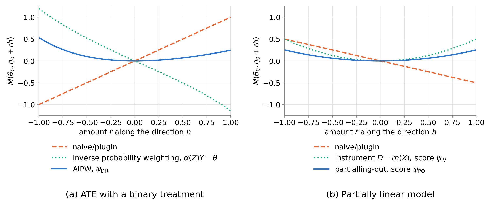
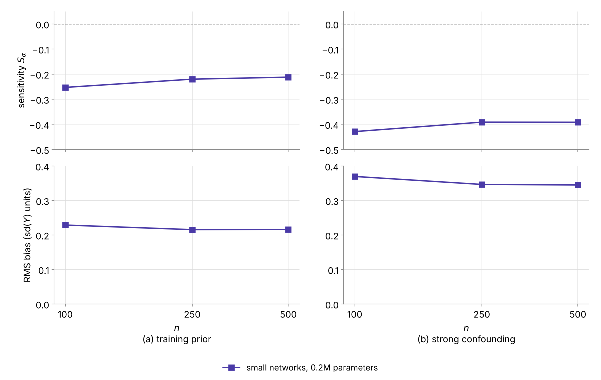
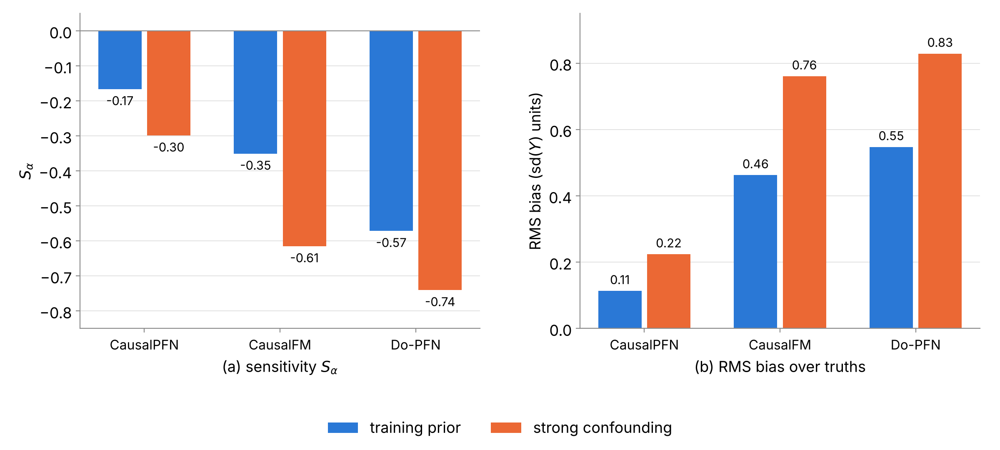
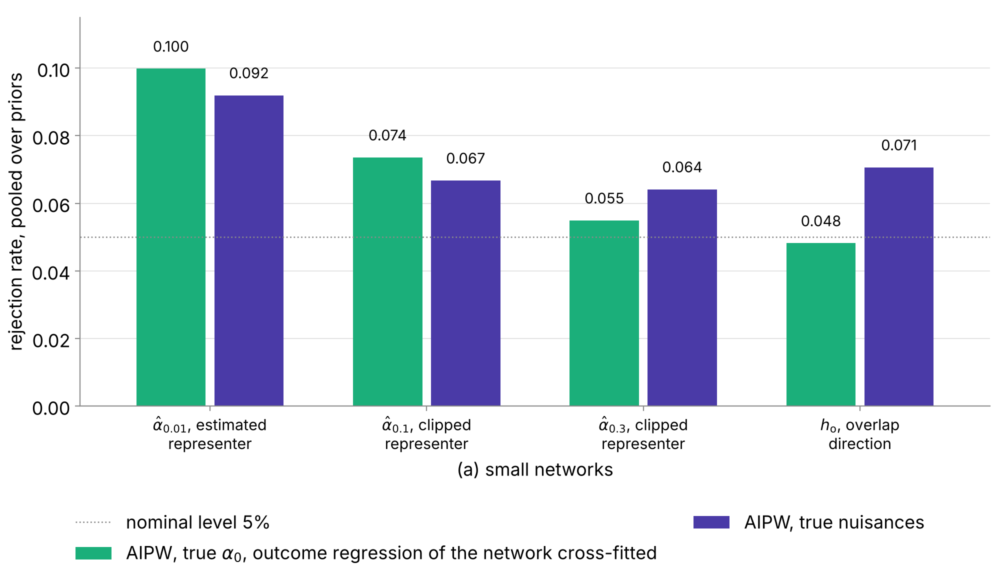
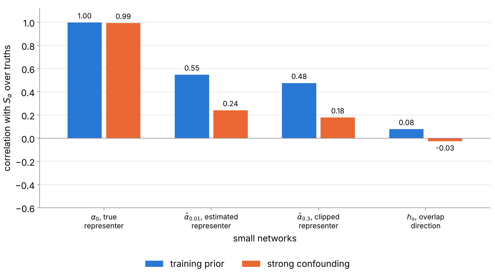

# Neyman orthogonality

## Data, target and Riesz representer {.smaller}

We observe $n$ independent copies of $W=(Y,Z)$ with law $P$, where $Y$ is an outcome and $Z$ collects the regressors, and write $g_0(z)=\mathbb{E}[Y\mid Z=z]$ for the outcome regression and $\langle f,g\rangle=\mathbb{E}[f(Z)g(Z)]$ for the inner product of $L^2(P_Z)$.

The target is a linear functional $\theta_0=\theta(g_0)$ of the outcome regression, with $\theta(g)=\mathbb{E}[\nu(W;g)]$. When $\theta$ is mean-square continuous, by the Riesz representation theorem [@riesz1907espece; @frechet1907ensembles] there is a unique $\alpha_0\in L^2(P_Z)$ with
$$
\theta(g)=\langle\alpha_0,g\rangle\quad\text{for all }g\in L^2(P_Z),\qquad\text{hence}\qquad\theta(g_0+h)-\theta_0=\langle\alpha_0,h\rangle .
$$
The representer $\alpha_0$ is therefore the derivative of the target with respect to the regression, and $\theta_0=\mathbb{E}[\alpha_0(Z)\,Y]$ [@chernozhukov2022automatic, Sec. 2].

| Target, with $Z=(D,X)$ | $\nu(W;g)$ | $\alpha_0(Z)$ |
|:--|:--|:--|
| average treatment effect (ATE), $D\in\{0,1\}$ | $g(1,X)-g(0,X)$ | $D/m_0(X)-(1-D)/\{1-m_0(X)\}$ |
| coefficient $\theta_0$ in $Y=\theta_0D+f_0(X)+\varepsilon$, $D=m_0(X)+V$ | $V\,g(Z)/\mathbb{E}[V^2]$ | $V/\mathbb{E}[V^2]$ |
| weighted average derivative, $D$ continuous | $\int\omega(u)\,\partial_dg(u,X)\,\mathrm{d}u$ | $-\omega'(D)/\varrho(D\mid X)$ |

: {tbl-colwidths="[44,28,28]"}

For the ATE, $m_0(x)=P(D=1\mid X=x)$ is the propensity score, and the target is identified under consistency, unconfoundedness and overlap [@rosenbaum1983central]. The partially linear model is that of @robinson1988root, with $\mathbb{E}[\varepsilon\mid D,X]=0$ and $\mathbb{E}[V\mid X]=0$. For the derivative, $\omega$ is a known density and $\varrho(d\mid x)$ is the density of $D$ given $X$ [@chernozhukov2022automatic, Table 1].

## Scores, moment conditions and cross-fitting {.smaller}

A score is a map $\psi(w;\theta,\eta)$ with a nuisance $\eta$ in a convex set $T$, and $M(\theta,\eta)=\mathbb{E}_P[\psi(W;\theta,\eta)]$ is its moment map. The score identifies $\theta_0$ if $M(\theta_0,\eta_0)=0$, this zero is unique, and the Jacobian $J_0=\partial_\theta M(\theta,\eta_0)|_{\theta=\theta_0}$ is non-singular. Examples are
$$
\begin{aligned}
\psi_{\mathrm{DR}}(W;\theta,g,\alpha)&=\nu(W;g)-\theta+\alpha(Z)\{Y-g(Z)\},\\
\psi_{\mathrm{IV}}(W;\theta,f,m)&=\{Y-\theta D-f(X)\}\{D-m(X)\},\\
\psi_{\mathrm{PO}}(W;\theta,\ell,m)&=\{Y-\ell(X)-\theta(D-m(X))\}\{D-m(X)\},
\end{aligned}
$$
where $\psi_{\mathrm{DR}}$ is the augmented inverse probability weighting (AIPW) score of any linear functional [@robins1994estimation; @chernozhukov2022automatic, eq. 2.4], and $\psi_{\mathrm{IV}}$ and $\psi_{\mathrm{PO}}$ are the scores of the partially linear model with $\ell_0(X)=\mathbb{E}[Y\mid X]=\theta_0m_0(X)+f_0(X)$ [@chernozhukov2018dml, eqs. 4.3–4.4].

<!-- A conditional moment restriction $\mathbb{E}[\rho(W;\theta_0,\eta_0)\mid Z]=0$ implies $\mathbb{E}[A(Z)\,\rho(W;\theta_0,\eta_0)]=0$ for every instrument $A(Z)$ [@chamberlain1987asymptotic]. The sensitivity of the moment condition to the nuisance and the efficiency of the estimator depend on the instrument. -->

For the double machine learning (DML) estimator, we partition the sample into folds $I_1,\dots,I_K$, compute $\hat\eta_k$ from the observations outside $I_k$, and solve [@chernozhukov2018dml, Def. 3.2]
$$
\frac1n\sum_{k=1}^K\sum_{i\in I_k}\psi(W_i;\theta,\hat\eta_k)=0 .
$$

## Three-term decomposition {.smaller .dense}

With $\mathbb{E}_{n,k}$ the average over fold $I_k$, $\mathbb{P}_n$ the average over the whole sample and $M(\theta_0,\eta_0)=0$, the average of the score splits as [@kennedy2024review]
$$
\mathbb{E}_{n,k}\psi(W;\theta_0,\hat\eta_k)
=\underbrace{\mathbb{E}_{n,k}\psi(W;\theta_0,\eta_0)}_{T_1}
+\underbrace{(\mathbb{E}_{n,k}-P)\{\psi(\cdot;\theta_0,\hat\eta_k)-\psi(\cdot;\theta_0,\eta_0)\}}_{T_2}
+\underbrace{M(\theta_0,\hat\eta_k)}_{T_3},
$$
and along the segment from $\eta_0$ to $\hat\eta_k$,
$$
T_3=\partial_rM\big(\theta_0,\eta_0+r(\hat\eta_k-\eta_0)\big)\big|_{r=0}+\int_0^1(1-r)\,\partial_r^2M\big(\theta_0,\eta_0+r(\hat\eta_k-\eta_0)\big)\,\mathrm{d}r .
$$

| Term | Property | Made negligible by |
|:--|:--|:--|
| $T_1$ | asymptotically normal | central limit theorem, which for the ATE requires overlap |
| $T_2$ | centred average of $n/K$ terms given $\hat\eta_k$ | cross-fitting with consistent $\hat\eta_k$, or stability of the nuisance estimator |
| $T_3$, first part | linear in $\hat\eta_k-\eta_0$ | Neyman orthogonality of the score |
| $T_3$, second part | quadratic in $\hat\eta_k-\eta_0$ | rates of convergence of $\hat\eta_k$ |

: {tbl-colwidths="[16,36,48]"}

<!-- For the plug-in score $\nu(W;g)-\theta$, $T_3=\langle\alpha_0,\hat g_k-g_0\rangle$ exactly.
*Nonparametric estimators of $g_0$ converge more slowly than $n^{-1/2}$, so $\sqrt n(\hat\theta-\theta_0)$ diverges unless this term is $o_P(n^{-1/2})$.  -->

## Definition {.smaller}

Following @chernozhukov2018dml [Sec. 2.1], let $\widetilde T=\{\eta-\eta_0:\eta\in T\}$ and define the Gateaux derivative map $\mathrm D_r:\widetilde T\to\mathbb{R}^{d_\theta}$ by
$$
\mathrm D_r[\eta-\eta_0]=\partial_r\Big\{\mathbb{E}_P\big[\psi\big(W;\theta_0,\eta_0+r(\eta-\eta_0)\big)\big]\Big\},\qquad r\in[0,1).
$$

[Definition]{.label} [@chernozhukov2018dml, Def. 2.1]. The score $\psi$ obeys the Neyman orthogonality condition at $(\theta_0,\eta_0)$ with respect to the nuisance realisation set $\mathcal T_N\subset T$ if $M(\theta_0,\eta_0)=0$, the map $\mathrm D_r[\eta-\eta_0]$ exists for all $r\in[0,1)$ and $\eta\in\mathcal T_N$, and
$$
\partial_\eta\mathbb{E}_P\psi(W;\theta_0,\eta_0)[\eta-\eta_0]:=\mathrm D_0[\eta-\eta_0]=0\qquad\text{for all }\eta\in\mathcal T_N .
$$

- The derivative is taken at the truth with the target held at $\theta_0$. It is the derivative of the moment map, which equals $\mathbb{E}_P\partial_\eta\psi$ only when differentiation under the integral is allowed.
- The set $\mathcal T_N$ contains the nuisance estimates, where $N$ is the sample size, and a smaller set imposes a weaker condition. The condition therefore depends on the law $P$ and on the set $\mathcal T_N$ as well as on the score.
- The score obeys the $\lambda_N$ near-orthogonality condition if $\|\mathrm D_0[\eta-\eta_0]\|\le\lambda_N=o(N^{-1/2})$ for all $\eta\in\mathcal T_N$ [@chernozhukov2018dml, Def. 2.2], which arises when the parameter that orthogonalises the score is defined by a regularised problem.

## Moment maps along a nuisance direction

{width=100%}

[With $X$ uniform on $[0,1]$ and $\theta_0=1$, panel (a) uses $m_0(x)=0.25+0.5x$, $g_0(d,x)=d+2x$ and the direction $(g,m)=(g_0+rd,\,m_0+0.15r)$, and panel (b) uses $m_0(x)=x$, $f_0(x)=x^2$ and the directions $f_0+r$, $\ell_0+r$ and $m_0+0.5r$. The slope at $r=0$ is $\mathrm D_0[h]$, which vanishes for the AIPW score and for both scores of the partially linear model.]{.source}

## Construction of orthogonal scores {.smaller}

[Correction by the Riesz representer.]{.label} For a fixed $A\in L^2(P_Z)$, the score $\nu(W;g)-\theta+A(Z)\{Y-g(Z)\}$ has the derivative $\mathrm D_0[h]=\mathbb{E}[\nu(W;h)]-\mathbb{E}[A(Z)h(Z)]=\langle\alpha_0-A,\,h\rangle$ in a direction $h$ of $g$. It is orthogonal in $g$ for a dense set of directions exactly when $A=\alpha_0$, so the correction term of an orthogonal score of a linear functional is the Riesz representer times the residual. With $\alpha$ as a second nuisance, the score is orthogonal in $\alpha$ because $\mathbb{E}[Y-g_0(Z)\mid Z]=0$.

[Orthogonal instruments.]{.label} In the partially linear model, the moment $\mathbb{E}[A(D,X)\{Y-\theta_0D-f(X)\}]$ has the derivative $-\mathbb{E}\big[\mathbb{E}[A\mid X]\,h(X)\big]$ in a direction $h(X)$ of $f$, so it is orthogonal in $f$ exactly when $\mathbb{E}[A\mid X]=0$. Every instrument $\{D-m_0(X)\}k(X)$ satisfies this condition, so orthogonal scores are not unique, and the choice of $k$ affects the efficiency [@chernozhukov2018dml, Sec. 2.2.4].

[Projection on the nuisance scores.]{.label} In a regular parametric model with scores $s_\theta$ and $s_\eta$ and information matrix with blocks $I_{\theta\eta}$ and $I_{\eta\eta}$, let $\mathbb{E}_{\theta_0,\eta}\psi(W;\theta_0,\eta)=0$ for all $\eta$. Differentiating in $\eta$ gives $\partial_\eta M(\theta_0,\eta_0)=-\mathbb{E}[\psi_0s_\eta^\top]$, where $\psi_0=\psi(\cdot;\theta_0,\eta_0)$. The residual score of @neyman1959optimal [-@neyman1979calpha],
$$
\psi=s_\theta-I_{\theta\eta}I_{\eta\eta}^{-1}s_\eta ,
$$
is uncorrelated with $s_\eta$ and therefore orthogonal. @chernozhukov2018dml [Sec. 2.2] construct orthogonal scores in likelihood and moment problems by projecting a score off the nuisance directions, and the orthogonalising matrix becomes a further nuisance.

## Double robustness and the mixed bias property {.smaller}

Let the nuisance be a pair $(g,\alpha)\in\mathcal T_g\times\mathcal T_\alpha$. The score is doubly robust if $M(\theta_0,g,\alpha_0)=M(\theta_0,g_0,\alpha)=0$ for all $g$ and $\alpha$, and it has the mixed bias property if $M(\theta_0,g,\alpha)=\mathbb{E}[S(W)\,(g-g_0)(Z)\,(\alpha-\alpha_0)(Z)]$ for all $(g,\alpha)$ and a known function $S$ [@rotnitzky2021mixed]. The AIPW score has the mixed bias property with $S=-1$ [@chernozhukov2022automatic, eq. 2.5],
$$
M(\theta_0,g,\alpha)=-\langle g-g_0,\,\alpha-\alpha_0\rangle\qquad\text{for every pair }(g,\alpha).
$$

[Proposition.]{.label} Let $T=\mathcal T_g\times\mathcal T_\alpha$ be a product of convex sets, let $\mathcal T_N=T$, and let $\mathrm D_0$ be linear. Then the following hold.

1. The mixed bias property implies double robustness, and double robustness implies orthogonality.
2. If $M(\theta_0,g_0,\alpha)=0$ for every $\alpha$, the score is doubly robust exactly when it is orthogonal and $g\mapsto M(\theta_0,g,\alpha_0)$ is affine [@chernozhukov2022locally, Thm. 4].
3. Orthogonality does not imply double robustness. In the partially linear model,
$$
M_{\mathrm{PO}}(\theta_0,\ell,m)=\langle\ell-\ell_0,\,m-m_0\rangle-\theta_0\|m-m_0\|^2,\qquad M_{\mathrm{IV}}(\theta_0,f,m)=\langle f-f_0,\,m-m_0\rangle,
$$
so both scores are orthogonal, and for $\theta_0\neq0$ only $\psi_{\mathrm{IV}}$ is doubly robust.

Since $\ell_0=\theta_0m_0+f_0$ contains $m_0$, an error in $m$ also enters through $\ell$. The choice of the nuisance that is called the outcome model matters for double robustness and does not matter for orthogonality.

## Properties and limits of orthogonal scores {.smaller}

:::: {.columns}
::: {.column width="52%"}
[Properties]{.label}

- The nuisance error enters the bias term $T_3$ only through second-order terms, which are $o_P(n^{-1/2})$ when $\|\hat\eta_k-\eta_0\|=o_P(n^{-1/4})$ in $L^2(P)$, or, for scores with the mixed bias property, when $\|\hat g-g_0\|\,\|\hat\alpha-\alpha_0\|=o_P(n^{-1/2})$, so any learner with these rates can estimate the nuisance.
- With cross-fitting and these rates, the DML estimator is asymptotically linear with influence function $-J_0^{-1}\psi_0$, and Wald intervals with a plug-in variance estimator are valid uniformly over models in which the rates hold uniformly [@chernozhukov2018dml, Thm. 3.1, Thm. 3.2 and Cor. 3.1].
<!-- - If an orthogonal score identifies the target along a nonparametric model, $-J_0^{-1}\psi_0$ is the efficient influence function (EIF), the influence function of an efficient estimator, and the DML estimator attains the efficiency bound (Appendix). -->
- Under the mixed bias property the bias formula holds for every nuisance pair, so nuisance errors from any source enter through one inner product.
:::
::: {.column width="48%"}
[Limits]{.label}

- Orthogonality removes only the first-order part of $T_3$, and nuisance errors that do not shrink with $n$ violate the rate conditions.
- Overlap is needed for $\alpha_0\in L^2(P_Z)$ and for a bounded $\hat\alpha$, and trimming changes the estimand.
- Identification of a causal target requires assumptions about the process that generates the data, which do not depend on the score.
<!-- - Among the orthogonal scores the EIF has the smallest variance, and $\psi_{\mathrm{PO}}$ is efficient when $\operatorname{Var}(\varepsilon\mid D,X)$ is constant. -->
- The definition applies to estimators that solve an estimating equation.
:::
::::

# Generalisations of Neyman orthogonality

## Approaches by term of the decomposition {.smaller}

| Approach | Term | Representative references |
|:--|:--|:--|
| correction of the score | first part of $T_3$ | [@newey1994asymptotic; @chernozhukov2018dml; @chernozhukov2022locally] |
| automatic or numerical correction | first part of $T_3$ | [@chernozhukov2022automatic; @chernozhukov2022riesznet; @carone2019toward; @ichimura2022influence] |
| fit that solves the orthogonal equation | first part of $T_3$ | [@scharfstein1999adjusting; @vanderlaan2006tmle; @brunssmith2026augmented] |
| balancing and minimax weights | first part of $T_3$ | [@zubizarreta2015stable; @kallus2020generalized; @hirshberg2021augmentedaos] |
| prior invariant along the least-favourable direction | first part of $T_3$ | [@castillo2015bvm; @ray2020semiparametric; @breunig2025double; @melnychuk2026debiased] |
| higher-order orthogonality and influence functions | higher-order parts of $T_3$ | [@mackey2018orthogonal; @robins2008higher; @robins2017minimax] |
| cross-fitting, stability of the nuisance estimator | $T_2$ | [@chernozhukov2018dml; @chen2022debiased] |
| calibration and further targeting | second part of $T_3$, one slow nuisance | [@benkeser2017doubly; @vanderlaan2024calibration] |

: {tbl-colwidths="[30,19,51]"}

## Automatic debiased machine learning {.smaller .dense}

The correction term of an orthogonal score of a linear functional contains the Riesz representer, which minimises the Riesz loss
$$
\mathbb{E}\big[\alpha(Z)^2-2\nu(W;\alpha)\big]=\|\alpha-\alpha_0\|^2-\|\alpha_0\|^2 .
$$
The loss can be evaluated without a formula for $\alpha_0$ when $\nu$ does not depend on $P$, as for the ATE, and minimising an empirical version of it over a class of functions is called Riesz regression [@chernozhukov2021riesz].

- @chernozhukov2022automatic minimise a Lasso version of the Riesz loss over linear $\alpha$, use the fit in the cross-fitted AIPW score of any mean-square continuous linear functional, and call the method automatic debiased machine learning.
- RieszNet learns $g$ and $\alpha$ with a neural network that shares its layers between the two, and ForestRiesz learns $\alpha$ with a random forest [@chernozhukov2022riesznet].
- @chernozhukov2026causalml give a textbook account of automatic debiased machine learning, and @vanderlaan2025automatic extend it to smooth functionals of M-estimands, which are population risk minimisers such as counterfactual regressions, survival functions and conditional average treatment effects, using the gradient and Hessian of the loss in place of an analytic influence function.
- For targets without a known form of the influence function, the correction can be computed numerically, by finite differences of $P\mapsto\theta(P)$ at an estimate of $P$ perturbed toward a smoothed point mass [@carone2019toward; @jordan2022empirical], or as the derivative of the limit of the estimator along contamination paths [@ichimura2022influence].

## Orthogonality without an explicit correction {.smaller .dense}

- [Targeting.]{.label} The clever covariate [@scharfstein1999adjusting; @bang2005doubly] and targeted maximum likelihood [@vanderlaan2006tmle; @vanderlaan2011targeted] add $\hat\alpha$ to the outcome fit so that $\mathbb{P}_n[\hat\alpha\{Y-\hat g\}]=0$, and the plug-in at the modified fit equals the corrected estimator.
- [Sieves.]{.label} Least squares on a closed subspace $\mathcal S$, with projection $\mathsf P_{\mathcal S}$ and $\mathsf M_{\mathcal S}=I-\mathsf P_{\mathcal S}$, solves the orthogonal equation for $\mathsf P_{\mathcal S}\alpha_0$, and the plug-in bias is $-\langle\mathsf M_{\mathcal S}\alpha_0,\mathsf M_{\mathcal S}g_0\rangle$ [@chernozhukov2022automatic, eq. 2.6]. Sieve plug-ins can be efficient for smooth functionals [@newey1994asymptotic; @shen1997methods].
- [Balancing weights.]{.label} Weighting estimators $n^{-1}\sum_iw_iY_i$ can be designed so that the weights balance a class of outcome functions, exactly or up to a bound on the worst-case imbalance [@zubizarreta2015stable; @kallus2020generalized; @hirshberg2021augmentedaos]. When the outcome and weighting models are linear in the same basis, augmented balancing weights are equivalent to a single linear regression [@brunssmith2026augmented].
- [Priors.]{.label} The no-bias condition of a semiparametric Bernstein–von Mises theorem [@castillo2015bvm] holds when the prior is approximately invariant under shifts of order $n^{-1/2}$ along the least-favourable direction, which for the ATE is proportional to the Riesz representer when $\operatorname{Var}(Y\mid Z)$ is constant [@ray2019debiased; @breunig2025double]. Priors that depend on an estimated propensity score achieve this invariance [@ray2020semiparametric]. @javurek2026generalized put a prior on the causal target and update it with a loss that identifies the target in a generalised posterior, which for Neyman-orthogonal losses converges to its oracle counterpart. Other approaches correct the posterior [@breunig2025double; @yiu2025semiparametric] or change the outcome model, by a reparametrisation [@hahn2018regularization] or with the estimated propensity score as a covariate [@hahn2020bcf].

## Learned representations and in-context nuisance learners {.smaller}

- Neural networks for treatment effects learn representations that predict both the treatment and the outcome, as DragonNet with its targeted regularisation [@shi2019adapting] and the adapted text embeddings of @veitch2020adapting.
- @melnychuk2026orthogonal argue that end-to-end representation learning lacks the quasi-oracle efficiency of Neyman-orthogonal learners, and they propose OR-learners, which combine learned representations with Neyman-orthogonal learners of causal quantities.
- TabPFN, a prior-data fitted network (PFN) for tabular prediction [@hollmann2025tabpfn], has been used as nuisance learner in meta-learners for heterogeneous effects [@zhang2025tabpfn] and in the DoubleML software [@bach2024doubleml].
- @wang2026amortized add a propensity output to CausalPFN, trained jointly with its outcome model, and build AIPW and TMLE estimators on it. These estimators remain stable as confounding grows, whereas the Bayesian plug-in estimate of CausalPFN degrades.
- Optimal covariate balancing is dual to a regularised self-attention, and @zhang2024cina learn balancing weights across data sets.
- For a simplified transformer, the variance of a PFN vanishes as $n$ grows while its bias need not [@nagler2023pfn].

## Causal prior-data fitted networks {.smaller}

- Causal PFNs, such as Do-PFN [@robertson2025dopfn], CausalPFN [@balazadeh2025causalpfn] and CausalFM [@ma2026causalfm], return effect estimates from the data set in context, without an orthogonal score.
- In simulations based on clinical data, the estimates of CausalPFN were biased and its credible intervals covered poorly [@mourao2026prior].
- @wang2026unveiling prove that one structural causal model induces an exponentially large space of interventional distributions, so that pretraining leaves part of them uncovered, which leads to posterior inconsistency and estimation bias, and they propose fine-tuning for specific interventions.
- @melnychuk2026frequentist show that PFNs used as Bayesian ATE estimators have a confounding bias induced by the prior, which they identify with regularisation-induced confounding, the bias of a regularised outcome regression that shrinks the coefficients of covariates that also predict the treatment [@hahn2018regularization], and they correct it by a one-step correction of martingale posteriors of TabPFN.
- @zhang2026fluctuate pretrains causal tabular models on the labels $\theta(P)+\mathbb{P}_n\varphi_P$, the ATE plus the fluctuation term of its EIF, and derives the coverage of Wald intervals for the frozen network.

Neyman orthogonality is defined for scores, and causal PFNs that return the effect directly have none.

## Debiased prior-data fitted networks {.smaller .dense}

@melnychuk2026debiased train a PFN with the log loss on the target $\theta_\xi$ of data-generating processes $\xi$ drawn from a prior $\Pi$. They call the network idealised when it returns the posterior of $\theta_\xi$ exactly, and they study this posterior under data from a fixed law $P$ for general targets with an EIF, including the ATE.

- Without a correction, the $L^2$ concentration error of the target posterior is at most the posterior average of the nuisance error plus a second-order remainder, and a worst-case posterior inherits the nuisance rate [@melnychuk2026debiased, Thm. 1].
- [Label correction.]{.label} The network is trained on the labels $\theta_\xi+\sum_i\varpi_i\varphi_\xi(W_i)$, with the EIF $\varphi_\xi$ under $\xi$ and Bayesian bootstrap weights $(\varpi_1,\dots,\varpi_n)\sim\mathrm{Dirichlet}(1,\dots,1)$ drawn independently of $\xi$ and $\mathcal D_n$, so that the one-step posterior correction of @yiu2025semiparametric is applied in pretraining [@melnychuk2026debiased, Eq. 12].
- [Prior correction.]{.label} Each process $\xi$ is perturbed along a least-favourable submodel, a one-dimensional submodel through $\xi$ whose score is $\varphi_\xi$, with a coefficient $\kappa\sim N(0,\sigma_n^2)$ and $n\sigma_n^2\to\infty$, which extends the prior correction of @ray2020semiparametric [@melnychuk2026debiased, Eq. 15]. For the ATE with Gaussian noise of unit variance, the outcome regression $g_\xi$ of $\xi$ is replaced by $g_\xi+\kappa\alpha_\xi$, with the Riesz representer $\alpha_\xi$ of the ATE under $\xi$, and the density of $X$ is reweighted with the same $\kappa$ (App. F.2.1).
- With either correction and a stochastically equicontinuous posterior, the posterior of the idealised network concentrates at the rate $n^{-1/2}$ plus the remainder (Thm. 2). When the remainder is $o_P(n^{-1/2})$, a Bernstein–von Mises theorem with the efficient variance holds under regularity conditions (Thm. 3). When the mean square of the remainder is bounded uniformly over a class of laws supported by the prior, the worst-case risk of the posterior mean over this class is of order $n^{-1}$ plus this bound, the minimax rate when a matching lower bound holds (Thm. 4).
- In ATE experiments, the training prior draws the propensity score independently of the outcome regressions, and an evaluation prior has more observed confounding. Under the evaluation prior, the authors report that both corrected networks often have a smaller $L^2$ risk than the network without a correction for $n\ge1024$ with 5 covariates and $n\ge2048$ with 10, and the total variation distance of all networks to the efficient normal approximation grows with $n$ (Sec. 5).

<!-- # Orthogonality for estimators without a score

## Estimators without a score {.smaller}

The following estimators map the data set $\mathcal D_n=(W_1,\dots,W_n)$ to an estimate without an estimating equation.

- Posterior means, which are Bayes rules under a prior.
- Plug-in estimators with regularised or learned outcome regressions, which are subject to regularisation-induced confounding.
- Networks trained end to end on the target, and plug-in estimators on learned representations.
- In-context learners, which are fixed maps $F_\chi$ with parameters $\chi$ learned in pretraining on synthetic data sets from a prior $\Pi$ over data-generating processes $\xi$ [@muller2022pfn].

[Lemma.]{.label} Over all measurable maps $F$, the squared pretraining loss $\mathbb{E}_{\xi,\mathcal D_n}[\{F(\mathcal D_n)-\theta_\xi\}^2]$ is minimised, uniquely up to almost sure equality, by the posterior mean $\hat\theta_\Pi(\mathcal D_n)=\mathbb{E}_\Pi[\theta_\xi\mid\mathcal D_n]$ [@muller2022pfn; @foong2020metalearning].

A trained network computes $\hat\theta_\chi=\hat\theta_\Pi+a_\chi(\mathcal D_n)$, where $a_\chi$ is the amortisation error. By the lemma, the minimiser of the pretraining loss is a Bayes rule, whose properties depend on the prior and on the training target. The amortisation error of a fixed network is not guaranteed to vanish as $n$ grows, so rate conditions on in-context nuisances cannot be verified from the pretraining objective alone. -->

<!-- 
## First-order insensitivity {.smaller}

[Outcome shifts.]{.label} For a direction $h\in L^2(P_Z)$ and $\delta\in\mathbb{R}$, let $P_{\delta h}$ be the law of $(Y+\delta h(Z),Z)$. Under $P_{\delta h}$ the outcome regression is $g_0+\delta h$ and the target is $\theta_0+\delta\langle\alpha_0,h\rangle$. Write $b_n(\delta;h)=\mathbb{E}_{\delta h}[\hat\theta]-\theta(P_{\delta h})$ for the bias of an estimator $\hat\theta$ along the shift.

[Proposed definition.]{.label} The estimator $\hat\theta$ is first-order insensitive to the outcome regression in the direction $h$ if $\partial_\delta b_n(0;h)=0$, and asymptotically first-order insensitive over a class of directions if this derivative tends to zero uniformly over the class.

- The bias then does not drift at the scale $n^{-1/2}$ along local shifts. The condition is the derivative part of local asymptotic unbiasedness [@hirano2012impossibility] and, under uniform integrability, equivalent to regularity along these shifts [@vandervaart1998asymptotic, Ch. 8].
- The definition needs only the map from data sets to estimates, so it applies to trained networks, whereas @melnychuk2026debiased analyse the idealised network.

## Causal PFNs under independent mechanisms {.smaller .dense}

Write a task as $\xi=(\xi_X,\xi_D,\xi_Y)$ with $P_\xi=P_{X;\xi_X}\otimes P_{D\mid X;\xi_D}\otimes P_{Y\mid D,X;\xi_Y}$. The prior $\Pi$ has independent mechanisms if $\xi_D$ is independent of $(\xi_X,\xi_Y)$ under $\Pi$.

[Proposition.]{.label} Under independent mechanisms, $\Pi(\mathrm{d}\xi_X,\mathrm{d}\xi_Y\mid\mathcal D_n)\propto\Pi_{X,Y}(\mathrm{d}\xi_X,\mathrm{d}\xi_Y)\prod_ip(X_i;\xi_X)\,p(Y_i\mid D_i,X_i;\xi_Y)$ does not involve the treatment likelihood, so the posterior mean of the ATE is a Bayesian outcome regression with the uncorrected term $\langle\alpha_0,\hat g_\Pi-g_0\rangle$ in its error, where $\hat g_\Pi=\mathbb{E}_\Pi[g_\xi\mid\mathcal D_n]$. The factorisation is the Bayesian ignorability of the treatment assignment [@gelman2013bda, Sec. 8.2; @li2023bayesian, Sec. 3].

| Model | Treatment mechanism | Outcome mechanism | Prior dependence |
|:--|:--|:--|:--|
| Do-PFN [@robertson2025dopfn] | node of a random structural causal model | node of the same graph | shared graph, independent weights |
| CausalPFN [@balazadeh2025causalpfn] | logit of $X$ that is constant, linear or a random network | relabelled columns of a base table | independent draws |
| CausalFM [@ma2026causalfm] | random network $f_A(X,U_A)$ | random network $f_Y(X,A,U_Y)$ | independent weights and noise |

: {tbl-colwidths="[22,28,26,24]"}

[Proposed result.]{.label} Under independent mechanisms, the Bayes rule for a training target that is a function of $(\xi_X,\xi_Y,\mathcal D_n)$ does not involve the treatment likelihood. The minimiser of the squared pretraining loss therefore involves the treatment likelihood only when the training target depends on $\xi_D$ or the prior couples $\xi_D$ with $(\xi_X,\xi_Y)$, as the priors of @li2023bayesian [Sec. 5] do, and the label correction and the prior correction of @melnychuk2026debiased are instances of the two cases. -->

# Research question and contribution

::: {.content-visible when-format="revealjs"}
::: {.notes}
Here the talk moves from the literature to our own project.
:::
:::

## Project question and motivation {.smaller}

[Motivation.]{.label} Causal PFNs return an effect estimate in one forward pass, but they have no score, so Neyman orthogonality cannot be checked for them. In simulations based on clinical data, CausalPFN was biased and its credible intervals covered poorly [@mourao2026prior]. The guarantees of @melnychuk2026debiased hold for the idealised network, and their theory sets the amortisation error of a trained network aside.

[Main question.]{.label} When is an estimator without a score, in particular a trained in-context learner, first-order insensitive to errors in the outcome regression, and how can this be checked from the data and the trained network alone?

1. Which property of an estimator takes the place of Neyman orthogonality, how is it related to regularity and to orthogonal scores, and which shifts beyond those of the outcome regression does it have to cover?
2. Do the implicit weights $w_i=n\,\partial\hat\theta/\partial Y_i$ of a trained network give a diagnostic of this property, and under which conditions does a test based on it have a known level?
3. Which training targets and priors make the Bayes rule of an in-context learner first-order insensitive?
4. Are trained networks first-order insensitive when they use the corrections of @melnychuk2026debiased, or in-context nuisances with cross-fitting and an AIPW layer?

::: {.content-visible when-format="revealjs"}
::: {.notes}
- A score $\psi(W;\theta,\eta)$ is an estimating function whose mean is zero at the true $\theta_0$ and the true nuisance $\eta_0$. Neyman orthogonality says that this mean does not move to first order when the nuisance moves.
- A causal PFN returns the estimate in one forward pass and has no score, so orthogonality cannot be checked for it.
- Mourão et al. (2026) found in simulations based on clinical data that CausalPFN was biased and that its credible intervals covered poorly.
- Melnychuk et al. (2026) prove guarantees for an idealised network that returns the exact posterior. The difference between a trained network and this idealised network, the amortisation error, is outside their theory.
- Main question in words. When does an estimator without a score have a bias that does not react to small errors in the outcome regression, and how can we check this with one data set and the network?
- Sub-question 1 is answered by first-order insensitivity in the next section, sub-question 2 by the diagnostic and the block test. Sub-questions 3 and 4 concern training targets, priors and designs, and today only the variants of the loss touch them.

*Say it like this.* Orthogonality is a property of a score. Our networks have no score, so we need a property of the estimator itself, and a way to check it from the data.
:::
:::

<!-- ## Contribution and positioning {.smaller .dense}

| Proposed contribution | Closest work | What is new |
|:--|:--|:--|
| A criterion without a score, first-order insensitivity along shifts of the outcome regression | local asymptotic unbiasedness [@hirano2012impossibility]; @giordano2026locally | the derivative condition of local asymptotic unbiasedness at fixed $n$, written for every estimator differentiable in the outcomes as balance of its implicit weights, with the Riesz representer as target |
| A diagnostic from one backward pass, the imbalance of the implicit weights | balance checks of linear weights [@chattopadhyay2023implied; @knaus2024weighted]; @giordano2026locally | estimators other than posterior means, such as trained networks, the expected imbalance as the sensitivity, and a block test whose level is at most nominal for normal block values |
| The weighting representation of estimators that are equivariant in the outcomes | the error of linear estimators [@armstrong2021finite]; twicing kernels [@newey2004twicing] | $\hat\theta=n^{-1}\sum_iw_iY_i$ for nonlinear estimators such as trained networks, with the bias as the sensitivity along $g_0$ plus a noise term, and a correction whose bias is an inner product of two errors |
| Bayes rules of in-context learners under the label and prior corrections | @melnychuk2026debiased; @zhang2026fluctuate; @li2023bayesian; @linero2021ignorability | when the treatment mechanism enters the Bayes rule, the AIPW form of the Bayes rule of the label correction, and finite-sample unbiasedness of a prior correction in a Gaussian model |
| Measurement of the implicit weights of trained causal PFNs and of designs with in-context nuisances, such as an AIPW layer on nuisance heads and cross-fitting in context | @mourao2026prior; @wang2026amortized; @melnychuk2026debiased | first-order insensitivity of trained networks, measured with the diagnostic |

: {tbl-colwidths="[34,26,40]"}

::: {.content-visible when-format="revealjs"}
::: {.notes}
Read each row from the left column (what we propose) to the right column (what is new relative to the closest work).

1. The criterion is a derivative condition on the bias at a fixed sample size. Hirano and Porter (2012) define local asymptotic unbiasedness for $n\to\infty$, and Giordano et al. (2026) study local balance of posterior means.
2. The diagnostic is the imbalance of the implicit weights. Balance checks of weights exist for estimators linear in the outcomes (Chattopadhyay and Zubizarreta 2023, Knaus 2024). New are nonlinear estimators such as networks, the fact that the expected imbalance equals the sensitivity, and a test with a known level.
3. The weighting representation $\hat\theta=n^{-1}\sum_iw_iY_i$ is known for linear estimators (Armstrong and Kolesár 2021), and we show it for nonlinear equivariant estimators.
4. The Bayes rules of in-context learners are theory work that is not on today's slides.
5. The measurement on trained causal PFNs is the experimental part.
:::
::: -->

# First-order insensitivity and implicit weights

::: {.content-visible when-format="revealjs"}
::: {.notes}
Notation used from here on.

- $W=(Y,Z)$ is one row, with outcome $Y$ and $Z=(D,X)$, the binary treatment $D$ and the covariates $X$. A data set has $n$ independent rows with law $P$.
- The subscript $0$ marks the true object under $P$, so $g_0$, $\theta_0$, $m_0$ and $\alpha_0$ are the true outcome regression, target, propensity score and Riesz representer. The $0$ does not mean that anything is set to zero, and `aipw_cf_alpha0` means AIPW with the true $\alpha_0$.
- In $\hat\alpha_{0.3}$ and $\hat\alpha_{0.01}$ the subscript is the clipping bound of the estimated propensity score, so $\hat\alpha_{0.3}$ uses $\hat m$ clipped to $[0.3,0.7]$ and $\hat\alpha_{0.01}$ is almost unclipped.
- $g_0(z)=\mathbb E[Y\mid Z=z]$, the noise is $\varepsilon=Y-g_0(Z)$, and the ATE is $\theta_0=\mathbb E[g_0(1,X)-g_0(0,X)]=\theta(g_0)$ with $\theta(g)=\mathbb E[\nu(W;g)]$ and $\nu(W;g)=g(1,X)-g(0,X)$.
- $\langle a,b\rangle=\mathbb E[a(Z)b(Z)]$ and $\|a\|^2=\langle a,a\rangle$. $L^2(P_Z)$ is the set of functions $h$ of $Z$ with $\mathbb E[h(Z)^2]<\infty$.
- For the ATE, $\alpha_0(d,x)=d/m_0(x)-(1-d)/\{1-m_0(x)\}$, and $\mathbb E[\alpha_0(Z)g(Z)]=\mathbb E[g(1,X)-g(0,X)]$ for every $g$, because $\mathbb E[D\,g(D,X)/m_0(X)\mid X]=g(1,X)$.
- $\mathbb E[\cdot]$ is the mean over many data sets drawn from $P$, so $\mathbb E[\hat\theta]-\theta_0$ is the bias.
:::
:::

## Outcome shifts and first-order insensitivity {.smaller}

[Idea.]{.label} A causal PFN learns the outcome regression $g_0$ from the data set and returns an estimate $\hat\theta$, but it has no score whose orthogonality could be checked. We therefore ask how the mean of the estimate responds when the outcome regression changes. When the true effect changes by some amount, the mean of a good estimate changes by the same amount, and any difference is a bias caused by errors in learning $g_0$.

[Outcome shifts.]{.label} For a direction $h\in L^2(P_Z)$ and $\delta\in\mathbb{R}$, let $P_{\delta h}$ be the law of $(Y+\delta h(Z),Z)$ under $P$, so that every outcome is moved by $\delta h(Z)$. Under $P_{\delta h}$ the outcome regression is $g_0+\delta h$ and the target is $\theta_0+\delta\langle\alpha_0,h\rangle$, and the bias of $\hat\theta$ along the shift is $b_n(\delta;h)=\mathbb{E}_{\delta h}[\hat\theta]-\theta(P_{\delta h})$.

[Definition.]{.label} The estimator is first-order insensitive to the outcome regression in the direction $h$ at $P$ and sample size $n$ if $\partial_\delta b_n(0;h)=0$, and over a class $\mathcal H\subset L^2(P_Z)$ if this holds for every $h\in\mathcal H$. We call $\partial_\delta b_n(0;h)$ the sensitivity in the direction $h$. A sensitivity of zero means that, to first order, the mean of the estimate moves one for one with the target when the regression moves along $h$.

[Example.]{.label} For the ATE and $h(d,x)=d$, the shift adds $\delta$ to every treated outcome, so the ATE increases by $\delta$. A plug-in estimate whose fitted effect is shrunk toward zero increases by less than $\delta$, and its sensitivity in this direction is negative.

- The definition uses only the map from data sets to estimates, so it applies to posterior means and to trained networks.
- Neyman orthogonality requires that a moment condition does not respond to first-order errors in a nuisance, and first-order insensitivity requires the same of the mean of the estimate along shifts of the outcome regression.
- As $n\to\infty$, the condition is the derivative part of local asymptotic unbiasedness [@hirano2012impossibility].

::: {.content-visible when-format="revealjs"}
::: {.notes}
**What is $h$?** A function of the treatment and the covariates with $\mathbb E[h(Z)^2]<\infty$. It gives the shape of a change of the outcome regression.

- $h(d,x)=d$ adds the same amount to every treated outcome, and the ATE changes by exactly that amount.
- $h(d,x)=x_1$ moves both arms in the same way, and the ATE does not change, since $h(1,x)-h(0,x)=0$.
- $h=\alpha_0$ is the direction in which the ATE changes most per unit size of the change, since $|\langle\alpha_0,h\rangle|\le\|\alpha_0\|\,\|h\|$ by the Cauchy–Schwarz inequality.

**What is $\delta$?** A real number, the size of the shift. $\delta=0$ is the true law, and we only need small $\delta$, because the errors of a learned regression are small.

**What is $P_{\delta h}$?** Take every row, keep $Z$, and add $\delta h(Z)$ to its outcome. The noise does not change, the outcome regression becomes $g_0+\delta h$, and by linearity $\theta(P_{\delta h})=\theta_0+\delta\langle\alpha_0,h\rangle$.

**Reading $b_n(\delta;h)=\mathbb E_{\delta h}[\hat\theta]-\theta(P_{\delta h})$.** "The expected value of theta hat under P delta h, minus theta of P delta h." The first term is the average estimate over many data sets of size $n$ from the shifted law, the second the true ATE in that shifted world. So $b_n(\delta;h)$ is the bias in a world whose regression is moved by $\delta h$, and $b_n(0;h)$ is the ordinary bias.

**Reading $\partial_\delta b_n(0;h)$.** The slope of the bias in $\delta$ at $\delta=0$, the true law. Zero slope means that the mean of the estimate moves by $\delta\langle\alpha_0,h\rangle$, as much as the target. A negative slope means that the estimate moves less than the target, which is what shrinkage does.

**Relation to orthogonality.** Orthogonality asks that the mean of the score does not react to first-order errors in the nuisance, and first-order insensitivity asks the same of the mean of the estimate along changes of the outcome regression. Local asymptotic unbiasedness uses shifts of size $t/\sqrt n$, and our condition is its derivative part at fixed $n$.

*Say it like this.* We imagine a slightly different world in which the outcome regression is moved by $\delta$ times $h$. The true ATE then moves by $\delta\langle\alpha_0,h\rangle$. If the average estimate moves by the same amount, errors in learning the regression along $h$ do not turn into bias.
:::
:::

## Implicit weights {.smaller .dense}

[Definition.]{.label} For an estimator that is differentiable in the outcomes, the implicit weights are $w_i=n\,\partial\hat\theta/\partial Y_i$, the change of the estimate per unit change of the outcome of row $i$, multiplied by $n$. A network returns all $n$ weights in one backward pass. For a linear estimator $\hat\theta=n^{-1}\sum_iw_iY_i$ the weights are its coefficients, for example $w_i=\hat\alpha(Z_i)$ for an inverse propensity weighting estimator, and for posterior means they are the locally equivalent weights of @giordano2026locally.

[Sensitivity and weights.]{.label} Moving every outcome by $\delta h(Z_i)$ moves the estimate by approximately $\delta\,n^{-1}\sum_iw_ih(Z_i)$, while the target moves by $\delta\langle\alpha_0,h\rangle$.
$$
\partial_\delta b_n(0;h)=\mathbb{E}_P\Big[\frac1n\sum_{i=1}^nw_i\,h(Z_i)\Big]-\langle\alpha_0,h\rangle .
$$
The estimator is first-order insensitive in the direction $h$ exactly when its weights balance $h$ in expectation in the sense of this equation. For the ATE, $\langle\alpha_0,h\rangle=\mathbb{E}[h(1,X)-h(0,X)]$, and the weights of an insensitive estimator act on $h$ in expectation like the inverse propensity weights $\alpha_0(Z)=D/m_0(X)-(1-D)/\{1-m_0(X)\}$.

<!-- [Plug-in and AIPW.]{.label} For a plug-in estimator whose outcome regression is a linear smoother $\hat S$ fitted on an independent sample, the sensitivity is $\mathbb{E}\langle\alpha_0,\hat Sh-h\rangle$, the error of the smoother on $h$ weighted by the representer. For the AIPW estimator with correction weights $\hat a$ it is $\mathbb{E}\langle\alpha_0-\hat a,\hat Sh-h\rangle$, a product of two errors. -->

[Sample imbalance.]{.label} The sample imbalance $\hat\Delta(h)=n^{-1}\sum_iw_ih(Z_i)-n^{-1}\sum_i\nu(W_i;h)$ has the sensitivity as its mean when $\nu$ does not depend on $P$, as for the ATE, and it needs neither $g_0$ nor $\alpha_0$. In simulations, where $\alpha_0$ is known, we report $S_\alpha=\mathbb{E}[\hat\Delta(\alpha_0)]/\|\alpha_0\|^2$. A value $S_\alpha=0$ means that the mean of the estimate follows a shift of the target along $\alpha_0$ fully, and $S_\alpha=-0.2$ means that it follows only 80% of it.

::: {.content-visible when-format="revealjs"}
::: {.notes}
- **Reading $w_i$.** If the outcome of row $i$ increases by a small amount $e$, the estimate increases by about $e\,w_i/n$. The factor $n$ puts the weights on the scale of inverse propensity weights. Automatic differentiation gives all $n$ derivatives in one backward pass.
- **Examples.** For inverse propensity weighting $w_i=\hat\alpha(Z_i)$. For the difference in means $w_i=n/n_1$ for treated and $-n/n_0$ for control rows. For a network the weights depend on all outcomes and are computed at the observed data.
- **Derivation.** Under the shift $Y_i$ becomes $Y_i+\delta h(Z_i)$, and by the chain rule the derivative of $\hat\theta$ in $\delta$ is $n^{-1}\sum_iw_ih(Z_i)$. The mean of the estimate moves by its expectation, the target by $\langle\alpha_0,h\rangle$, and the sensitivity is the difference. The domination condition allows us to exchange derivative and mean.
- **Balance.** $\alpha_0$ satisfies $\mathbb E[\alpha_0(Z)h(Z)]=\mathbb E[h(1,X)-h(0,X)]$ for every $h$. Weights that behave on average like $\alpha_0$, that is $\mathbb E[w_i\mid Z_i]=\alpha_0(Z_i)$ for an estimator that treats the rows symmetrically, have zero sensitivity in every direction.
- **Plug-in and AIPW.** $\hat Sh$ is the regression method applied to $h$ as if it were the outcome. For the plug-in the sensitivity is the error the method makes when the truth moves by $h$, weighted by $\alpha_0$. For AIPW it is the product of two errors, which is why AIPW is less sensitive.
- **Sample imbalance.** The weighted mean of $h$ minus the sample change of the ATE along $h$. Its mean is the sensitivity, and it needs neither $g_0$ nor $\alpha_0$.
- **Why $S_\alpha$.** Along $h=\alpha_0$ the target moves by $\delta\|\alpha_0\|^2$ and the mean of the estimate by $\delta\|\alpha_0\|^2(1+S_\alpha)$, so $1+S_\alpha$ is the share of the change that the estimate follows. $S_\alpha=-1$ means no response at all. It needs the true $\alpha_0$, so we compute it only in simulations.

*Say it like this.* The weights show how the estimate reacts to each outcome. If they act on average like inverse propensity weights, the estimate follows every shift of the regression, and otherwise the gap is the sensitivity.
:::
:::

## Estimators that are equivariant in the outcomes {.smaller .dense}

[Why this class matters.]{.label} The implicit weights are derivatives, so in general they describe only the response of the estimate to small changes of the outcomes. For estimators that are equivariant in the outcomes they describe the estimate itself, which is then a weighted mean of the outcomes, and its bias is the sum of an imbalance of the weights and a remainder. Our networks belong to this class, because they standardise the outcomes of the context with its mean and standard deviation and report the effect on the original scale, and so do least squares and AIPW with equivariant nuisance estimators.

[Equivariance.]{.label} The estimator is equivariant in the outcomes if $\hat\theta(Z_{1:n},a+bY_{1:n})=a\,\kappa_n(Z_{1:n})+b\,\hat\theta(Z_{1:n},Y_{1:n})$ for all $a\in\mathbb{R}$ and $b>0$. Adding $a$ to every outcome then moves the estimate by $a\kappa_n$, and multiplying every outcome by $b$ multiplies the estimate by $b$. For the ATE, $\kappa_n=0$.

[Weighting representation.]{.label} By Euler's theorem for homogeneous functions, an equivariant estimator that is differentiable in the outcomes satisfies $\hat\theta=n^{-1}\sum_iw_iY_i$ at every data set, although its weights depend on the outcomes. With $\varepsilon_i=Y_i-g_0(Z_i)$, the error splits into the three terms that @armstrong2021finite [Secs. 2.2, 3.2] give for linear estimators,
$$
\hat\theta-\theta_0=\underbrace{\hat\Delta(g_0)}_{\text{imbalance along }g_0}+\underbrace{\Big\{\frac1n\sum_{i=1}^n\nu(W_i;g_0)-\theta_0\Big\}}_{\text{mean zero}}+\underbrace{\frac1n\sum_{i=1}^nw_i\varepsilon_i}_{\text{noise term}} .
$$

- For every law of the noise, the bias is the sensitivity along the true regression $g_0$ plus the mean of the noise term. An equivariant estimator that is first-order insensitive along $g_0$ is therefore unbiased up to the noise term.
<!-- - The noise term has mean zero for estimators linear in the outcomes with weights that depend on the covariates only, and otherwise it comes from the dependence of the weights on the outcomes. For normal noise, by Stein's lemma, its mean is $\sum_i\mathbb{E}[\sigma^2(Z_i)\,\partial^2\hat\theta/\partial Y_i^2]$, the curvature of the estimate in the outcomes. -->

::: {.content-visible when-format="revealjs"}
::: {.notes}
- **Why it matters.** Weights are derivatives and in general describe only small changes. For equivariant estimators the estimate is exactly the weighted mean $n^{-1}\sum_iw_iY_i$, so the weights describe the whole estimate and its bias.
- **Reading the definition.** Add $a$ to every outcome and the estimate moves by $a\kappa_n$; multiply every outcome by $b>0$ and the estimate is multiplied by $b$. Adding a constant to all outcomes changes no treatment effect, so $\kappa_n=0$ for the ATE.
- **Our networks.** They compute $(Y_i-\bar Y)/s_Y$ from the context, predict on this scale and multiply by $s_Y$. A shift leaves the standardised outcomes and the estimate unchanged, and a scaling by $b$ multiplies $s_Y$ and the estimate by $b$.
- **Euler.** From $\hat\theta(bY)=b\,\hat\theta(Y)$, the derivative in $b$ at $b=1$ gives $\sum_iY_i\,\partial\hat\theta/\partial Y_i=\hat\theta$.
- **Decomposition.** Insert $Y_i=g_0(Z_i)+\varepsilon_i$ and add and subtract $n^{-1}\sum_i\nu(W_i;g_0)$. The imbalance along $g_0$ has the sensitivity along $g_0$ as its mean, the direction that scales the regression and the target together. The middle term is sampling noise with mean zero, the same for every estimator. The noise term has mean zero when the weights depend only on the covariates, because $\mathbb E[\varepsilon_i\mid Z_{1:n}]=0$, and for a network it is the covariance of weights and noise, for normal noise the curvature.
- For the small networks the bias is almost all imbalance along $g_0$ (correlation 0.98 to 0.99), so their noise term is small.

*Say it like this.* Because the networks standardise the outcomes, their estimate is exactly a weighted mean of the outcomes. The error then splits into an imbalance part, which our diagnostic targets, a sampling part and a curvature part.
:::
:::

## A diagnostic from one data set {.smaller .dense}

[Goal.]{.label} In an application we have one data set and the trained network, but neither $g_0$ nor $\alpha_0$. From these alone we want to test whether the network is first-order insensitive in a direction $\hat h$, that is, whether $\mathbb{E}[\hat\Delta(\hat h)]=0$.

[Imbalance.]{.label} For the ATE, the imbalance along $\hat h$ is the weighted mean of $\hat h$ minus the change of the ATE along $\hat h$,
$$
\hat\Delta(\hat h)=\frac1n\sum_{i=1}^nw_i\,\hat h(D_i,X_i)-\frac1n\sum_{i=1}^n\{\hat h(1,X_i)-\hat h(0,X_i)\},
$$
and it needs only the weights of the network and the direction.

[Direction.]{.label} The test is informative along directions in which the network is sensitive. Since $S_\alpha$ depends mostly on the response of the estimate where the overlap is weak and $|\alpha_0|$ is large, we use a direction close to $\alpha_0$, estimated on a separate part of the data. The last $n_s=\max(50,\lceil0.2n\rceil)$ rows form a split, on which we fit a propensity score $\hat m$, and the direction is the clipped representer
$$
\hat\alpha_{0.3}(d,x)=\frac{d}{\hat m_{0.3}(x)}-\frac{1-d}{1-\hat m_{0.3}(x)},\qquad \hat m_{0.3}=\min\{\max(\hat m,0.3),0.7\}.
$$
The network is run on the other $n_e=n-n_s$ rows, the evaluation rows.

- The direction is fitted on the split, so it is fixed given the split, and the imbalance on the evaluation rows has the sensitivity along $\hat h$ as its mean.
- Without the clipping, rows with propensity scores close to 0 or 1 receive very large inverse propensities and dominate the imbalance.
- The candidates for $\hat m$ are logistic regression, gradient boosting and the propensity head of the network, and we take the one whose representer has the smallest Riesz loss on the split.

::: {.content-visible when-format="revealjs"}
::: {.notes}
- **Goal.** Test the hypothesis that the sensitivity along $\hat h$ is zero, with one data set and the network, without $g_0$ or $\alpha_0$.
- **The imbalance.** The first sum is the weighted mean of $\hat h$ with the weights of the network, the second how much the ATE would change if the regression moved by $\hat h$. Under the hypothesis they agree in expectation.
- **Why close to $\alpha_0$.** $S_\alpha$ comes mostly from rows with weak overlap, where $|\alpha_0|$ is large and the networks shrink most. A direction such as $h=x_1$ would give little power.
- **The split.** $n_s$ is 50 rows at $n=250$ and 100 rows at $n=500$, and the network runs on the other 200 or 400 rows. Given the split, $\hat h$ is a fixed function for the evaluation rows, so the mean of the imbalance is the sensitivity along $\hat h$. Fitting $\hat h$ on the same rows would use the data twice.
- **The clipping.** With $\hat m$ in $[0.3,0.7]$, $|\hat\alpha_{0.3}|\le 1/0.3\approx 3.3$, and rows with $\hat m$ near 0 or 1 cannot dominate.
- **Choice of $\hat m$.** The Riesz loss of a candidate representer $a$ is $n_s^{-1}\sum_i\{a(Z_i)^2-2[a(1,X_i)-a(0,X_i)]\}$. Its mean is $\|a-\alpha_0\|^2-\|\alpha_0\|^2$, so it is smallest for the candidate closest to $\alpha_0$.
:::
:::

<!-- ## Block test of zero sensitivity {.smaller .dense}

[Blocks.]{.label} One run of the network gives one imbalance, and no formula for its variance is known for a network. We therefore cut the evaluation rows into $q$ blocks, with $q=4$ or $5$, run the network on each block alone, with the block as its context, and compute the imbalance $\hat\Delta_b$ of each block along $\hat h$. Given the split, the $q$ values are independent, and each has the sensitivity at the size of a block as its mean.

[Test.]{.label} With the mean $\bar\Delta$ and the standard deviation $s_\Delta$ of the $q$ values, the test rejects zero sensitivity at the nominal level of 5% when $|t_q|>t_{q-1,0.975}$, where $t_q=\sqrt q\,\bar\Delta/s_\Delta$. When the block values are normal, the level is at most nominal for $2\le q\le14$, also when their variances differ [@ibragimov2010tstatistic].

[Skewness.]{.label} The contributions $w_i\hat h(Z_i)-\nu(W_i;\hat h)$ of the rows contain inverse propensities and are skewed to the right, so with few rows per block the $t$-statistic is skewed to the left and rejects too often in the lower tail. The transformation of @hall1992removal corrects the statistic for the skewness of the contributions before it is compared with $t_{q-1,0.975}$.

[Checks in simulations.]{.label} The level is the rejection rate for two estimators whose sensitivity is zero in every direction that is fixed given the split:

1. the AIPW estimate with the true representer and the outcome regression of the network cross-fitted in two folds;
2. the AIPW estimate with both true nuisances, whose implicit weights are $\alpha_0(Z_i)$.

The power is the rejection rate for the plug-in estimate of the network, which is sensitive.

::: {.content-visible when-format="revealjs"}
::: {.notes}
- **Why blocks.** One run gives one imbalance, and there is no variance formula for a network. With 5 blocks of 80 rows at $n=500$, each run on its own context, the block imbalances are independent given the split, so their spread estimates the uncertainty. Each has the sensitivity at the block size as its mean.
- **The test.** The usual one-sample $t$-statistic of the $q$ block values. The critical values are 3.18 for $q=4$ and 2.78 for $q=5$. Ibragimov and Müller (2010) show that with normal block values the test keeps its level for $2\le q\le14$, also with unequal variances.
- **Skewness.** The contributions contain inverse propensities and are skewed to the right. With few rows per block the mean and the standard deviation of a block are positively correlated, so the $t$-statistic is skewed to the left and rejects too often in the lower tail. Hall's transformation $t_q+\gamma(t_q^2/3+1/6)/\sqrt q+\gamma^2t_q^3/(27q)$, with the estimated skewness $\gamma$, removes this skewness to first order.
- **Why the true $\alpha_0$ in the first null estimator.** Its mean is $\theta(\hat g)+\langle\alpha_0,g-\hat g\rangle=\langle\alpha_0,g\rangle$ for every true regression $g$, so it is unbiased in every shifted world, and its slope is zero by construction. Its rejection rate is therefore the level.
- The AIPW estimate with both true nuisances has the weights $\alpha_0(Z_i)$ and balances every direction.
- Both use the network's data, so the test sees realistic contributions while the hypothesis holds. The power is the rejection rate for the plug-in estimate of the network.

*Say it like this.* We split the data into a few independent blocks, compute the imbalance in each block and run a $t$-test across the blocks. Hall's correction removes the skewness that inverse propensities create.
:::
::: -->

# Experiments with trained networks

::: {.content-visible when-format="revealjs"}
::: {.notes}
Here we move from the method to its evaluation on our small trained networks and on released networks.
:::
:::

## Networks, priors and truths {.smaller .dense}

[Networks.]{.label} We train small causal PFNs with the backbone of nanoTabPFN [@pfefferle2025nanotabpfn], with about 0.2M parameters and a decoder for the conditional average treatment effect (CATE), for 3,000 steps in four variants of the loss and with three seeds each. The plug-in estimate of the ATE is the mean of the predicted CATEs with the whole sample as context. In the first variant the network has no nuisance heads and is trained on the CATE and the ATE, in the second its heads for $m$, $g$ and $\alpha$ are supervised with the exact nuisances of the simulator, in the third the loss on the ATE is also taken through an AIPW layer with cross-fitting in context, and in the fourth the losses of the heads are annealed to zero by the middle of training.

[Training prior.]{.label} A task has a binary treatment, one to five covariates and 50 to 250 rows, and its propensity score, baseline and effect are random linear functions, random networks, Gaussian processes or sums of trees. The baseline is drawn with a correlation $\rho$ with the logit of the propensity score, where $|\rho|\le0.9$, so the treatment and outcome mechanisms are dependent.

[Truths.]{.label} A truth is one data-generating process, drawn from the training prior or from a prior with strong confounding and weak overlap, in which $|\rho|\in[0.7,0.9]$ and the scale of the propensity logit lies in $[1.5,2.5]$, both inside the ranges of the training prior. We use 16 truths per prior with 32 data sets each at $n=100$, 250 and 500, and for the diagnostic also 40 to 128 new truths per prior, drawn with another seed, with 32 data sets each at $n=250$ and 500. Outcomes are in units of the standard deviation of $Y$ under the truth.

[Released networks.]{.label} CausalPFN [@balazadeh2025causalpfn], CausalFM [@ma2026causalfm] and Do-PFN [@robertson2025dopfn] are evaluated at the 16 truths per prior on 8 data sets each. We use them as black boxes, so their sensitivities are central finite differences of the estimate along the direction.

::: {.content-visible when-format="revealjs"}
::: {.notes}
- A causal PFN is trained on many simulated tasks drawn from a prior. Each task is a data-generating process, and the network learns to predict the CATE of the rows from a context of rows. The plug-in estimate of the ATE is the mean of the predicted CATEs.
- The twelve small networks are 4 variants times 3 seeds. V0 has no nuisance heads, V1 has heads for $m$, $g$ and $\alpha$ supervised with the exact nuisances, V2 adds an AIPW layer with cross-fitting in context, and in V3 the head losses are annealed to zero by the middle of training.
- $\rho$ is the correlation between the baseline outcome and the logit of the propensity score, which creates confounding. Strong confounding uses $|\rho|\in[0.7,0.9]$ and a propensity logit scaled by 1.5 to 2.5, which gives weak overlap. Both ranges lie inside the training prior, so these truths are a hard region of the prior.
- A truth is one fixed data-generating process. Units are standard deviations of $Y$, so a bias of 0.2 is 0.2 standard deviations.
- Released networks are black boxes, so their sensitivity is the central finite difference $\{\hat\theta(Y+\eta h)-\hat\theta(Y-\eta h)\}/(2\eta)$.
:::
:::

## Sensitivity of trained networks along the Riesz representer {.smaller}

{fig-align="center" width=66%}

[The values are averages of the plug-in estimates at the 16 truths per prior over five small networks. At $n=500$, $S_\alpha$ is $-0.21$ on the training prior and $-0.39$ under strong confounding, so the mean of the estimate follows only 79% and 61% of a shift of the outcome regression along $\alpha_0$, and the magnitude of $S_\alpha$ decreases only slightly from $n=100$ to $500$.]{.source}

::: {.content-visible when-format="revealjs"}
::: {.notes}
- Top panels show $S_\alpha$, bottom panels the RMS bias, the root mean square over truths of the bias at each truth, against $n$.
- At $n=500$ the average estimate follows only 79% and 61% of a shift along $\alpha_0$. The values hardly change from $n=100$ to 500, so the shrinkage does not disappear with more rows in this range.
- Strong confounding is worse because the networks shrink most where the overlap is weak.

*Say it like this.* The small networks follow only about 80% of a change of the true effect on the training prior, and about 60% under strong confounding.
:::
:::

## Released causal PFNs {.smaller}

Under a prior in which the treatment mechanism is drawn independently of the covariate and outcome mechanisms, the posterior mean of the ATE does not involve the likelihood of the treatments, so it is a Bayesian outcome regression with the uncorrected term in its error. The priors of CausalPFN and CausalFM have this form.

{fig-align="center" width=74%}

[The bars are for $n=500$ with 8 data sets per truth at the 16 truths per prior. CausalPFN follows 83% of a shift along $\alpha_0$ on the training prior and 70% under strong confounding, with an RMS bias of 0.11 and 0.22, and CausalFM and Do-PFN follow only 26% to 65% of such a shift, with an RMS bias of 0.46 to 0.83. At the same truths, $S_\alpha$ is $-0.21$ and $-0.39$ for our small networks.]{.source}

::: {.content-visible when-format="revealjs"}
::: {.notes}
- Under independent mechanisms the treatments carry no information about the outcome regression, so the posterior mean of the ATE is the ATE of the posterior mean regression $\hat g_\Pi$. Its error contains $\langle\alpha_0,\hat g_\Pi-g_0\rangle$, the plug-in error that AIPW would correct.
- CausalPFN follows 83% and 70% of a shift, CausalFM and Do-PFN only 26% to 65%. Our small networks, with $S_\alpha$ of $-0.21$ and $-0.39$, are slightly more sensitive than CausalPFN.
:::
:::

## Noise term and corrections {.smaller}

[Correction.]{.label} Subtracting the imbalance along an outcome regression $\hat g$ fitted on an independent sample gives $\hat\theta^{\mathrm c}=\hat\theta-\hat\Delta(\hat g)$, a plug-in estimator corrected with the implicit weights. For an estimator invariant under permutations of the observations, with $\omega_n(z)=\mathbb{E}[w_1\mid Z_1=z]$, the bias of $\hat\theta^{\mathrm c}$ is $\langle\omega_n-\alpha_0,\,g_0-\hat g\rangle$ plus the noise term, a product of two errors as in the mixed bias property of AIPW.

[Small networks.]{.label} For the small networks, the bias is almost entirely the imbalance along $g_0$, with correlations of 0.98 to 0.99 over truths, so by the decomposition for equivariant estimators the noise term is small. Subtracting the imbalance along an outcome regression fitted by gradient boosting out of fold, $\hat\theta^{\mathrm c}=\hat\theta-\hat\Delta(\hat g)$, lowers the RMS bias at $n=500$ from 0.215 to 0.091 on the training prior and from 0.344 to 0.164 under strong confounding.

- The correction uses only the implicit weights of the network and an outcome regression fitted on other rows.

::: {.content-visible when-format="revealjs"}
::: {.notes}
- The correction is a plug-in with $\hat g$ plus the residuals weighted by the network's own weights, so it looks like AIPW with the network's weights in place of $\hat\alpha$.
- Its bias is the product of a weight error, $\omega_n-\alpha_0$ with the average weight $\omega_n$, and a regression error, plus the noise term.
- With $\hat g$ from gradient boosting fitted on other rows, the RMS bias of the small networks at $n=500$ falls by about half.

*Say it like this.* The network's own weights can be used to correct its estimate, and the correction halves the bias of the small networks.
:::
:::

<!-- ## Level of the block test {.smaller}

{fig-align="center" width=62%}

[Each bar is the larger of the rejection rates at $n=250$ and $500$ on the small networks, pooled over both priors. Along the estimated representer $\hat\alpha_{0.01}$ and with the clipping bound 0.1, the test rejects too often. The excess rejections lie in the lower tail, since the contributions of the rows are skewed to the right, with a median skewness of 2.9 to 7.7 over the data sets, and a $t$-statistic of a mean of such contributions is skewed to the left [@hall1992removal]. We chose the bound 0.3 on 24 further truths per prior that do not enter these rates, and with it the block test with $q=4$ rejects in 4.7% to 6.4% of the data sets pooled over both priors and in at most 6.8% on each prior.]{.source}

::: {.content-visible when-format="revealjs"}
::: {.notes}
- Each bar is the larger of the two rejection rates at $n=250$ and $500$ for the two estimators with zero sensitivity, pooled over both priors, along four directions. The dotted line is the nominal 5%.
- Along the almost unclipped representer and with the bound 0.1, the test rejects too often, in the lower tail, because the contributions are strongly skewed.
- The bound 0.3 was chosen on 24 separate truths per prior.
- The overlap direction $h_{\mathrm o}=(2d-1)\hat m(1-\hat m)$ is bounded and puts weight on rows with good overlap.
:::
::: -->
<!-- 
## Estimand of the diagnostic {.smaller}

{fig-align="center" width=62%}

[The bars are correlations over truths on the small networks at $n=500$ between $S_\alpha$ and the mean share of the plug-in estimate along a direction, which is its imbalance as a share of the change of the target along that direction. Along $\alpha_0$ the correlation is at least 0.99, and along the directions fitted on the split it is at most 0.55 and 0.24 on the two priors, so the diagnostic does not estimate $S_\alpha$, and we use it as a test of zero sensitivity along the fitted direction.]{.source}

::: {.content-visible when-format="revealjs"}
::: {.notes}
- The share along a direction is the imbalance divided by the change of the target along that direction, the analogue of $S_\alpha$ for that direction.
- Along the true $\alpha_0$ the share is $S_\alpha$ itself up to sampling noise, so the correlation is at least 0.99.
- Along the fitted directions the correlation is low, because $S_\alpha$ comes mostly from rows with weak overlap, which the clipping downweights. So the diagnostic does not estimate $S_\alpha$, and we use it only as a test.
:::
:::

## Results of the diagnostic on the small networks {.smaller}

| | 16 truths per prior | 40 to 128 new truths per prior |
|:--|:--|:--|
| Test | block test with $q=4$ along $\hat\alpha_{0.3}$ | block test with $q=5$ along $\hat\alpha_{0.3}$ after the transformation of Hall |
| Rejection rate under zero sensitivity at $n=250$ and $500$ | 4.7% to 6.4% pooled over both priors, at most 6.8% on each prior | 3.9% to 5.2% pooled over both priors, at most 5.3% on each prior |
| Rejection rate for the plug-in estimate (power) | 0.56 and 0.61 at $n=500$ | 0.68 and 0.70 at $n=250$, 0.58 and 0.64 at $n=500$ |
| Correlation of the share with $S_\alpha$ at $n=500$ | 0.48 and 0.18 | 0.32 and 0.33 |

: {tbl-colwidths="[30,35,35]"}

- Under zero sensitivity the test rejects close to the nominal level of 5%, and with the transformation it rejects for the plug-in estimate in 58% to 70% of the data sets with at most 500 rows.
- On the new truths, the block test with $q=4$ without the transformation rejects under zero sensitivity in 7.8% of the data sets pooled over both priors and in 9.0% under strong confounding, so the transformation is needed for the level.
- The share along the fitted direction is only weakly correlated with $S_\alpha$, so we make no claim that it estimates $S_\alpha$ or its sign.
- At $n=500$, central differences of the estimate from forward passes agree with the backward pass within two Monte Carlo standard errors in 99% of 384 pairs of truth and network, so for a network available only as a black box the imbalance can be computed from forward passes.

::: {.content-visible when-format="revealjs"}
::: {.notes}
- The middle column is the block test with $q=4$ without the transformation on the 16 truths per prior. The right column is the block test with $q=5$ after Hall's transformation on new truths that played no role in choosing the test, which guards against a test that looks good by chance.
- The level is close to the nominal 5%.
- The test detects the sensitivity of the plug-in estimate in 58% to 70% of the data sets with at most 500 rows. Power is lower at $n=500$ than at $n=250$, possibly because the sensitivity per block is smaller with larger blocks, and this is open.
- Without the transformation the level is too high on the new truths, so the correction is needed.
- The finite differences agree with the backward pass, so the test also works for black-box networks.
:::
::: -->

## Status and next steps {.smaller .dense}

| Part | Status |
|:--|:--|
| First-order insensitivity, implicit weights, equivariant estimators and the corrections | propositions in the draft of the paper, working on proofs |
| Block test of zero sensitivity | level at most nominal for normal block values, and with the transformation of Hall rejection rates under zero sensitivity of at most 5.3% on each prior on new truths for the small networks |
| Small networks | evaluated at $n\le500$ |
| Released networks CausalPFN, CausalFM and Do-PFN | evaluated at the 16 truths per prior |

: {tbl-colwidths="[48,52]"}

[Next steps.]{.label} We evaluate larger networks, compute the power of the test up to $n=2{,}000$ and evaluate the corrections. The target venue of the paper is ICML 2027, with the ATE in the main text, and CausalPFN is evaluated on IHDP [@hill2011bayesian] and on the LaLonde PSID data [@lalonde1986evaluating; @dehejia1999causal] in the version of RealCause [@neal2020realcause], against tuned DoubleML [@bach2024doubleml] and AIPW with TabPFN nuisances [@hollmann2025tabpfn].

::: {.content-visible when-format="revealjs"}
::: {.notes}
- The theory, with definitions, propositions and proofs, is drafted. The level result for the block test holds for normal block values and the untransformed statistic, and the level after the transformation rests on the simulations.
- Next come larger networks, the power up to $n=2{,}000$ and the corrections.
- IHDP is a semi-synthetic benchmark with known outcome surfaces, and the RealCause version of the LaLonde PSID data is a simulation fitted to real data, so in both the true effect is known.
:::
:::

## Questions for discussion {.smaller}

1. Which fixed directions of a sensitivity, such as the constant shift $h(d,x)=d$ of the treatment effect, have a meaning in applications?
2. Would users of a pretrained causal estimator run a test of zero sensitivity along such directions before reporting the estimate?
<!-- 3. How can the level be controlled under skewed contributions with few blocks, for example by the transformation of @hall1992removal or by a bootstrap-$t$? -->
3. Which released networks and which benchmarks with known outcome regressions should the evaluation include?

::: {.content-visible when-format="revealjs"}
::: {.notes}
Own positions, if asked.

1. The shift $h(d,x)=d$ asks whether the estimate follows when every treated outcome is one unit higher, which is easy to explain. Shifts of the effect in one covariate are another candidate.
2. The test plays the role of a balance check after matching, run before the estimate is reported.
3. Hall's transformation works in our simulations. A bootstrap-$t$ is the alternative, and theory for both is open.
4. IHDP and LaLonde are planned, and ACIC data are a further candidate.

Likely questions and short answers.

- *Why not just compute the bias?* It needs the true effect, which is unknown in an application, while the sensitivity can be tested from the data.
- *Is an insensitive estimator unbiased?* Insensitivity concerns the slope of the bias. For an equivariant estimator, insensitivity along $g_0$ makes it unbiased up to the noise term.
- *Does running the network on blocks change the estimator?* Yes, each block is a smaller context, and the test concerns the sensitivity at the block size.
- *Why not the bootstrap?* A bootstrap needs many forward passes and theory for a nonlinear estimator, while independent blocks give a $t$-test that keeps its level with few groups.
- *Why clip at 0.3?* Clipping trades power for level, and the bound was chosen on separate truths.
- *Are the networks out of distribution under strong confounding?* No, both parameters lie inside the ranges of the training prior.
:::
:::

## References {.scrollable}

::: {#refs}
:::

# Appendix

## Asymptotic normality of the DML estimator {.smaller}

Let $\psi=\psi^a(W;\eta)\,\theta+\psi^b(W;\eta)$ be Neyman orthogonal with respect to $\mathcal T_N$, and let $\hat\eta_k\in\mathcal T_N$ with probability at least $1-\Delta_N$, where $\Delta_N\to0$, $\delta_N\to0$ and
$$
\begin{aligned}
r_N'&=\sup_{\eta\in\mathcal T_N}\big(\mathbb{E}_P\|\psi(W;\theta_0,\eta)-\psi(W;\theta_0,\eta_0)\|^2\big)^{1/2}\le\delta_N,\\
\lambda_N'&=\sup_{r\in(0,1),\,\eta\in\mathcal T_N}\big\|\partial_r^2M\big(\theta_0,\eta_0+r(\eta-\eta_0)\big)\big\|\le\delta_NN^{-1/2}.
\end{aligned}
$$
Under these conditions and the moment and identification conditions of Assumptions 3.1 and 3.2 of @chernozhukov2018dml, by their Theorem 3.1,
$$
\sqrt N(\hat\theta-\theta_0)=-J_0^{-1}\frac1{\sqrt N}\sum_{i=1}^N\psi(W_i;\theta_0,\eta_0)+o_P(1)\;\rightsquigarrow\;N(0,\sigma^2),\qquad\sigma^2=J_0^{-1}\,\mathbb{E}_P[\psi_0\psi_0^\top]\,(J_0^{-1})^\top,
$$
uniformly over the laws that satisfy the assumptions, and Wald intervals with the plug-in variance estimator are uniformly valid [@chernozhukov2018dml, Thm. 3.2 and Cor. 3.1].

By the bound on $r_N'$ and cross-fitting, $T_2=o_P(N^{-1/2})$. By the bound on $\lambda_N'$, the second part of $T_3$ is $o_P(N^{-1/2})$, which for smooth scores holds when the $L^2$ rate $\varepsilon_N$ of the nuisance estimator is $o(N^{-1/4})$, and for $\psi_{\mathrm{DR}}$, where $\partial_r^2M=-2\langle g-g_0,\alpha-\alpha_0\rangle$, when the product of the two errors is $o(N^{-1/2})$.

## Orthogonal scores and efficient influence functions {.smaller}

A regular submodel is a path $t\mapsto P_t$ through $P$, differentiable in quadratic mean, whose log density has derivative $s$ at $t=0$, and $L^2_0(P)$ is the space of square-integrable functions with mean zero. A function $\varphi\in L^2_0(P)$ is a gradient of $\theta$ at $P$ if $\partial_t\theta(P_t)|_{t=0}=\mathbb{E}[\varphi\,s]$ for every regular submodel, and in a locally nonparametric model, in which these derivatives $s$ are dense in $L^2_0(P)$, the gradient is unique and is the efficient influence function (EIF) [@vandervaart1998asymptotic, Ch. 25]. If $\psi$ identifies $\theta$ along a regular submodel, $\mathbb{E}_{P_t}\psi(W;\theta(P_t),\eta(P_t))=0$, then differentiation at $t=0$ gives
$$
0=\mathbb{E}_P[\psi_0\,s]+J_0\,\dot\theta+\mathrm D_0[\dot\eta],
$$
with $\dot\theta$ and $\dot\eta$ the derivatives of $\theta(P_t)$ and $\eta(P_t)$ at $t=0$. Hence $\mathrm D_0$ vanishes on all nuisance tangents $\dot\eta$ exactly when $-J_0^{-1}\psi_0$ is a gradient, and in a locally nonparametric model a score that identifies $\theta$ along the model is orthogonal exactly when $-J_0^{-1}\psi_0$ is the EIF [@newey1994asymptotic; @chernozhukov2022locally]. For the ATE, $\psi_{\mathrm{DR}}(\cdot;\theta_0,g_0,\alpha_0)$ is the EIF [@hahn1998role].

## Formulations of orthogonality {.smaller}

The formulations below are equivalent to the definition, or sufficient for it, under conditions on the model and the directions.

| Formulation | Condition | Source |
|:--|:--|:--|
| conditional form | the derivative of the score in the value of the nuisance at the data point has conditional mean zero | @mackey2018orthogonal |
| local robustness, no first-step adjustment | the derivative of the moment along mixtures of $P$ with another law vanishes | @newey1994asymptotic; @chernozhukov2022locally |
| nuisance tangent space | $\psi_0$ is orthogonal in $L^2(P)$ to the closed span of the derivatives $s$ of submodels that move only $\eta$ | @tsiatis2006semiparametric |
| parameter orthogonality | the likelihood score of $\theta$ is uncorrelated with that of $\eta$ | @cox1987parameter |
| orthogonal loss | the cross derivative of the population risk in the target and the nuisance vanishes at the minimiser | @foster2023orthogonal |

## Local robustness and general targets {.smaller}

- @newey1994asymptotic derives the adjustment term that a nonparametric first step adds to the influence function of a two-step estimator, and the term vanishes for orthogonal scores.
- @chernozhukov2022locally construct locally robust moments $\psi=q+\phi$ for the generalised method of moments and for nonlinear functionals, where $\phi$ is the influence function of the first step along paths $F_\tau=(1-\tau)F_0+\tau H$.
- @chernozhukov2022nested give debiased estimators for dynamic treatment effects and general nested functionals, in which each regression is a nuisance of the next.
- @bennett2025inference study functionals that are strongly identified while the nuisance is weakly identified, as in instrumental variable and proxy models. A representer in the range of the adjoint of the operator that defines the nuisance is necessary for $\sqrt n$-estimation.
- @foster2023orthogonal extend orthogonality to population risks $L(\theta,g)$ whose minimiser $\theta$ is a function, such as a conditional average treatment effect, and the excess risk of the second stage is then insensitive to first order to the nuisance error. The R-learner loss $\mathbb{E}[\{Y-\ell(X)-\tau(X)(D-m(X))\}^2]$ of @nie2021quasi is orthogonal in $(\ell,m)$.

## Higher-order terms and minimax rates {.smaller}

- @mackey2018orthogonal call a moment $k$-orthogonal if its conditional derivatives in the nuisance vanish up to order $k$, and then a nuisance rate of $o(n^{-1/(2k+2)})$ in the $L^{2(k+1)}$ norm suffices [@mackey2018orthogonal, Cor. 4]. In the partially linear model with conditionally Gaussian treatment noise, every twice differentiable $2$-orthogonal score has $J_0=0$ and does not identify $\theta_0$ [@mackey2018orthogonal, Thm. 5]. @bonhomme2026higher construct moment functions that are Neyman orthogonal to a chosen order in parametric moment-condition models, with a number of additional nuisance parameters that does not grow with the order.
- Higher-order influence functions estimate higher-order terms of the von Mises expansion by U-statistics and attain minimax rates for nuisance functions too rough for $\sqrt n$-estimation [@robins2008higher; @robins2017minimax].
- When the nuisance functions satisfy no assumptions beyond the $L^2$ errors of their estimates, the product rate of first-order estimators is minimax optimal for quadratic functionals such as the expected conditional covariance [@balakrishnan2026fundamental], and the product rate of doubly robust estimators is minimax optimal for the ATE [@jin2024structure].

## Forms of robustness and inference {.smaller}

- @rotnitzky2021mixed characterise the parameters whose influence functions have the mixed bias property, and @smucler2019unifying distinguish rate double robustness, asymptotic normality whenever both nuisance estimators are consistent and $\|\hat g-g_0\|\,\|\hat\alpha-\alpha_0\|=o_P(n^{-1/2})$, from model double robustness, the same conclusion when one nuisance estimator converges to the truth and the other to a different limit.
- With more than two nuisances, robustness takes the form of multiple robustness in mediation analysis [@tchetgen2012semiparametric] and of sequential double robustness in longitudinal models, where the bias is a sum of products of errors, one per stage [@luedtke2017sequential; @rotnitzky2017multiply].
- A doubly robust estimator can be made asymptotically linear when only one nuisance is estimated consistently, by further targeting [@benkeser2017doubly] or by calibration [@vanderlaan2024calibration], and leave-one-out stability of the nuisance estimator can replace sample splitting [@chen2022debiased].
- Estimators that use working models selected from the data are not regular, so inference for $\theta_0$ is not uniformly valid over the full model even when the score is orthogonal [@vanderlaan2023adml, Thm. 7].

<!-- ## Proposed results for in-context learners {.smaller .dense}

- [Bayes rule of the label correction.]{.label} Since the Bayesian bootstrap weights have mean $1/n$, the posterior mean under the label correction equals the Bayes rule for the one-step label $n^{-1}\sum_i[\tau_\xi(X_i)+\alpha_\xi(Z_i)\{Y_i-g_\xi(Z_i)\}]$ of @zhang2026fluctuate, with $\tau_\xi=g_\xi(1,\cdot)-g_\xi(0,\cdot)$. This Bayes rule is the posterior average of the AIPW estimator, which @antonelli2022causal propose. Under independent mechanisms it equals the AIPW estimator at the posterior means $\hat\tau_\Pi$, $\hat g_\Pi$ and $\hat\alpha_\Pi$ of $\tau_\xi$, $g_\xi$ and $\alpha_\xi$, and when $\xi_D$ and $(\xi_X,\xi_Y)$ are dependent under $\Pi$ it differs from it by $-n^{-1}\sum_i\operatorname{Cov}_\Pi\{\alpha_\xi(Z_i),g_\xi(Z_i)\mid\mathcal D_n\}$. The nuisances are evaluated on the rows to which they were fitted, so the empirical process term has to be controlled without sample splitting [@chen2022debiased], and @melnychuk2026debiased assume a stochastic equicontinuity condition that makes it negligible.
- [Finite-sample analysis of the prior correction.]{.label} In the Gaussian partially linear model $D=X\gamma+V$, $Y=\theta D+X\beta+\varepsilon$ with known $\gamma$, take a flat prior on $\theta$ and $\beta=\tilde\beta+\kappa\gamma$ with a Gaussian prior on $\tilde\beta$ and a flat prior on $\kappa$, which under the flat prior on $\theta$ is the correction of the outcome regression along $\alpha_\xi$ [@linero2021ignorability; @linero2024ignorability]. The posterior mean of $\theta$ is then unbiased given $X$ for every $\beta$ whenever this conditional mean exists. The correction is specific to one functional [@ritov2014coda, Thm. 4.3].
- [Cross-fitting in context.]{.label} Predicting fold $I_k$ as a query set with the other folds as context gives an exact cross-fit with $K$ forward passes when query rows do not influence the representations of the context rows.
- [Score layers.]{.label} @wang2026amortized train a propensity head jointly with CausalPFN and apply AIPW and TMLE outside the network. An AIPW layer inside the network on nuisance heads that predict $g$ and $\alpha$ attains the Bayes rule with $\hat\alpha\equiv0$ under an end-to-end loss on $\theta_\xi$, so its heads need not output the nuisances. The orthogonal structure is kept when the heads are trained on their nuisance targets and the gradient of the loss on $\theta_\xi$ is stopped at the heads.
- [Riesz representers in context.]{.label} A learner trained on the exact $\alpha_\xi$ or with the Riesz loss outputs $\hat\alpha$ for any linear functional without inverting a propensity score, which extends the propensity head of @wang2026amortized.

## Simulation in a Gaussian partially linear model {.smaller .dense}

In a simulation of posterior means, computed in closed form or by Gibbs sampling, let $D=X\gamma+V$ and $Y=\theta D+X\beta+\varepsilon$ with standard Gaussian noise, $p=100$ covariates, $\theta_0=1$ and $\beta=\gamma=u_1$ for a unit vector $u_1$, so the outcome and the treatment depend on the same covariate direction. The prior with independent mechanisms puts a flat prior on $\theta$ and independent priors $\beta\sim N(0,I/p)$ and $\gamma\sim N(0,I/p)$, and its posterior mean is $\hat\theta_{\mathrm I}=D^\top\mathsf M_\lambda Y/D^\top\mathsf M_\lambda D$ with $\mathsf M_\lambda=I-X(X^\top X+\lambda I)^{-1}X^\top$ and $\lambda=p$. The conditional bias $D^\top\mathsf M_\lambda X\beta/D^\top\mathsf M_\lambda D$ of $\hat\theta_{\mathrm I}$ [@hahn2018regularization, eq. 2.3] is the imbalance $n^{-1}\sum_iw_i(X\beta)_i-\langle\alpha_0,X\beta\rangle$ of its implicit weights on $X\beta$, since $\langle\alpha_0,X\beta\rangle=0$. Under the corrected prior, $\beta$ is replaced by $\beta+\kappa\gamma$ with $\kappa\sim N(0,10^2)$ and $\gamma$ unknown. Since $\alpha_\xi=D-X\gamma$ under unit noise variance and the prior on $\theta$ is flat, this is the correction of the outcome regression along $\alpha_\xi$.

| Estimator | $n=200$ | | $n=800$ | | $n=3200$ | |
|:--|--:|--:|--:|--:|--:|--:|
| | bias/sd | cover | bias/sd | cover | bias/sd | cover |
| least squares | −0.00 | 97.6 | −0.06 | 94.2 | +0.03 | 95.8 |
| posterior mean, independent mechanisms | +4.81 | 0.4 | +3.17 | 12.2 | +1.72 | 60.4 |
| one-step correction of the posterior mean | +2.81 | 8.6 | +0.64 | 84.2 | +0.13 | 93.4 |
| DML, cross-fitted ridge | +1.43 | 50.0 | +0.15 | 92.2 | +0.06 | 93.2 |
| posterior mean with covariate $X\hat\gamma$ | +0.02 | 96.4 | −0.06 | 94.2 | +0.03 | 95.8 |
| posterior mean, corrected prior | +0.99 | 89.0 | +0.22 | 93.0 | +0.08 | 93.5 |

: {tbl-colwidths="[40,10,10,10,10,10,10]"}

[Bias in units of the sampling standard deviation and coverage (%) of nominal 95% intervals, 500 replications and 200 for the corrected prior. At truths with $\beta$ orthogonal to $\gamma$ and at truths drawn from the prior, the posterior mean under independent mechanisms covers between 94.8% and 96.6% and has the smallest root mean squared error of the estimators compared.]{.source} -->

## Work plan, first evidence and risks {.smaller .dense}

[Work packages.]{.label}

1. Theory of the criterion, its relation to regularity and to orthogonal scores, the weighting representation of equivariant estimators and the block test, drafted with proofs, and a central limit theorem for the sample imbalance of estimators that are nonlinear in the outcomes, which is open.
2. Bayes rules for training labels and priors beyond the Gaussian model, including the empirical process term without sample splitting.
3. Experiments that compute implicit weights and sensitivities of trained networks, under way for our networks and for CausalPFN, CausalFM and Do-PFN at simulated truths, and planned for networks with the label and prior corrections and for semi-synthetic data, compared with DML with in-context nuisances and cross-fitting.
4. Designs with score layers that stop the gradient at the nuisance heads and with Riesz heads in context, assessed with the diagnostic.

[First evidence.]{.label} In the simulation in the Gaussian partially linear model with $p=100$ and $n=200$, the imbalance of the implicit weights in the treatment direction $X\gamma$, averaged over 100 replications, orders the five estimators by their bias. It is 0.30 for the posterior mean under independent mechanisms (bias 4.8 sd), 0.19 for its one-step correction (2.8 sd), 0.14 for DML with cross-fitted ridge (1.4 sd), $-0.003$ for the posterior mean with the covariate $X\hat\gamma$ (0.02 sd) and 0 for least squares (0.00 sd).

[Risks.]{.label}

- Along directions close to $\alpha_0$, the contributions of the rows are skewed by inverse propensities, and the block test rejects too often. On the small networks and on new truths, the block test with $q=5$ along the clipped representer after the transformation of Hall rejects under zero sensitivity in at most 5.3% of the data sets on each prior, and the block test with $q=4$ without the transformation in up to 9.0% on one prior.
- Work on causal PFNs appears quickly, as @melnychuk2026debiased and @wang2026amortized show, so the scope of the project has to be fixed early.

## Further research questions {.smaller .dense}

| | Question | Closest prior work |
|:-|:----------|:--------|
| 1 | The level of tests of zero sensitivity when the contributions of the rows are skewed, and a central limit theorem for the sample imbalance of nonlinear estimators | [@ibragimov2010tstatistic; @hall1992removal; @giordano2026locally; @chen2022debiased] |
| 2 | First-order insensitivity of trained causal PFNs with the label and prior corrections, measured through implicit weights | [@melnychuk2026debiased; @melnychuk2026frequentist] |
| 3 | Finite-sample properties of the prior correction of the outcome regression beyond the Gaussian partially linear model | [@melnychuk2026debiased; @linero2024ignorability] |
| 4 | Sensitivity along shifts of the treatment mechanism and the covariate law, and a characterisation of the estimators that are first-order insensitive in all directions through the gradient of $\theta$ | [@chernozhukov2022locally] |
| 5 | An in-context learner that outputs the Riesz representer of a functional given as input | [@wang2026amortized; @zhang2024cina; @chernozhukov2022riesznet] |
| 6 | Compositions of learned components, and conditions under which learned representations span both $g_0$ and $\alpha_0$ | [@melnychuk2026orthogonal; @belloni2014inference; @chernozhukov2022nested] |
| 7 | Leave-one-out stability of attention as a replacement for sample splitting | [@nagler2023pfn; @chen2022debiased] |

: {tbl-colwidths="[4,58,38]"}
