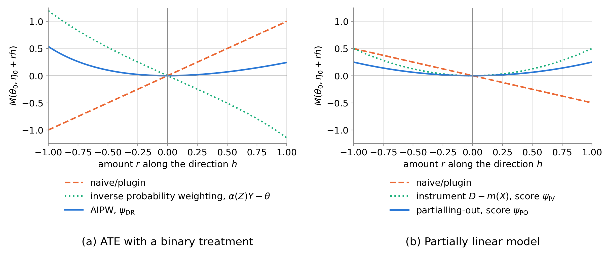

# Neyman orthogonality

## Data, target and Riesz representer {.smaller}

We observe $n$ independent copies of $W=(Y,Z)$ with law $P$, where $Y$ is an outcome and $Z$ collects the regressors, and write $g_0(z)=\mathbb{E}[Y\mid Z=z]$ for the outcome regression and $\langle f,g\rangle=\mathbb{E}[f(Z)g(Z)]$ for the inner product of $L^2(P_Z)$.

The target is a linear functional $\theta_0=\theta(g_0)$ of the outcome regression, with $\theta(g)=\mathbb{E}[\nu(W;g)]$. When $\theta$ is mean-square continuous, by the Riesz representation theorem [@riesz1907espece; @frechet1907ensembles] there is a unique $\alpha_0\in L^2(P_Z)$ with
$$
\theta(g)=\langle\alpha_0,g\rangle\quad\text{for all }g\in L^2(P_Z),\qquad\text{hence}\qquad\theta(g_0+h)-\theta_0=\langle\alpha_0,h\rangle .
$$
The representer $\alpha_0$ is therefore the derivative of the target with respect to the regression, and $\theta_0=\mathbb{E}[\alpha_0(Z)\,Y]$ [@chernozhukov2022automatic, Sec. 2].

| Target, with $Z=(D,X)$ | $\nu(W;g)$ | $\alpha_0(Z)$ |
|:--|:--|:--|
| average treatment effect (ATE), $D\in\{0,1\}$ | $g(1,X)-g(0,X)$ | $D/m_0(X)-(1-D)/\{1-m_0(X)\}$ |
| coefficient $\theta_0$ in $Y=\theta_0D+f_0(X)+\varepsilon$, $D=m_0(X)+V$ | $V\,g(Z)/\mathbb{E}[V^2]$ | $V/\mathbb{E}[V^2]$ |
| weighted average derivative, $D$ continuous | $\int\omega(u)\,\partial_dg(u,X)\,\mathrm{d}u$ | $-\omega'(D)/\varrho(D\mid X)$ |

: {tbl-colwidths="[44,28,28]"}

For the ATE, $m_0(x)=P(D=1\mid X=x)$ is the propensity score, and the target is identified under consistency, unconfoundedness and overlap [@rosenbaum1983central]. The partially linear model is that of @robinson1988root, with $\mathbb{E}[\varepsilon\mid D,X]=0$ and $\mathbb{E}[V\mid X]=0$. For the derivative, $\omega$ is a known density and $\varrho(d\mid x)$ is the density of $D$ given $X$ [@chernozhukov2022automatic, Table 1].

## Scores, moment conditions and cross-fitting {.smaller}

A score is a map $\psi(w;\theta,\eta)$ with a nuisance $\eta$ in a convex set $T$, and $M(\theta,\eta)=\mathbb{E}_P[\psi(W;\theta,\eta)]$ is its moment map. The score identifies $\theta_0$ if $M(\theta_0,\eta_0)=0$, this zero is unique, and the Jacobian $J_0=\partial_\theta M(\theta,\eta_0)|_{\theta=\theta_0}$ is non-singular. Examples are
$$
\begin{aligned}
\psi_{\mathrm{DR}}(W;\theta,g,\alpha)&=\nu(W;g)-\theta+\alpha(Z)\{Y-g(Z)\},\\
\psi_{\mathrm{IV}}(W;\theta,f,m)&=\{Y-\theta D-f(X)\}\{D-m(X)\},\\
\psi_{\mathrm{PO}}(W;\theta,\ell,m)&=\{Y-\ell(X)-\theta(D-m(X))\}\{D-m(X)\},
\end{aligned}
$$
where $\psi_{\mathrm{DR}}$ is the augmented inverse probability weighting (AIPW) score of any linear functional [@robins1994estimation; @chernozhukov2022automatic, eq. 2.4], and $\psi_{\mathrm{IV}}$ and $\psi_{\mathrm{PO}}$ are the scores of the partially linear model with $\ell_0(X)=\mathbb{E}[Y\mid X]=\theta_0m_0(X)+f_0(X)$ [@chernozhukov2018dml, eqs. 4.3–4.4].

<!-- A conditional moment restriction $\mathbb{E}[\rho(W;\theta_0,\eta_0)\mid Z]=0$ implies $\mathbb{E}[A(Z)\,\rho(W;\theta_0,\eta_0)]=0$ for every instrument $A(Z)$ [@chamberlain1987asymptotic]. The sensitivity of the moment condition to the nuisance and the efficiency of the estimator depend on the instrument. -->

For the double machine learning (DML) estimator, we partition the sample into folds $I_1,\dots,I_K$, compute $\hat\eta_k$ from the observations outside $I_k$, and solve [@chernozhukov2018dml, Def. 3.2]
$$
\frac1n\sum_{k=1}^K\sum_{i\in I_k}\psi(W_i;\theta,\hat\eta_k)=0 .
$$

## Three-term decomposition {.smaller .dense}

With $\mathbb{E}_{n,k}$ the average over fold $I_k$, $\mathbb{P}_n$ the average over the whole sample and $M(\theta_0,\eta_0)=0$, the average of the score splits as [@kennedy2024review]
$$
\mathbb{E}_{n,k}\psi(W;\theta_0,\hat\eta_k)
=\underbrace{\mathbb{E}_{n,k}\psi(W;\theta_0,\eta_0)}_{T_1}
+\underbrace{(\mathbb{E}_{n,k}-P)\{\psi(\cdot;\theta_0,\hat\eta_k)-\psi(\cdot;\theta_0,\eta_0)\}}_{T_2}
+\underbrace{M(\theta_0,\hat\eta_k)}_{T_3},
$$
and along the segment from $\eta_0$ to $\hat\eta_k$,
$$
T_3=\partial_rM\big(\theta_0,\eta_0+r(\hat\eta_k-\eta_0)\big)\big|_{r=0}+\int_0^1(1-r)\,\partial_r^2M\big(\theta_0,\eta_0+r(\hat\eta_k-\eta_0)\big)\,\mathrm{d}r .
$$

| Term | Property | Made negligible by |
|:--|:--|:--|
| $T_1$ | asymptotically normal | central limit theorem, which for the ATE requires overlap |
| $T_2$ | centred average of $n/K$ terms given $\hat\eta_k$ | cross-fitting with consistent $\hat\eta_k$, or stability of the nuisance estimator |
| $T_3$, first part | linear in $\hat\eta_k-\eta_0$ | Neyman orthogonality of the score |
| $T_3$, second part | quadratic in $\hat\eta_k-\eta_0$ | rates of convergence of $\hat\eta_k$ |

: {tbl-colwidths="[16,36,48]"}

<!-- For the plug-in score $\nu(W;g)-\theta$, $T_3=\langle\alpha_0,\hat g_k-g_0\rangle$ exactly.
*Nonparametric estimators of $g_0$ converge more slowly than $n^{-1/2}$, so $\sqrt n(\hat\theta-\theta_0)$ diverges unless this term is $o_P(n^{-1/2})$.  -->

## Definition {.smaller}

Following @chernozhukov2018dml [Sec. 2.1], let $\widetilde T=\{\eta-\eta_0:\eta\in T\}$ and define the Gateaux derivative map $\mathrm D_r:\widetilde T\to\mathbb{R}^{d_\theta}$ by
$$
\mathrm D_r[\eta-\eta_0]=\partial_r\Big\{\mathbb{E}_P\big[\psi\big(W;\theta_0,\eta_0+r(\eta-\eta_0)\big)\big]\Big\},\qquad r\in[0,1).
$$

[Definition]{.label} [@chernozhukov2018dml, Def. 2.1]. The score $\psi$ obeys the Neyman orthogonality condition at $(\theta_0,\eta_0)$ with respect to the nuisance realisation set $\mathcal T_N\subset T$ if $M(\theta_0,\eta_0)=0$, the map $\mathrm D_r[\eta-\eta_0]$ exists for all $r\in[0,1)$ and $\eta\in\mathcal T_N$, and
$$
\partial_\eta\mathbb{E}_P\psi(W;\theta_0,\eta_0)[\eta-\eta_0]:=\mathrm D_0[\eta-\eta_0]=0\qquad\text{for all }\eta\in\mathcal T_N .
$$

- The derivative is taken at the truth with the target held at $\theta_0$. It is the derivative of the moment map, which equals $\mathbb{E}_P\partial_\eta\psi$ only when differentiation under the integral is allowed.
- The set $\mathcal T_N$ contains the nuisance estimates, where $N$ is the sample size, and a smaller set imposes a weaker condition. The condition therefore depends on the law $P$ and on the set $\mathcal T_N$ as well as on the score.
- The score obeys the $\lambda_N$ near-orthogonality condition if $\|\mathrm D_0[\eta-\eta_0]\|\le\lambda_N=o(N^{-1/2})$ for all $\eta\in\mathcal T_N$ [@chernozhukov2018dml, Def. 2.2], which arises when the parameter that orthogonalises the score is defined by a regularised problem.

## Moment maps along a nuisance direction

{width=100%}

[With $X$ uniform on $[0,1]$ and $\theta_0=1$, panel (a) uses $m_0(x)=0.25+0.5x$, $g_0(d,x)=d+2x$ and the direction $(g,m)=(g_0+rd,\,m_0+0.15r)$, and panel (b) uses $m_0(x)=x$, $f_0(x)=x^2$ and the directions $f_0+r$, $\ell_0+r$ and $m_0+0.5r$. The slope at $r=0$ is $\mathrm D_0[h]$, which vanishes for the AIPW score and for both scores of the partially linear model.]{.source}

## Construction of orthogonal scores {.smaller}

[Correction by the Riesz representer.]{.label} For a fixed $A\in L^2(P_Z)$, the score $\nu(W;g)-\theta+A(Z)\{Y-g(Z)\}$ has the derivative $\mathrm D_0[h]=\mathbb{E}[\nu(W;h)]-\mathbb{E}[A(Z)h(Z)]=\langle\alpha_0-A,\,h\rangle$ in a direction $h$ of $g$. It is orthogonal in $g$ for a dense set of directions exactly when $A=\alpha_0$, so the correction term of an orthogonal score of a linear functional is the Riesz representer times the residual. With $\alpha$ as a second nuisance, the score is orthogonal in $\alpha$ because $\mathbb{E}[Y-g_0(Z)\mid Z]=0$.

[Orthogonal instruments.]{.label} In the partially linear model, the moment $\mathbb{E}[A(D,X)\{Y-\theta_0D-f(X)\}]$ has the derivative $-\mathbb{E}\big[\mathbb{E}[A\mid X]\,h(X)\big]$ in a direction $h(X)$ of $f$, so it is orthogonal in $f$ exactly when $\mathbb{E}[A\mid X]=0$. Every instrument $\{D-m_0(X)\}k(X)$ satisfies this condition, so orthogonal scores are not unique, and the choice of $k$ affects the efficiency [@chernozhukov2018dml, Sec. 2.2.4].

[Projection on the nuisance scores.]{.label} In a regular parametric model with scores $s_\theta$ and $s_\eta$ and information matrix with blocks $I_{\theta\eta}$ and $I_{\eta\eta}$, let $\mathbb{E}_{\theta_0,\eta}\psi(W;\theta_0,\eta)=0$ for all $\eta$. Differentiating in $\eta$ gives $\partial_\eta M(\theta_0,\eta_0)=-\mathbb{E}[\psi_0s_\eta^\top]$, where $\psi_0=\psi(\cdot;\theta_0,\eta_0)$. The residual score of @neyman1959optimal [-@neyman1979calpha],
$$
\psi=s_\theta-I_{\theta\eta}I_{\eta\eta}^{-1}s_\eta ,
$$
is uncorrelated with $s_\eta$ and therefore orthogonal. @chernozhukov2018dml [Sec. 2.2] construct orthogonal scores in likelihood and moment problems by projecting a score off the nuisance directions, and the orthogonalising matrix becomes a further nuisance.

## Double robustness and the mixed bias property {.smaller}

Let the nuisance be a pair $(g,\alpha)\in\mathcal T_g\times\mathcal T_\alpha$. The score is doubly robust if $M(\theta_0,g,\alpha_0)=M(\theta_0,g_0,\alpha)=0$ for all $g$ and $\alpha$, and it has the mixed bias property if $M(\theta_0,g,\alpha)=\mathbb{E}[S(W)\,(g-g_0)(Z)\,(\alpha-\alpha_0)(Z)]$ for all $(g,\alpha)$ and a known function $S$ [@rotnitzky2021mixed]. The AIPW score has the mixed bias property with $S=-1$ [@chernozhukov2022automatic, eq. 2.5],
$$
M(\theta_0,g,\alpha)=-\langle g-g_0,\,\alpha-\alpha_0\rangle\qquad\text{for every pair }(g,\alpha).
$$

[Proposition.]{.label} Let $T=\mathcal T_g\times\mathcal T_\alpha$ be a product of convex sets, let $\mathcal T_N=T$, and let $\mathrm D_0$ be linear. Then the following hold.

1. The mixed bias property implies double robustness, and double robustness implies orthogonality.
2. If $M(\theta_0,g_0,\alpha)=0$ for every $\alpha$, the score is doubly robust exactly when it is orthogonal and $g\mapsto M(\theta_0,g,\alpha_0)$ is affine [@chernozhukov2022locally, Thm. 4].
3. Orthogonality does not imply double robustness. In the partially linear model,
$$
M_{\mathrm{PO}}(\theta_0,\ell,m)=\langle\ell-\ell_0,\,m-m_0\rangle-\theta_0\|m-m_0\|^2,\qquad M_{\mathrm{IV}}(\theta_0,f,m)=\langle f-f_0,\,m-m_0\rangle,
$$
so both scores are orthogonal, and for $\theta_0\neq0$ only $\psi_{\mathrm{IV}}$ is doubly robust.

Since $\ell_0=\theta_0m_0+f_0$ contains $m_0$, an error in $m$ also enters through $\ell$. The choice of the nuisance that is called the outcome model matters for double robustness and does not matter for orthogonality.

## Properties and limits of orthogonal scores {.smaller}

:::: {.columns}
::: {.column width="52%"}
[Properties]{.label}

- The nuisance error enters the bias term $T_3$ only through second-order terms, which are $o_P(n^{-1/2})$ when $\|\hat\eta_k-\eta_0\|=o_P(n^{-1/4})$ in $L^2(P)$, or, for scores with the mixed bias property, when $\|\hat g-g_0\|\,\|\hat\alpha-\alpha_0\|=o_P(n^{-1/2})$, so any learner with these rates can estimate the nuisance.
- With cross-fitting and these rates, the DML estimator is asymptotically linear with influence function $-J_0^{-1}\psi_0$, and Wald intervals with a plug-in variance estimator are valid uniformly over models in which the rates hold uniformly [@chernozhukov2018dml, Thm. 3.1, Thm. 3.2 and Cor. 3.1].
<!-- - If an orthogonal score identifies the target along a nonparametric model, $-J_0^{-1}\psi_0$ is the efficient influence function (EIF), the influence function of an efficient estimator, and the DML estimator attains the efficiency bound (Appendix). -->
- Under the mixed bias property the bias formula holds for every nuisance pair, so nuisance errors from any source enter through one inner product.
:::
::: {.column width="48%"}
[Limits]{.label}

- Orthogonality removes only the first-order part of $T_3$, and nuisance errors that do not shrink with $n$ violate the rate conditions.
- Overlap is needed for $\alpha_0\in L^2(P_Z)$ and for a bounded $\hat\alpha$, and trimming changes the estimand.
- Identification of a causal target requires assumptions about the process that generates the data, which do not depend on the score.
<!-- - Among the orthogonal scores the EIF has the smallest variance, and $\psi_{\mathrm{PO}}$ is efficient when $\operatorname{Var}(\varepsilon\mid D,X)$ is constant. -->
- The definition applies to estimators that solve an estimating equation.
:::
::::

# Generalisations of Neyman orthogonality

## Approaches by term of the decomposition {.smaller}

| Approach | Term | Representative references |
|:--|:--|:--|
| correction of the score | first part of $T_3$ | [@newey1994asymptotic; @chernozhukov2018dml; @chernozhukov2022locally] |
| automatic or numerical correction | first part of $T_3$ | [@chernozhukov2022automatic; @chernozhukov2022riesznet; @carone2019toward; @ichimura2022influence] |
| fit that solves the orthogonal equation | first part of $T_3$ | [@scharfstein1999adjusting; @vanderlaan2006tmle; @brunssmith2026augmented] |
| balancing and minimax weights | first part of $T_3$ | [@zubizarreta2015stable; @kallus2020generalized; @hirshberg2021augmentedaos] |
| prior invariant along the least-favourable direction | first part of $T_3$ | [@castillo2015bvm; @ray2020semiparametric; @breunig2025double; @melnychuk2026debiased] |
| higher-order orthogonality and influence functions | higher-order parts of $T_3$ | [@mackey2018orthogonal; @robins2008higher; @robins2017minimax] |
| cross-fitting, stability of the nuisance estimator | $T_2$ | [@chernozhukov2018dml; @chen2022debiased] |
| calibration and further targeting | second part of $T_3$, one slow nuisance | [@benkeser2017doubly; @vanderlaan2024calibration] |

: {tbl-colwidths="[30,19,51]"}

## Automatic debiased machine learning {.smaller .dense}

The correction term of an orthogonal score of a linear functional contains the Riesz representer, which minimises the Riesz loss
$$
\mathbb{E}\big[\alpha(Z)^2-2\nu(W;\alpha)\big]=\|\alpha-\alpha_0\|^2-\|\alpha_0\|^2 .
$$
The loss can be evaluated without a formula for $\alpha_0$ when $\nu$ does not depend on $P$, as for the ATE, and minimising an empirical version of it over a class of functions is called Riesz regression [@chernozhukov2021riesz].

- @chernozhukov2022automatic minimise a Lasso version of the Riesz loss over linear $\alpha$, use the fit in the cross-fitted AIPW score of any mean-square continuous linear functional, and call the method automatic debiased machine learning.
- RieszNet learns $g$ and $\alpha$ with a neural network that shares its layers between the two, and ForestRiesz learns $\alpha$ with a random forest [@chernozhukov2022riesznet].
- @chernozhukov2026causalml give a textbook account of automatic debiased machine learning, and @vanderlaan2025automatic extend it to smooth functionals of M-estimands, which are population risk minimisers such as counterfactual regressions, survival functions and conditional average treatment effects, using the gradient and Hessian of the loss in place of an analytic influence function.
- For targets without a known form of the influence function, the correction can be computed numerically, by finite differences of $P\mapsto\theta(P)$ at an estimate of $P$ perturbed toward a smoothed point mass [@carone2019toward; @jordan2022empirical], or as the derivative of the limit of the estimator along contamination paths [@ichimura2022influence].

## Orthogonality without an explicit correction {.smaller .dense}

- [Targeting.]{.label} The clever covariate [@scharfstein1999adjusting; @bang2005doubly] and targeted maximum likelihood [@vanderlaan2006tmle; @vanderlaan2011targeted] add $\hat\alpha$ to the outcome fit so that $\mathbb{P}_n[\hat\alpha\{Y-\hat g\}]=0$, and the plug-in at the modified fit equals the corrected estimator.
- [Sieves.]{.label} Least squares on a closed subspace $\mathcal S$, with projection $\mathsf P_{\mathcal S}$ and $\mathsf M_{\mathcal S}=I-\mathsf P_{\mathcal S}$, solves the orthogonal equation for $\mathsf P_{\mathcal S}\alpha_0$, and the plug-in bias is $-\langle\mathsf M_{\mathcal S}\alpha_0,\mathsf M_{\mathcal S}g_0\rangle$ [@chernozhukov2022automatic, eq. 2.6]. Sieve plug-ins can be efficient for smooth functionals [@newey1994asymptotic; @shen1997methods].
- [Balancing weights.]{.label} Weighting estimators $n^{-1}\sum_iw_iY_i$ can be designed so that the weights balance a class of outcome functions, exactly or up to a bound on the worst-case imbalance [@zubizarreta2015stable; @kallus2020generalized; @hirshberg2021augmentedaos]. When the outcome and weighting models are linear in the same basis, augmented balancing weights are equivalent to a single linear regression [@brunssmith2026augmented].
- [Priors.]{.label} The no-bias condition of a semiparametric Bernstein–von Mises theorem [@castillo2015bvm] holds when the prior is approximately invariant under shifts of order $n^{-1/2}$ along the least-favourable direction, which for the ATE is proportional to the Riesz representer when $\operatorname{Var}(Y\mid Z)$ is constant [@ray2019debiased; @breunig2025double]. Priors that depend on an estimated propensity score achieve this invariance [@ray2020semiparametric]. @javurek2026generalized put a prior on the causal target and update it with a loss that identifies the target in a generalised posterior, which for Neyman-orthogonal losses converges to its oracle counterpart. Other approaches correct the posterior [@breunig2025double; @yiu2025semiparametric] or change the outcome model, by a reparametrisation [@hahn2018regularization] or with the estimated propensity score as a covariate [@hahn2020bcf].

## Learned representations and in-context nuisance learners {.smaller}

- Neural networks for treatment effects learn representations that predict both the treatment and the outcome, as DragonNet with its targeted regularisation [@shi2019adapting] and the adapted text embeddings of @veitch2020adapting.
- @melnychuk2026orthogonal argue that end-to-end representation learning lacks the quasi-oracle efficiency of Neyman-orthogonal learners, and they propose OR-learners, which combine learned representations with Neyman-orthogonal learners of causal quantities.
- TabPFN, a prior-data fitted network (PFN) for tabular prediction [@hollmann2025tabpfn], has been used as nuisance learner in meta-learners for heterogeneous effects [@zhang2025tabpfn] and in the DoubleML software [@bach2024doubleml].
- @wang2026amortized add a propensity output to CausalPFN, trained jointly with its outcome model, and build AIPW and TMLE estimators on it. These estimators remain stable as confounding grows, whereas the Bayesian plug-in estimate of CausalPFN degrades.
- Optimal covariate balancing is dual to a regularised self-attention, and @zhang2024cina learn balancing weights across data sets.
- For a simplified transformer, the variance of a PFN vanishes as $n$ grows while its bias need not [@nagler2023pfn].

## Causal prior-data fitted networks {.smaller}

- Causal PFNs, such as Do-PFN [@robertson2025dopfn], CausalPFN [@balazadeh2025causalpfn] and CausalFM [@ma2026causalfm], return effect estimates from the data set in context, without an orthogonal score.
- In simulations based on clinical data, the estimates of CausalPFN were biased and its credible intervals covered poorly [@mourao2026prior].
- @wang2026unveiling prove that one structural causal model induces an exponentially large space of interventional distributions, so that pretraining leaves part of them uncovered, which leads to posterior inconsistency and estimation bias, and they propose fine-tuning for specific interventions.
- @melnychuk2026frequentist show that PFNs used as Bayesian ATE estimators have a confounding bias induced by the prior, which they identify with regularisation-induced confounding, the bias of a regularised outcome regression that shrinks the coefficients of covariates that also predict the treatment [@hahn2018regularization], and they correct it by a one-step correction of martingale posteriors of TabPFN.
- @zhang2026fluctuate pretrains causal tabular models on the labels $\theta(P)+\mathbb{P}_n\varphi_P$, the ATE plus the fluctuation term of its EIF, and derives the coverage of Wald intervals for the frozen network.

Neyman orthogonality is defined for scores, and causal PFNs that return the effect directly have none.

## Debiased prior-data fitted networks {.smaller .dense}

@melnychuk2026debiased train a PFN with the log loss on the target $\theta_\xi$ of data-generating processes $\xi$ drawn from a prior $\Pi$. They call the network idealised when it returns the posterior of $\theta_\xi$ exactly, and they study this posterior under data from a fixed law $P$ for general targets with an EIF, including the ATE.

- Without a correction, the $L^2$ concentration error of the target posterior is at most the posterior average of the nuisance error plus a second-order remainder, and a worst-case posterior inherits the nuisance rate [@melnychuk2026debiased, Thm. 1].
- [Label correction.]{.label} The network is trained on the labels $\theta_\xi+\sum_i\varpi_i\varphi_\xi(W_i)$, with the EIF $\varphi_\xi$ under $\xi$ and Bayesian bootstrap weights $(\varpi_1,\dots,\varpi_n)\sim\mathrm{Dirichlet}(1,\dots,1)$ drawn independently of $\xi$ and $\mathcal D_n$, so that the one-step posterior correction of @yiu2025semiparametric is applied in pretraining [@melnychuk2026debiased, Eq. 12].
- [Prior correction.]{.label} Each process $\xi$ is perturbed along a least-favourable submodel, a one-dimensional submodel through $\xi$ whose score is $\varphi_\xi$, with a coefficient $\kappa\sim N(0,\sigma_n^2)$ and $n\sigma_n^2\to\infty$, which extends the prior correction of @ray2020semiparametric [@melnychuk2026debiased, Eq. 15]. For the ATE with Gaussian noise of unit variance, the outcome regression $g_\xi$ of $\xi$ is replaced by $g_\xi+\kappa\alpha_\xi$, with the Riesz representer $\alpha_\xi$ of the ATE under $\xi$, and the density of $X$ is reweighted with the same $\kappa$ (App. F.2.1).
- With either correction and a stochastically equicontinuous posterior, the posterior of the idealised network concentrates at the rate $n^{-1/2}$ plus the remainder (Thm. 2). When the remainder is $o_P(n^{-1/2})$, a Bernstein–von Mises theorem with the efficient variance holds under regularity conditions (Thm. 3). When the mean square of the remainder is bounded uniformly over a class of laws supported by the prior, the worst-case risk of the posterior mean over this class is of order $n^{-1}$ plus this bound, the minimax rate when a matching lower bound holds (Thm. 4).
- In ATE experiments, the training prior draws the propensity score independently of the outcome regressions, and an evaluation prior has more observed confounding. Under the evaluation prior, the authors report that both corrected networks often have a smaller $L^2$ risk than the network without a correction for $n\ge1024$ with 5 covariates and $n\ge2048$ with 10, and the total variation distance of all networks to the efficient normal approximation grows with $n$ (Sec. 5).

<!-- # Orthogonality for estimators without a score

## Estimators without a score {.smaller}

The following estimators map the data set $\mathcal D_n=(W_1,\dots,W_n)$ to an estimate without an estimating equation.

- Posterior means, which are Bayes rules under a prior.
- Plug-in estimators with regularised or learned outcome regressions, which are subject to regularisation-induced confounding.
- Networks trained end to end on the target, and plug-in estimators on learned representations.
- In-context learners, which are fixed maps $F_\chi$ with parameters $\chi$ learned in pretraining on synthetic data sets from a prior $\Pi$ over data-generating processes $\xi$ [@muller2022pfn].

[Lemma.]{.label} Over all measurable maps $F$, the squared pretraining loss $\mathbb{E}_{\xi,\mathcal D_n}[\{F(\mathcal D_n)-\theta_\xi\}^2]$ is minimised, uniquely up to almost sure equality, by the posterior mean $\hat\theta_\Pi(\mathcal D_n)=\mathbb{E}_\Pi[\theta_\xi\mid\mathcal D_n]$ [@muller2022pfn; @foong2020metalearning].

A trained network computes $\hat\theta_\chi=\hat\theta_\Pi+a_\chi(\mathcal D_n)$, where $a_\chi$ is the amortisation error. By the lemma, the minimiser of the pretraining loss is a Bayes rule, whose properties depend on the prior and on the training target. The amortisation error of a fixed network is not guaranteed to vanish as $n$ grows, so rate conditions on in-context nuisances cannot be verified from the pretraining objective alone. -->

<!-- 
## First-order insensitivity {.smaller}

[Outcome shifts.]{.label} For a direction $h\in L^2(P_Z)$ and $\delta\in\mathbb{R}$, let $P_{\delta h}$ be the law of $(Y+\delta h(Z),Z)$. Under $P_{\delta h}$ the outcome regression is $g_0+\delta h$ and the target is $\theta_0+\delta\langle\alpha_0,h\rangle$. Write $b_n(\delta;h)=\mathbb{E}_{\delta h}[\hat\theta]-\theta(P_{\delta h})$ for the bias of an estimator $\hat\theta$ along the shift.

[Proposed definition.]{.label} The estimator $\hat\theta$ is first-order insensitive to the outcome regression in the direction $h$ if $\partial_\delta b_n(0;h)=0$, and asymptotically first-order insensitive over a class of directions if this derivative tends to zero uniformly over the class.

- The bias then does not drift at the scale $n^{-1/2}$ along local shifts. The condition is the derivative part of local asymptotic unbiasedness [@hirano2012impossibility] and, under uniform integrability, equivalent to regularity along these shifts [@vandervaart1998asymptotic, Ch. 8].
- The definition needs only the map from data sets to estimates, so it applies to trained networks, whereas @melnychuk2026debiased analyse the idealised network.

## Causal PFNs under independent mechanisms {.smaller .dense}

Write a task as $\xi=(\xi_X,\xi_D,\xi_Y)$ with $P_\xi=P_{X;\xi_X}\otimes P_{D\mid X;\xi_D}\otimes P_{Y\mid D,X;\xi_Y}$. The prior $\Pi$ has independent mechanisms if $\xi_D$ is independent of $(\xi_X,\xi_Y)$ under $\Pi$.

[Proposition.]{.label} Under independent mechanisms, $\Pi(\mathrm{d}\xi_X,\mathrm{d}\xi_Y\mid\mathcal D_n)\propto\Pi_{X,Y}(\mathrm{d}\xi_X,\mathrm{d}\xi_Y)\prod_ip(X_i;\xi_X)\,p(Y_i\mid D_i,X_i;\xi_Y)$ does not involve the treatment likelihood, so the posterior mean of the ATE is a Bayesian outcome regression with the uncorrected term $\langle\alpha_0,\hat g_\Pi-g_0\rangle$ in its error, where $\hat g_\Pi=\mathbb{E}_\Pi[g_\xi\mid\mathcal D_n]$. The factorisation is the Bayesian ignorability of the treatment assignment [@gelman2013bda, Sec. 8.2; @li2023bayesian, Sec. 3].

| Model | Treatment mechanism | Outcome mechanism | Prior dependence |
|:--|:--|:--|:--|
| Do-PFN [@robertson2025dopfn] | node of a random structural causal model | node of the same graph | shared graph, independent weights |
| CausalPFN [@balazadeh2025causalpfn] | logit of $X$ that is constant, linear or a random network | relabelled columns of a base table | independent draws |
| CausalFM [@ma2026causalfm] | random network $f_A(X,U_A)$ | random network $f_Y(X,A,U_Y)$ | independent weights and noise |

: {tbl-colwidths="[22,28,26,24]"}

[Proposed result.]{.label} Under independent mechanisms, the Bayes rule for a training target that is a function of $(\xi_X,\xi_Y,\mathcal D_n)$ does not involve the treatment likelihood. The minimiser of the squared pretraining loss therefore involves the treatment likelihood only when the training target depends on $\xi_D$ or the prior couples $\xi_D$ with $(\xi_X,\xi_Y)$, as the priors of @li2023bayesian [Sec. 5] do, and the label correction and the prior correction of @melnychuk2026debiased are instances of the two cases. -->

# Research question and contribution

## Project question and motivation {.smaller}

[Motivation.]{.label} Causal PFNs return an effect estimate in one forward pass, but they have no score, so Neyman orthogonality cannot be checked for them. In simulations based on clinical data, CausalPFN was biased and its credible intervals covered poorly [@mourao2026prior]. The guarantees of @melnychuk2026debiased hold for the idealised network, and their theory sets the amortisation error of a trained network aside.

[Main question.]{.label} When is an estimator without a score, in particular a trained in-context learner, first-order insensitive to errors in the outcome regression, and how can this be checked from the data and the trained network alone?

1. Which property of an estimator takes the place of Neyman orthogonality, how is it related to regularity and to orthogonal scores, and which shifts beyond those of the outcome regression does it have to cover?
2. Do the implicit weights $w_i=n\,\partial\hat\theta/\partial Y_i$ of a trained network give a diagnostic of this property, and under which conditions does a test based on it have a known level?
3. Which training targets and priors make the Bayes rule of an in-context learner first-order insensitive?
4. Are trained networks first-order insensitive when they use the corrections of @melnychuk2026debiased, or in-context nuisances with cross-fitting and an AIPW layer?

## Contribution and positioning {.smaller .dense}

| Proposed contribution | Closest work | What is new |
|:--|:--|:--|
| A criterion without a score, first-order insensitivity along shifts of the outcome regression | local asymptotic unbiasedness [@hirano2012impossibility]; @giordano2026locally | the derivative condition of local asymptotic unbiasedness at fixed $n$, written for every estimator differentiable in the outcomes as balance of its implicit weights, with the Riesz representer as target |
| A diagnostic from one backward pass, the imbalance of the implicit weights | balance checks of linear weights [@chattopadhyay2023implied; @knaus2024weighted]; @giordano2026locally | estimators other than posterior means, such as trained networks, the expected imbalance as the sensitivity, and a test with a known level |
| Bayes rules of in-context learners under the label and prior corrections | @melnychuk2026debiased; @zhang2026fluctuate; @li2023bayesian; @linero2021ignorability | when the treatment mechanism enters the Bayes rule, the AIPW form of the Bayes rule of the label correction, and finite-sample unbiasedness of a prior correction in a Gaussian model |
| Measurement of the implicit weights of trained causal PFNs and of designs with in-context nuisances, such as an AIPW layer on nuisance heads and cross-fitting in context | @mourao2026prior; @wang2026amortized; @melnychuk2026debiased | first-order insensitivity of trained networks, measured with the diagnostic |

: {tbl-colwidths="[32,28,40]"}

## References {.scrollable}

::: {#refs}
:::

# Appendix

## Asymptotic normality of the DML estimator {.smaller}

Let $\psi=\psi^a(W;\eta)\,\theta+\psi^b(W;\eta)$ be Neyman orthogonal with respect to $\mathcal T_N$, and let $\hat\eta_k\in\mathcal T_N$ with probability at least $1-\Delta_N$, where $\Delta_N\to0$, $\delta_N\to0$ and
$$
\begin{aligned}
r_N'&=\sup_{\eta\in\mathcal T_N}\big(\mathbb{E}_P\|\psi(W;\theta_0,\eta)-\psi(W;\theta_0,\eta_0)\|^2\big)^{1/2}\le\delta_N,\\
\lambda_N'&=\sup_{r\in(0,1),\,\eta\in\mathcal T_N}\big\|\partial_r^2M\big(\theta_0,\eta_0+r(\eta-\eta_0)\big)\big\|\le\delta_NN^{-1/2}.
\end{aligned}
$$
Under these conditions and the moment and identification conditions of Assumptions 3.1 and 3.2 of @chernozhukov2018dml, by their Theorem 3.1,
$$
\sqrt N(\hat\theta-\theta_0)=-J_0^{-1}\frac1{\sqrt N}\sum_{i=1}^N\psi(W_i;\theta_0,\eta_0)+o_P(1)\;\rightsquigarrow\;N(0,\sigma^2),\qquad\sigma^2=J_0^{-1}\,\mathbb{E}_P[\psi_0\psi_0^\top]\,(J_0^{-1})^\top,
$$
uniformly over the laws that satisfy the assumptions, and Wald intervals with the plug-in variance estimator are uniformly valid [@chernozhukov2018dml, Thm. 3.2 and Cor. 3.1].

By the bound on $r_N'$ and cross-fitting, $T_2=o_P(N^{-1/2})$. By the bound on $\lambda_N'$, the second part of $T_3$ is $o_P(N^{-1/2})$, which for smooth scores holds when the $L^2$ rate $\varepsilon_N$ of the nuisance estimator is $o(N^{-1/4})$, and for $\psi_{\mathrm{DR}}$, where $\partial_r^2M=-2\langle g-g_0,\alpha-\alpha_0\rangle$, when the product of the two errors is $o(N^{-1/2})$.

## Orthogonal scores and efficient influence functions {.smaller}

A regular submodel is a path $t\mapsto P_t$ through $P$, differentiable in quadratic mean, whose log density has derivative $s$ at $t=0$, and $L^2_0(P)$ is the space of square-integrable functions with mean zero. A function $\varphi\in L^2_0(P)$ is a gradient of $\theta$ at $P$ if $\partial_t\theta(P_t)|_{t=0}=\mathbb{E}[\varphi\,s]$ for every regular submodel, and in a locally nonparametric model, in which these derivatives $s$ are dense in $L^2_0(P)$, the gradient is unique and is the efficient influence function (EIF) [@vandervaart1998asymptotic, Ch. 25]. If $\psi$ identifies $\theta$ along a regular submodel, $\mathbb{E}_{P_t}\psi(W;\theta(P_t),\eta(P_t))=0$, then differentiation at $t=0$ gives
$$
0=\mathbb{E}_P[\psi_0\,s]+J_0\,\dot\theta+\mathrm D_0[\dot\eta],
$$
with $\dot\theta$ and $\dot\eta$ the derivatives of $\theta(P_t)$ and $\eta(P_t)$ at $t=0$. Hence $\mathrm D_0$ vanishes on all nuisance tangents $\dot\eta$ exactly when $-J_0^{-1}\psi_0$ is a gradient, and in a locally nonparametric model a score that identifies $\theta$ along the model is orthogonal exactly when $-J_0^{-1}\psi_0$ is the EIF [@newey1994asymptotic; @chernozhukov2022locally]. For the ATE, $\psi_{\mathrm{DR}}(\cdot;\theta_0,g_0,\alpha_0)$ is the EIF [@hahn1998role].

## Formulations of orthogonality {.smaller}

The formulations below are equivalent to the definition, or sufficient for it, under conditions on the model and the directions.

| Formulation | Condition | Source |
|:--|:--|:--|
| conditional form | the derivative of the score in the value of the nuisance at the data point has conditional mean zero | @mackey2018orthogonal |
| local robustness, no first-step adjustment | the derivative of the moment along mixtures of $P$ with another law vanishes | @newey1994asymptotic; @chernozhukov2022locally |
| nuisance tangent space | $\psi_0$ is orthogonal in $L^2(P)$ to the closed span of the derivatives $s$ of submodels that move only $\eta$ | @tsiatis2006semiparametric |
| parameter orthogonality | the likelihood score of $\theta$ is uncorrelated with that of $\eta$ | @cox1987parameter |
| orthogonal loss | the cross derivative of the population risk in the target and the nuisance vanishes at the minimiser | @foster2023orthogonal |

## Local robustness and general targets {.smaller}

- @newey1994asymptotic derives the adjustment term that a nonparametric first step adds to the influence function of a two-step estimator, and the term vanishes for orthogonal scores.
- @chernozhukov2022locally construct locally robust moments $\psi=q+\phi$ for the generalised method of moments and for nonlinear functionals, where $\phi$ is the influence function of the first step along paths $F_\tau=(1-\tau)F_0+\tau H$.
- @chernozhukov2022nested give debiased estimators for dynamic treatment effects and general nested functionals, in which each regression is a nuisance of the next.
- @bennett2025inference study functionals that are strongly identified while the nuisance is weakly identified, as in instrumental variable and proxy models. A representer in the range of the adjoint of the operator that defines the nuisance is necessary for $\sqrt n$-estimation.
- @foster2023orthogonal extend orthogonality to population risks $L(\theta,g)$ whose minimiser $\theta$ is a function, such as a conditional average treatment effect, and the excess risk of the second stage is then insensitive to first order to the nuisance error. The R-learner loss $\mathbb{E}[\{Y-\ell(X)-\tau(X)(D-m(X))\}^2]$ of @nie2021quasi is orthogonal in $(\ell,m)$.

## Higher-order terms and minimax rates {.smaller}

- @mackey2018orthogonal call a moment $k$-orthogonal if its conditional derivatives in the nuisance vanish up to order $k$, and then a nuisance rate of $o(n^{-1/(2k+2)})$ in the $L^{2(k+1)}$ norm suffices [@mackey2018orthogonal, Cor. 4]. In the partially linear model with conditionally Gaussian treatment noise, every twice differentiable $2$-orthogonal score has $J_0=0$ and does not identify $\theta_0$ [@mackey2018orthogonal, Thm. 5]. @bonhomme2026higher construct moment functions that are Neyman orthogonal to a chosen order in parametric moment-condition models, with a number of additional nuisance parameters that does not grow with the order.
- Higher-order influence functions estimate higher-order terms of the von Mises expansion by U-statistics and attain minimax rates for nuisance functions too rough for $\sqrt n$-estimation [@robins2008higher; @robins2017minimax].
- When the nuisance functions satisfy no assumptions beyond the $L^2$ errors of their estimates, the product rate of first-order estimators is minimax optimal for quadratic functionals such as the expected conditional covariance [@balakrishnan2026fundamental], and the product rate of doubly robust estimators is minimax optimal for the ATE [@jin2024structure].

## Forms of robustness and inference {.smaller}

- @rotnitzky2021mixed characterise the parameters whose influence functions have the mixed bias property, and @smucler2019unifying distinguish rate double robustness, asymptotic normality whenever both nuisance estimators are consistent and $\|\hat g-g_0\|\,\|\hat\alpha-\alpha_0\|=o_P(n^{-1/2})$, from model double robustness, the same conclusion when one nuisance estimator converges to the truth and the other to a different limit.
- With more than two nuisances, robustness takes the form of multiple robustness in mediation analysis [@tchetgen2012semiparametric] and of sequential double robustness in longitudinal models, where the bias is a sum of products of errors, one per stage [@luedtke2017sequential; @rotnitzky2017multiply].
- A doubly robust estimator can be made asymptotically linear when only one nuisance is estimated consistently, by further targeting [@benkeser2017doubly] or by calibration [@vanderlaan2024calibration], and leave-one-out stability of the nuisance estimator can replace sample splitting [@chen2022debiased].
- Estimators that use working models selected from the data are not regular, so inference for $\theta_0$ is not uniformly valid over the full model even when the score is orthogonal [@vanderlaan2023adml, Thm. 7].

## Implicit weights {.smaller .dense}

[Definition.]{.label} For an estimator that is differentiable in the outcomes, the implicit weights are $w_i=n\,\partial\hat\theta/\partial Y_i$, computed for a network by one backward pass. For estimators linear in the outcomes they are the implied weights of @chattopadhyay2023implied and the outcome weights of @knaus2024weighted, and for posterior means the locally equivalent weights of @giordano2026locally, who read covariate balance as the first-order response of the estimate to an outcome shift.

[Proposed result.]{.label} For any such estimator, in expectation over the sampling law and under a domination condition on the derivative of $\delta\mapsto\hat\theta(Z_{1:n},Y_{1:n}+\delta h(Z_{1:n}))$,
$$
\partial_\delta b_n(0;h)=\mathbb{E}_P\Big[\frac1n\sum_{i=1}^nw_i\,h(Z_i)\Big]-\langle\alpha_0,h\rangle .
$$
The estimator is first-order insensitive in the direction $h$ exactly when its implicit weights balance $h$ in expectation, and over a class $\mathcal H$ exactly when they act in expectation as the Riesz representer on $\mathcal H$.

[Proposed result.]{.label} For a corrected plug-in estimator $\hat\theta=n^{-1}\sum_i[\nu(W_i;\hat g)+\hat a(Z_i)\{Y_i-\hat g(Z_i)\}]$ with a linear smoother $\hat g=\hat SY'$ and correction weights $\hat a$ fitted on an independent sample, $\partial_\delta b_n(0;h)=\mathbb{E}\langle\alpha_0-\hat a,\,\hat Sh-h\rangle$, where $\hat Sh$ is the smoother applied to $h$. The sensitivity of the AIPW estimator is therefore bounded by the product of the two errors, and that of the plug-in estimator, with $\hat a=0$, is of first order in the error of the smoother.

When $\nu$ does not depend on $P$, as for the ATE, the sample imbalance $\hat\Delta(h)=n^{-1}\sum_iw_ih(Z_i)-n^{-1}\sum_i\nu(W_i;h)$ can be computed without $g_0$ or $\alpha_0$, for instance in the direction of an estimated treatment regression $\hat m(X)$.

<!-- ## Proposed results for in-context learners {.smaller .dense}

- [Bayes rule of the label correction.]{.label} Since the Bayesian bootstrap weights have mean $1/n$, the posterior mean under the label correction equals the Bayes rule for the one-step label $n^{-1}\sum_i[\tau_\xi(X_i)+\alpha_\xi(Z_i)\{Y_i-g_\xi(Z_i)\}]$ of @zhang2026fluctuate, with $\tau_\xi=g_\xi(1,\cdot)-g_\xi(0,\cdot)$. This Bayes rule is the posterior average of the AIPW estimator, which @antonelli2022causal propose. Under independent mechanisms it equals the AIPW estimator at the posterior means $\hat\tau_\Pi$, $\hat g_\Pi$ and $\hat\alpha_\Pi$ of $\tau_\xi$, $g_\xi$ and $\alpha_\xi$, and when $\xi_D$ and $(\xi_X,\xi_Y)$ are dependent under $\Pi$ it differs from it by $-n^{-1}\sum_i\operatorname{Cov}_\Pi\{\alpha_\xi(Z_i),g_\xi(Z_i)\mid\mathcal D_n\}$. The nuisances are evaluated on the rows to which they were fitted, so the empirical process term has to be controlled without sample splitting [@chen2022debiased], and @melnychuk2026debiased assume a stochastic equicontinuity condition that makes it negligible.
- [Finite-sample analysis of the prior correction.]{.label} In the Gaussian partially linear model $D=X\gamma+V$, $Y=\theta D+X\beta+\varepsilon$ with known $\gamma$, take a flat prior on $\theta$ and $\beta=\tilde\beta+\kappa\gamma$ with a Gaussian prior on $\tilde\beta$ and a flat prior on $\kappa$, which under the flat prior on $\theta$ is the correction of the outcome regression along $\alpha_\xi$ [@linero2021ignorability; @linero2024ignorability]. The posterior mean of $\theta$ is then unbiased given $X$ for every $\beta$ whenever this conditional mean exists. The correction is specific to one functional [@ritov2014coda, Thm. 4.3].
- [Cross-fitting in context.]{.label} Predicting fold $I_k$ as a query set with the other folds as context gives an exact cross-fit with $K$ forward passes when query rows do not influence the representations of the context rows.
- [Score layers.]{.label} @wang2026amortized train a propensity head jointly with CausalPFN and apply AIPW and TMLE outside the network. An AIPW layer inside the network on nuisance heads that predict $g$ and $\alpha$ attains the Bayes rule with $\hat\alpha\equiv0$ under an end-to-end loss on $\theta_\xi$, so its heads need not output the nuisances. The orthogonal structure is kept when the heads are trained on their nuisance targets and the gradient of the loss on $\theta_\xi$ is stopped at the heads.
- [Riesz representers in context.]{.label} A learner trained on the exact $\alpha_\xi$ or with the Riesz loss outputs $\hat\alpha$ for any linear functional without inverting a propensity score, which extends the propensity head of @wang2026amortized.

## Simulation in a Gaussian partially linear model {.smaller .dense}

In a simulation of posterior means, computed in closed form or by Gibbs sampling, let $D=X\gamma+V$ and $Y=\theta D+X\beta+\varepsilon$ with standard Gaussian noise, $p=100$ covariates, $\theta_0=1$ and $\beta=\gamma=u_1$ for a unit vector $u_1$, so the outcome and the treatment depend on the same covariate direction. The prior with independent mechanisms puts a flat prior on $\theta$ and independent priors $\beta\sim N(0,I/p)$ and $\gamma\sim N(0,I/p)$, and its posterior mean is $\hat\theta_{\mathrm I}=D^\top\mathsf M_\lambda Y/D^\top\mathsf M_\lambda D$ with $\mathsf M_\lambda=I-X(X^\top X+\lambda I)^{-1}X^\top$ and $\lambda=p$. The conditional bias $D^\top\mathsf M_\lambda X\beta/D^\top\mathsf M_\lambda D$ of $\hat\theta_{\mathrm I}$ [@hahn2018regularization, eq. 2.3] is the imbalance $n^{-1}\sum_iw_i(X\beta)_i-\langle\alpha_0,X\beta\rangle$ of its implicit weights on $X\beta$, since $\langle\alpha_0,X\beta\rangle=0$. Under the corrected prior, $\beta$ is replaced by $\beta+\kappa\gamma$ with $\kappa\sim N(0,10^2)$ and $\gamma$ unknown. Since $\alpha_\xi=D-X\gamma$ under unit noise variance and the prior on $\theta$ is flat, this is the correction of the outcome regression along $\alpha_\xi$.

| Estimator | $n=200$ | | $n=800$ | | $n=3200$ | |
|:--|--:|--:|--:|--:|--:|--:|
| | bias/sd | cover | bias/sd | cover | bias/sd | cover |
| least squares | −0.00 | 97.6 | −0.06 | 94.2 | +0.03 | 95.8 |
| posterior mean, independent mechanisms | +4.81 | 0.4 | +3.17 | 12.2 | +1.72 | 60.4 |
| one-step correction of the posterior mean | +2.81 | 8.6 | +0.64 | 84.2 | +0.13 | 93.4 |
| DML, cross-fitted ridge | +1.43 | 50.0 | +0.15 | 92.2 | +0.06 | 93.2 |
| posterior mean with covariate $X\hat\gamma$ | +0.02 | 96.4 | −0.06 | 94.2 | +0.03 | 95.8 |
| posterior mean, corrected prior | +0.99 | 89.0 | +0.22 | 93.0 | +0.08 | 93.5 |

: {tbl-colwidths="[40,10,10,10,10,10,10]"}

[Bias in units of the sampling standard deviation and coverage (%) of nominal 95% intervals, 500 replications and 200 for the corrected prior. At truths with $\beta$ orthogonal to $\gamma$ and at truths drawn from the prior, the posterior mean under independent mechanisms covers between 94.8% and 96.6% and has the smallest root mean squared error of the estimators compared.]{.source} -->

## Work plan, first evidence and risks {.smaller .dense}

[Work packages.]{.label}

1. Theory of the criterion, its relation to regularity and to orthogonal scores, conditions under which the implicit weights concentrate, and the imbalance in the estimated direction $X\hat\gamma$.
2. Bayes rules for training labels and priors beyond the Gaussian model, including the empirical process term without sample splitting.
3. Experiments that compute implicit weights and sensitivities of published causal PFNs and of networks with the label and prior corrections on semi-synthetic data with aligned confounding, compared with DML with in-context nuisances and cross-fitting.
4. Designs with score layers that stop the gradient at the nuisance heads and with Riesz heads in context, assessed with the diagnostic.

[First evidence.]{.label} In the simulation in the Gaussian partially linear model with $p=100$ and $n=200$, the imbalance of the implicit weights in the treatment direction $X\gamma$, averaged over 100 replications, orders the five estimators by their bias. It is 0.30 for the posterior mean under independent mechanisms (bias 4.8 sd), 0.19 for its one-step correction (2.8 sd), 0.14 for DML with cross-fitted ridge (1.4 sd), $-0.003$ for the posterior mean with the covariate $X\hat\gamma$ (0.02 sd) and 0 for least squares (0.00 sd).

[Risks.]{.label}

- If the implicit weights of a network that is nonlinear in the outcomes do not concentrate, the diagnostic is descriptive.
- Outcomes enter a PFN after standardisation, and several PFNs return binned predictive distributions, so the derivative with respect to $Y_i$ has to be taken through these steps.
- Work on causal PFNs appears quickly, as @melnychuk2026debiased and @wang2026amortized show, so the scope of the project has to be fixed early.

## Further research questions {.smaller .dense}

| | Question | Closest prior work |
|:-|:----------|:--------|
| 1 | Concentration of the implicit weights of nonlinear estimators, so that the sample imbalance gives a test with a known level | [@giordano2026locally; @chen2022debiased] |
| 2 | First-order insensitivity of trained causal PFNs, with and without the label and prior corrections, measured through implicit weights | [@melnychuk2026debiased; @melnychuk2026frequentist] |
| 3 | Finite-sample properties of the prior correction of the outcome regression beyond the Gaussian partially linear model | [@melnychuk2026debiased; @linero2024ignorability] |
| 4 | Sensitivity along shifts of the treatment mechanism and the covariate law, and a characterisation of the estimators that are first-order insensitive in all directions through the gradient of $\theta$ | [@chernozhukov2022locally] |
| 5 | An in-context learner that outputs the Riesz representer of a functional given as input | [@wang2026amortized; @zhang2024cina; @chernozhukov2022riesznet] |
| 6 | Compositions of learned components, and conditions under which learned representations span both $g_0$ and $\alpha_0$ | [@melnychuk2026orthogonal; @belloni2014inference; @chernozhukov2022nested] |
| 7 | Leave-one-out stability of attention as a replacement for sample splitting | [@nagler2023pfn; @chen2022debiased] |

: {tbl-colwidths="[4,58,38]"}
